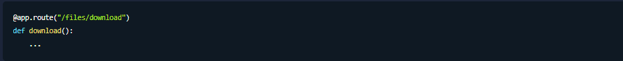
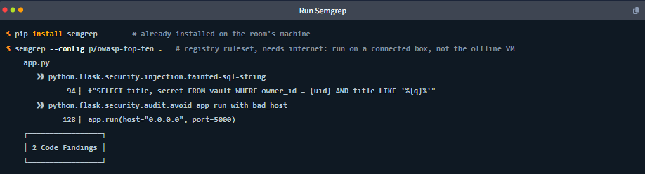
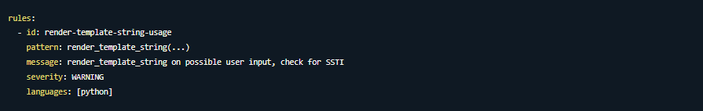

# **Web Frameworks: Code Review**
## **1. Introduction**
### 1. Các phương pháp kiểm thử bảo mật (Testing Approaches)
Bài học mở đầu bằng việc phân biệt 3 phương pháp kiểm thử, trong đó bài thực hành này sẽ tập trung vào **Grey-box** và **White-box**:
*   **Black-box testing (Kiểm thử hộp đen):** Tester chỉ thấy giao diện bên ngoài (ví dụ: form đăng nhập, các endpoint) và phải "đoán" xem hệ thống hoạt động thế nào để tìm lỗi.
    *   *Ví dụ thực tế:* Giống như bạn là thực khách tại nhà hàng, chỉ thấy món ăn được dọn ra chứ không biết quy trình nấu nướng trong bếp ra sao. Bạn chỉ có thể đánh giá món ăn qua mùi vị bề ngoài.
*   **White-box testing (Kiểm thử hộp trắng):** Tester thấy toàn bộ mã nguồn, các hàm, các câu lệnh truy vấn cơ sở dữ liệu. Việc tìm lỗi giống như đọc bản đồ, không cần phải đoán mò.
    *   *Ví dụ thực tế:* Giống như bạn là bếp trưởng hoặc người thiết kế nhà bếp, có trong tay công thức nấu ăn và biết rõ từng nguyên liệu được xử lý ở đâu.
*   **Grey-box testing (Kiểm thử hộp xám):** Nằm giữa hộp đen và hộp trắng. Tester có một phần thông tin, chẳng hạn như tài khoản đăng nhập hợp lệ hoặc một phần mã nguồn. 

### 2. Mục tiêu học tập (Learning Objectives)
Bài học hướng dẫn quy trình kiểm tra mã nguồn (Code Review) trên nền tảng Python và Flask với các mục tiêu:
*   Định hướng và làm quen nhanh chóng trong một kho mã nguồn (codebase) hoàn toàn xa lạ.
*   **Lập bản đồ bề mặt tấn công (Map the attack surface):** Tìm ra các điểm mà người dùng có thể tương tác từ các cấu hình và điều hướng (routing) của ứng dụng mà không cần chạy nó.
*   **Truy vết dữ liệu (Trace user-controlled input):** Theo dõi luồng dữ liệu do người dùng nhập vào từ điểm bắt đầu (source) đến điểm nó thực thi gây ra lỗ hổng (sink).
    *   *Ví dụ đời sống:* Giống như việc bạn nhỏ một giọt mực màu (dữ liệu độc hại - source) vào đầu nguồn của một hệ thống ống nước phức tạp, sau đó đi dọc theo đường ống để xem vòi nước nào xả ra nước có màu (điểm bị khai thác - sink).
*   Sử dụng các công cụ tìm kiếm dòng lệnh như `grep`, `ripgrep`, và `Semgrep` để lọc và phân loại hàng trăm file code chỉ trong vài phút.
*   Nhận diện các lỗ hổng bảo mật nghiêm trọng trong code: SQL Injection, Command injection, SSTI, Path traversal, v.v.

### 3. Kiến thức tiên quyết (Prerequisites)
Người học cần trang bị trước các kiến thức:
*   OWASP Top 10 (2025).
*   Cách sử dụng Burp Suite cơ bản.
*   Hiểu về lỗ hổng SQL Injection và Kỹ thuật khám phá nội dung (Content Discovery).

## **2. Orienting in a Codebase**
Khi mở một kho mã nguồn lạ, sai lầm lớn nhất là mở các tệp ra đọc một cách ngẫu nhiên. Bài học cung cấp một trình tự đọc chuẩn giúp bạn nắm bắt hệ thống nhanh chóng và hiệu quả trước khi bắt đầu tìm lỗi.

### 1. Trình tự đọc mã nguồn (The Reading Order)
Thay vì "đọc mò", hãy tuân thủ trình tự `7` bước sau (từ tổng quan đến chi tiết):
1.  **README và tài liệu (README and docs):** Hiểu ứng dụng làm gì, cách chạy, sử dụng framework nào.
2.  **Tệp khai báo phụ thuộc (Dependency manifest):** Xem các thư viện, phiên bản và bề mặt tấn công từ bên thứ ba.
3.  **Tệp cấu hình (Configuration files):** Tìm các chế độ gỡ lỗi (debug), mật khẩu bị lộ, chuỗi kết nối cơ sở dữ liệu.
4.  **Điều hướng / Điểm nối (Routing / entry points):** Lập danh sách toàn bộ các "cửa vào" của ứng dụng (bản đồ bề mặt tấn công).
5.  **Xác thực và phân quyền (Auth middleware and decorators):** Xem cửa nào được bảo vệ (cần đăng nhập), cửa nào mở tự do.
6.  **Cơ sở dữ liệu / Lớp mô hình (Database / models layer):** Nơi lưu trữ dữ liệu và cách các câu lệnh truy vấn được tạo ra.
7.  **Hàm xử lý điều hướng riêng lẻ (Individual route handlers):** Chỉ đọc chi tiết logic của các "cửa" đáng ngờ nhất ở bước cuối cùng.

> *Ví dụ thực tế:* Giống như khi bạn mua một chiếc xe hơi cũ. Bạn phải đọc sổ tay (1), xem xe dùng phụ tùng hãng nào (2), kiểm tra hệ thống điện/chìa khóa (3), nhìn quanh xem xe có mấy cửa (4), cửa nào bị hỏng khóa (5), vị trí bình xăng (6) rồi mới bắt đầu tháo tung động cơ ra kiểm tra chi tiết (7).

### 2. Phân tích chi tiết các bước quan trọng
*   **Kiểm tra tệp phụ thuộc (Dependency Manifests):** Mỗi ngôn ngữ có tệp riêng (ví dụ: `requirements.txt` trong Python, `pom.xml` trong Java). Việc thư viện bị ghim ở một phiên bản cũ kỹ có thể là dấu vết dẫn đến các lỗ hổng đã được công bố (CVE). Có thể dùng công cụ phụ trợ như `pip-audit` để quét nhanh.
*   **Ưu tiên cấu hình (Configuration First):** Developers rất hay mắc lỗi ở đây. Bạn cần săn lùng các cờ gỡ lỗi (như `DEBUG = True` trong file `config.py` của Flask), mật khẩu dạng văn bản thuần, hoặc chuỗi kết nối thẳng tới database.
    *   *Ví dụ thực tế:* Giống như việc kiểm tra xem chủ nhà có lỡ dán tờ giấy ghi mật khẩu két sắt lên cửa tủ lạnh hay không.
*   **Lập bản đồ bề mặt tấn công (Routing Is the Attack Surface Map):** Cần liệt kê mọi đường dẫn (route) vì chúng là nơi người dùng có thể tương tác. 
    
    *   Mỗi framework có cú pháp riêng (Flask dùng `@app.route`, Django dùng `urlpatterns`, Spring dùng `@GetMapping`), nhưng bản chất đều là tạo ra bề mặt tấn công.
*   **Ranh giới xác thực (Authentication Boundaries):** Đánh dấu các route xử lý thông tin nhạy cảm nhưng lại thiếu cơ chế bảo vệ (ví dụ thiếu `@login_required` trong Flask) hoặc kiểm tra quyền dựa trên thông tin do người dùng tự cung cấp (rất dễ bị thao túng).

## **3. Source-to-Sink Analysic**
Hầu hết các lỗi ứng dụng web đều có chung một mô hình: Dữ liệu do người dùng kiểm soát đi lạc vào một khu vực xử lý (operation) mà khu vực đó không được thiết kế để nhận dữ liệu lạ. White-box testing biến việc tìm lỗi thành một quy trình: Tìm nơi dữ liệu đi vào (source), tìm nơi dữ liệu đáp xuống (sink) và kiểm tra xem đoạn đường ở giữa có lớp bảo vệ nào không.

### 1. Nguồn nhập liệu (Sources)
Là bất kỳ nơi nào mà dữ liệu do người dùng kiểm soát có thể đi vào ứng dụng. 
*   Trong Flask, các nguồn này thường nằm trong đối tượng `request`.
*   *Ví dụ các nguồn:*
    *   `request.args`: Tham số trên đường dẫn URL (query string).
    *   `request.form`: Dữ liệu gửi qua form POST.
    *   `request.cookies`: Giá trị của cookie.
    *   Ngoài ra, các thành phần ít ngờ tới như `Host` header hoặc tên file được upload cũng là nguồn.
    *   *Ví dụ thực tế:* Nguồn (Source) giống như các cánh cửa, ống hút gió, hay khe hở của một tòa nhà. Bất cứ thứ gì từ bên ngoài có thể lọt vào (khí, nước, người) đều đi qua các điểm này.

### 2. Điểm đáp nguy hiểm (Sinks)
Là các hàm hoặc thao tác sẽ trở nên nguy hiểm nếu nhận phải dữ liệu từ kẻ tấn công. 
*   **Các Sinks tiêu biểu:**
    *   Cấu hình truy vấn SQL: `cursor.execute` (gây SQL Injection).
    *   Thực thi lệnh hệ thống: `os.system` hoặc `subprocess` với cờ `shell=True` (gây Command Injection).
    *   Kết xuất giao diện (Template rendering): `render_template_string` (gây SSTI).
    *   Đọc/Ghi đường dẫn file: `open`, `send_file` (gây Path Traversal).
*   **Lưu ý quan trọng:** Bản thân một Sink không phải là lỗi. Nó chỉ biến thành lỗi khi có dữ liệu từ Source truyền thẳng vào nó mà không bị chặn lại.

### 3. Đoạn đường ở giữa (The Path Between)
Nhiệm vụ của tester là đọc đoạn code nằm giữa Source và Sink để xem có các cơ chế lọc (sanitisation), kiểm tra hợp lệ (validation), hay ép kiểu (type coercion) hay không.
*   *Ví dụ:* Nếu biến số được ép về kiểu số nguyên `int()` trước khi đưa vào câu lệnh SQL, lỗi SQL Injection đã bị chặn. Nếu không có bước nào như vậy, ứng dụng có lỗi. Đừng bao giờ mặc định là lập trình viên đã làm bước này, hãy tự đọc code để kiểm tra.

### 4. Kỹ thuật truy vết hai chiều (Tracing in Two Directions)
*   **Truy vết ngược (Từ Sink về Source):** Rất hiệu quả khi Sink hiếm gặp. Tìm hàm nguy hiểm (như `cursor.execute`), sau đó dò ngược lên trên xem biến truyền vào nó lấy từ đâu.
*   **Truy vết xuôi (Từ Source đến Sink):** Hiệu quả khi đọc tuần tự code từ trên xuống dưới. 
*   Dù đi theo hướng nào, mục tiêu cuối cùng vẫn là trả lời câu hỏi: Có một đường dẫn "sạch" (không có bộ lọc) nối từ đầu vào đến khu vực nguy hiểm hay không?

### 5. Tại sao lọc ở điểm vào (Source) là không đủ?
Lỗ hổng "Order thứ 2" (Second-order pattern): Dữ liệu có thể được làm sạch ở cổng vào, lưu vào database, nhưng vài tuần sau lại được lôi ra và ném thẳng vào một Sink nguy hiểm ở một tính năng khác. 
*   *Ví dụ thực tế:* Bảo vệ kiểm tra một vị khách rất kỹ ở cổng vào, sau đó cho vào nhà (lưu vào Database). Nhưng vị khách này lén lấy một con dao trong bếp (tính năng ẩn) và gây rối ở phòng khách vài ngày sau đó. Do đó, phải truy vết dữ liệu kể cả khi nó đi vào và đi ra khỏi database.

### 6. Phân tích ví dụ thực tế (A Worked Example)
Bài học cung cấp một ví dụ về mã nguồn bị lỗi Server-Side Template Injection (SSTI)

```python
@app.route("/greet")
def greet():
    name = request.args.get("name")
    return render_template_string(f"Hello {name}")
```

*   **Source:** `request.args.get("name")` (Lấy tên người dùng nhập).
*   **Sink:** `render_template_string` (Biên dịch nội dung dưới dạng Jinja2 template).
*   **Đường nối:** Một chuỗi f-string định dạng `f"Hello {name}"` đẩy thẳng biến `name` vào Sink mà không có bộ lọc nào. Kẻ tấn công có thể nhập các mã thực thi template vào biến `name` để kiểm soát máy chủ.
*   **Cách khắc phục an toàn:** Thay vì dùng `render_template_string`, hãy dùng `render_template("greet.html", name=name)`. Lúc này dữ liệu sẽ được coi là "dữ liệu thuần túy" chứ không bị biên dịch thành mã code.

### 7. Tự động hóa bằng công cụ (Tracing With Tooling)
Kỹ thuật dò đường bằng tay như trên có thể được tự động hóa (Automate) trên quy mô toàn bộ dự án bằng các công cụ như `Semgrep` (sử dụng chế độ taint mode) hoặc `CodeQL`

## **4. Greping for Danger**
Việc đọc từng file bằng tay không khả thi đối với các dự án thực tế. Bài học giới thiệu phương pháp "phân loại" (triage): dùng công cụ rà soát nhanh ở lượt đầu để khoanh vùng các đoạn code khả nghi, sau đó mới dùng sức người để đọc và xác nhận. `grep` và `Semgrep` là hai công cụ phục vụ mục đích này. Cần nhớ: các công cụ này không trực tiếp "tìm ra bug", chúng chỉ "tìm ra chỗ đáng để đọc".

### 1. Dùng Grep để tìm các hàm nguy hiểm (Grep for Dangerous Calls)
*   **Mục tiêu:** Quét toàn bộ codebase để tìm các Sink (điểm đáp nguy hiểm) đã học ở phần trước.
*   **Câu lệnh:** Bài học cung cấp một câu lệnh `grep` phức tạp dùng biểu thức chính quy (Regex) để tìm hàng loạt hàm cùng lúc trong các file Python.
    ```bash
    $ grep -rn --include="*.py" -E "os\.system|subprocess|eval\(|exec\(|pickle\.loads|render_template_string|cursor\.execute|send_file|open\(" .
    ./app.py:12:    render_template_string,
    ./app.py:13:    send_file,
    ./app.py:86:    heading = render_template_string("Results for: " + q) if q else ""
    ./app.py:93:        cursor.execute(
    ./app.py:124:    return send_file(path)
    ```
*   **Giải thích các tham số (Flags) của Grep:**
    *   `-r`: Tìm đệ quy (vào sâu mọi thư mục con).
    *   `-n`: In ra số thứ tự dòng chứa kết quả.
    *   `--include="*.py"`: Chỉ tìm trong các file có đuôi Python.
    *   `-E`: Bật chế độ biểu thức chính quy mở rộng (cho phép dùng dấu `|` thay cho chữ "hoặc").
    *   **Mẹo bổ sung:** Thêm cờ `-A 3 -B 3` để in thêm 3 dòng code phía trên và phía dưới kết quả. Điều này cung cấp ngữ cảnh (context) giúp bạn nhìn sơ qua xem dữ liệu truyền vào hàm đó có phải từ người dùng hay không.

### 2. Dùng Grep để tìm thông tin nhạy cảm và cấu hình lỗi (Grep for Secrets and Config)
*   **Tìm mật khẩu (Hardcoded secrets):** Quét các biến có tên như `SECRET`, `KEY`, `PASSWORD`, `API_KEY` được gán cố định giá trị trong code.
    
    ```bash
    $ grep -rnE "(SECRET|KEY|TOKEN|PASSWORD|API_KEY)\s*=\s*['\"]" --include="*.py" .
    ./config.py:6:SECRET_KEY = "vk_s3cr3t_d0_n0t_sh1p_2026"
    ```

*   **Tìm cấu hình nguy hiểm:** Quét các cấu hình gỡ lỗi (debug) bị bật quên trên môi trường thật (ví dụ: `DEBUG = True`, `verify = False`).
    `[Ảnh minh họa - Lệnh grep tìm từ khóa DEBUG, TESTING và trả về kết quả DEBUG = True]`
*   **Tìm mẫu cố định (ví dụ AWS Key):** API key của AWS có một định dạng luôn luôn bắt đầu bằng `AKIA` theo sau là 16 ký tự chữ số ngẫu nhiên. Có thể dùng lệnh `grep -rE "AKIA[0-9A-Z]{16}"` để quét chính xác tuyệt đối lỗ hổng này.
    ```bash
    $ grep -rE "AKIA[0-9A-Z]{16}" .
    # no matches: this codebase contains no AWS keys (grep exits non-zero)
    ```

### 3. Phân loại theo bộ quy tắc với Semgrep (Semgrep for Rule-Based Triage)
*   Trong khi `grep` chỉ tìm các đoạn văn bản (text), `Semgrep` thông minh hơn vì nó tìm dựa trên "cấu trúc code" (code structure).
*   **Sử dụng bộ quy tắc có sẵn:** Bạn có thể chạy Semgrep với bộ quy tắc do cộng đồng viết (ví dụ `--config p/owasp-top-ten` hoặc `--config p/python`). Semgrep sẽ quét và chỉ ra đích danh loại lỗ hổng, dòng code bị lỗi và mức độ nghiêm trọng.
    
*   **Tự viết quy tắc (Custom Rule):** Khi bộ quy tắc cộng đồng không bao phủ hết, bạn có thể tự viết file YAML chỉ với 3 trường quan trọng:
    *   `pattern`: Hình dáng đoạn code cần khớp (ví dụ `render_template_string(...)`).
    *   `message`: Lời nhắn in ra màn hình khi tìm thấy.
    *   `severity`: Mức độ nghiêm trọng (ví dụ: WARNING).
    
### 4. Biết điểm dừng (Knowing When to Stop)
*   **Rủi ro của việc tự động hóa:** Là sự "tự tin thái quá". `grep` có thể tìm thấy hàm `cursor.execute`, nhưng nó KHÔNG biết biến truyền vào hàm đó là của người dùng (có lỗi) hay là một hằng số cố định (không có lỗi).
*   **Cách xử lý:** Một danh sách dài ngoằng các kết quả từ `grep` không phải là một "báo cáo lỗi", nó chỉ là một "danh sách việc cần làm" (To-do list). Bạn phải sắp xếp danh sách này theo thứ tự mức độ nghiêm trọng (ví dụ: ưu tiên kiểm tra `render_template_string` trước khi kiểm tra `open()`). Sau đó, bạn bắt buộc phải dùng mắt để đọc lại code xung quanh vùng bị báo cáo để đưa ra kết luận cuối cùng

## **4. Injection Vulnerabilities in Code**
Các lỗi Injection (tiêm nhiễm) đều có chung một mô hình: Dữ liệu của người dùng được truyền vào một trình thông dịch (database, shell, template engine, hoặc deserialiser), và trình thông dịch đó thực thi đúng những gì dữ liệu đó yêu cầu. Bài học so sánh cách viết code "Bị lỗi" (Vulnerable) và cách viết "An toàn" (Safe) để giúp nhận diện nhanh chóng.

### 1. SQL Injection (Tiêm nhiễm cơ sở dữ liệu)
*   **Bị lỗi (Vulnerable):** Xây dựng câu truy vấn bằng cách nối chuỗi trực tiếp dữ liệu người dùng (f-string hoặc toán tử cộng chuỗi).
    
    ```sql
    # Vulnerable: q is formatted straight into the SQL text
    q = request.args.get("q")
    cursor.execute(f"SELECT * FROM items WHERE name = '{q}'")
    ```

*   **An toàn (Safe):** Sử dụng tham số hóa (Parameterized queries). Dữ liệu được truyền dưới dạng tham số riêng biệt, hệ thống database sẽ đảm bảo dữ liệu không bao giờ bị hiểu nhầm thành câu lệnh.
    ```sql
    # Safe: the ? is a placeholder, q is bound as data
    cursor.execute("SELECT * FROM items WHERE name = ?", (q,))
    ```
*   **Lưu ý:** Lỗi này có thể xảy ra ngay cả khi dùng các thư viện ORM (Object-Relational Mapping) nếu lập trình viên sử dụng các hàm "thoát hiểm" (escape hatch) như `text()` trong SQLAlchemy hay `.raw()` / `.extra()` trong Django để tự viết truy vấn thô.

### 2. Command Injection (Tiêm nhiễm lệnh hệ thống)
*   **Bị lỗi (Vulnerable):** Đưa dữ liệu người dùng vào một chuỗi lệnh và để cho shell (trình vỏ hệ điều hành) phân tích cú pháp bằng cờ `shell=True`. Kẻ tấn công có thể dùng các ký tự đặc biệt như `;`, `|`, `&&` để chạy thêm các lệnh độc hại.
    ```bash
    # Vulnerable: shell=True means the shell parses the whole string
    host = request.args.get("host")
    subprocess.run(f"ping -c 1 {host}", shell=True)
    ```
*   **An toàn (Safe):** Truyền các tham số dưới dạng một danh sách (List) và không dùng shell. Hệ điều hành sẽ chạy trực tiếp chương trình và coi mọi thành phần trong danh sách là tham số văn bản đơn thuần (literal argument).
    ```bash
    # Safe: no shell, host is one argument and cannot add commands
    subprocess.run(["ping", "-c", "1", host])
    ```
### 3. Server-Side Template Injection (SSTI)
*   **Bị lỗi (Vulnerable):** Sử dụng hàm `render_template_string` để biên dịch trực tiếp dữ liệu do người dùng kiểm soát thành mã Jinja2. Do Jinja2 chạy trong cùng một tiến trình Python xử lý request, kẻ tấn công có thể leo thang từ việc in văn bản sang việc thực thi mã từ xa (RCE).
    ```python
    # Vulnerable: người dùng kiểm soát toàn bộ cú pháp template
    name = request.args.get("name")
    return render_template_string("Hello " + name)
    ```
*   **Cách kiểm tra nhanh (Smoke test):** Nhập thử `{{7*7}}`. Nếu ứng dụng trả về `49`, chứng tỏ nó đã tính toán toán học thay vì chỉ in ra chuỗi văn bản.
*   **An toàn (Safe):** Sử dụng các file template tĩnh và truyền dữ liệu vào thông qua hàm `render_template`.
    ```python
    # Safe: template là một file tĩnh, biến 'name' chỉ được coi là dữ liệu
    return render_template("hello.html", name=name)
    ```

### 4. Insecure Deserialisation (Giải mã dữ liệu không an toàn)
*   **Bị lỗi (Vulnerable):** Giải mã (Deserialise) các byte dữ liệu do người dùng kiểm soát bằng các công cụ có khả năng xây dựng các đối tượng tùy ý. Thư viện `pickle` trong Python là thủ phạm nguy hiểm nhất vì quá trình giải nén (unpickling) có thể thực thi mã thông qua hàm `__reduce__`.
    ```python
    # Vulnerable: một chuỗi pickle độc hại được tạo sẵn sẽ chạy code ngay khi được load
    data = request.cookies.get("prefs")
    prefs = pickle.loads(base64.b64decode(data))
    ```
*   **Khắc phục:** `yaml.load` cũng gặp vấn đề tương tự nếu không dùng `yaml.safe_load`. Cách khắc phục triệt để nhất là dùng các định dạng chỉ chứa dữ liệu thuần túy (như JSON) thay vì dùng `pickle` làm phương tiện vận chuyển dữ liệu người dùng.

### 5. Câu hỏi cốt lõi
Khi tìm thấy bất kỳ một Sink nào ở trên, luôn tự hỏi 2 câu:
1.  Giá trị này có bị người dùng kiểm soát không?
2.  Có bước kiểm tra (validation) nào diễn ra trước Sink không?
Nếu câu trả lời là "Có" rồi đến "Không", bạn đã tìm thấy một lỗ hổng bảo mật hợp lệ

## **5. Access Control, Path, and Secret Flaws in Code**
Không phải lỗi nào cũng tuân theo mô hình luồng dữ liệu (source-to-sink). Ba lỗi phổ biến dưới đây thường được phát hiện nhanh nhất vì chúng là sự thiếu sót (missing) chứ không phải luồng dữ liệu sai lệch.

### 1. Path Traversal (Xuyên thấu đường dẫn)
*   **Bản chất lỗ hổng:** Xảy ra khi xây dựng đường dẫn file từ dữ liệu người dùng nhập nhưng lại không kiểm tra xem đường dẫn đó có vượt ra ngoài thư mục cho phép hay không.
*   **Mã nguồn lỗi (Vulnerable):**
    ```python
    # Vulnerable: filename có thể là ../../etc/passwd
    filename = request.args.get("file")
    return send_file(os.path.join(UPLOAD_DIR, filename))
    ```
    *Giải thích:* Hàm `os.path.join` rất nguy hiểm vì nếu `filename` là một đường dẫn tuyệt đối (ví dụ: `/etc/passwd`), nó sẽ vứt bỏ hoàn toàn `UPLOAD_DIR`. Kẻ tấn công có thể dùng ký tự `../` để lùi ra khỏi thư mục tải lên và đọc trộm mã nguồn, file cấu hình, mã khóa SSH hoặc file hệ thống.
*   **Mã nguồn an toàn (Safe):**
    ```python
    # Safe: send_from_directory từ chối các đường dẫn thoát ra khỏi thư mục
    return send_from_directory(UPLOAD_DIR, filename)
    ```
*   **Mẹo Code Review:** Cứ nhìn thấy `send_file(os.path.join(...))` nhận dữ liệu người dùng là có thể kết luận bị lỗi Path Traversal. Hàm an toàn phải là `send_from_directory`.

### 2. Broken Access Control và IDOR (Lỗi kiểm soát truy cập)
*   **Bản chất lỗ hổng:** Xảy ra khi ứng dụng cho phép người dùng truy cập một tài nguyên (dựa trên ID do họ gửi lên) mà không kiểm tra xem họ có quyền (quyền sở hữu) với tài nguyên đó hay không. Lỗi này thường được gọi là IDOR (Insecure Direct Object Reference).
*   **Mã nguồn lỗi (Vulnerable):**
    ```python
    # Vulnerable: Bất kỳ user nào đăng nhập đều có thể đọc dữ liệu của người khác bằng cách đổi item_id
    @app.route("/vault/<int:item_id>")
    @login_required
    def vault(item_id):
        record = Vault.query.get(item_id)
        return jsonify(record.data)
    ```
    *Giải thích:* Mặc dù có `@login_required` (đã đăng nhập), nhưng hàm không kiểm tra xem `item_id` này có thuộc về người đang đăng nhập hay không. Hacker chỉ cần đổi số trên URL (ví dụ từ `/vault/1` sang `/vault/2`, `/vault/3`...) là đọc được sạch dữ liệu của người khác.
*   **Cách khắc phục & Nhận diện:** Lỗi này rất dễ phát hiện bằng cách đọc câu lệnh `WHERE` (hoặc filter) lúc truy vấn database. Nếu nó chỉ tìm theo `item_id` mà THIẾU điều kiện kiểu `owner_id = current_user`, đó chắc chắn là lỗi IDOR.

### 3. Hardcoded Secrets (Lộ lọt thông tin nhạy cảm)
*   **Bản chất lỗ hổng:** Ghi cố định các thông tin bảo mật (như SECRET_KEY, mật khẩu database, API token) dạng chuỗi văn bản thuần vào ngay trong mã nguồn.
*   **Mã nguồn lỗi (Vulnerable):**
    ```python
    # Vulnerable: Khóa ký mã nằm thẳng trong mã nguồn thay vì môi trường
    SECRET_KEY = "fl4sk_s3cr3t_d0_n0t_sh1p_2026"
    ```
    *Giải thích:* Chỉ cần ai đó đọc được file này là toàn bộ hệ thống bị thỏa hiệp (ví dụ: dùng SECRET_KEY để tự tạo cookie giả mạo đăng nhập thành admin). Hệ thống Git lưu lại toàn bộ lịch sử, nên dù bạn có xóa dòng này đi ở commit sau, hacker vẫn có thể đào lại được.
*   **Cách khắc phục:** Phải đưa các secret này vào biến môi trường (Environment variables) hoặc trình quản lý secret (Secrets manager). Các công cụ như `gitleaks` hay `trufflehog` thường được dùng để quét lại toàn bộ lịch sử code nhằm tìm kiếm các lỗi này[cite: 14, 15].